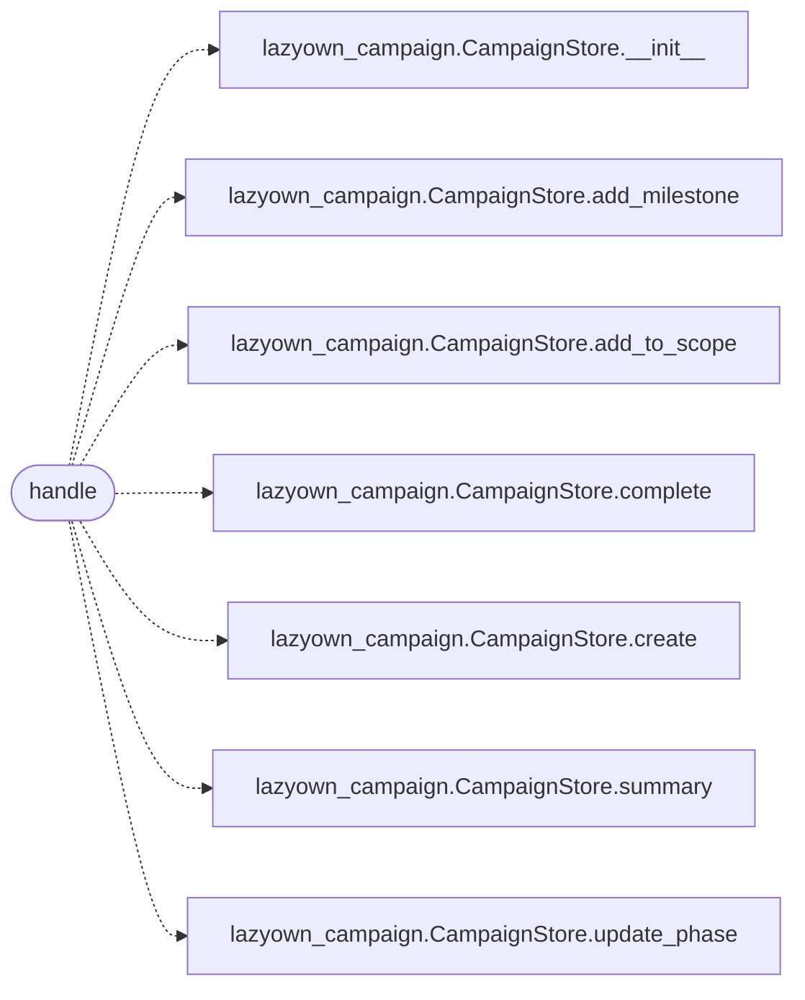

# `skills.mcp_tools.campaign`

> Source: [skills/mcp_tools/campaign.py:1](../../skills/mcp_tools/campaign.py#L1) | language `py` | coverage 100.0% | [API index](../index.md)

MCP tool ``lazyown_campaign`` (migrated from the call_tool dispatch chain).

## Contents

- **Functions:** [`handle`](#handle)
- **Constants:** [`TOOL`](#tool)

## Call Graph

Solid arrows stay in this module, dashed arrows leave it.



## Functions

<a id="handle"></a>

### `handle`

`function` `async` | [skills/mcp_tools/campaign.py:46](../../skills/mcp_tools/campaign.py#L46)

```python
async def handle(arguments: dict[str, Any], tool_name: str, ctx: MCPContext) -> list
```

Handle the lazyown_campaign MCP tool.

**Parameters**

| Name | Type | Default | Description |
|---|---|---|---|
| `arguments` | `dict[str, Any]` |  |  |
| `tool_name` | `str` |  |  |
| `ctx` | `MCPContext` |  |  |

**Returns:** `list`

*Calls:* [`CampaignStore.__init__`](skills.lazyown_campaign.py.md#campaignstore-__init__), [`CampaignStore.add_milestone`](skills.lazyown_campaign.py.md#campaignstore-add_milestone), [`CampaignStore.add_to_scope`](skills.lazyown_campaign.py.md#campaignstore-add_to_scope), [`CampaignStore.complete`](skills.lazyown_campaign.py.md#campaignstore-complete), [`CampaignStore.create`](skills.lazyown_campaign.py.md#campaignstore-create), [`CampaignStore.summary`](skills.lazyown_campaign.py.md#campaignstore-summary), [`CampaignStore.update_phase`](skills.lazyown_campaign.py.md#campaignstore-update_phase)

---

## Constants

<a id="tool"></a>

### `TOOL`

`constant` | [skills/mcp_tools/campaign.py:12](../../skills/mcp_tools/campaign.py#L12)

```python
TOOL
```

---
