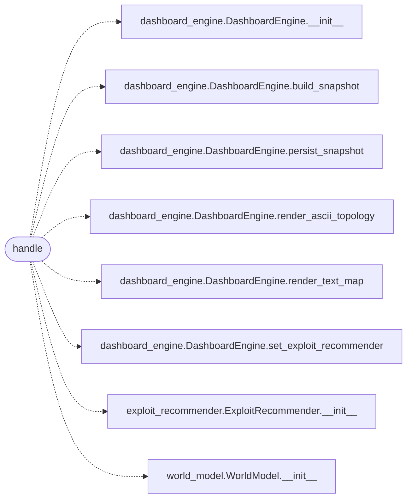

# `skills.mcp_tools.dashboard_snapshot`

> Source: [skills/mcp_tools/dashboard_snapshot.py:1](../../skills/mcp_tools/dashboard_snapshot.py#L1) | language `py` | coverage 100.0% | [API index](../index.md)

MCP tool ``lazyown_dashboard_snapshot``: render the live network map.

## Contents

- **Functions:** [`handle`](#handle)
- **Constants:** [`TOOL`](#tool)

## Call Graph

Solid arrows stay in this module, dashed arrows leave it.



## Functions

<a id="handle"></a>

### `handle`

`function` `async` | [skills/mcp_tools/dashboard_snapshot.py:28](../../skills/mcp_tools/dashboard_snapshot.py#L28)

```python
async def handle(arguments: dict[str, Any], tool_name: str, ctx: MCPContext) -> list
```

Build and persist a dashboard snapshot, returning map and topology.

**Parameters**

| Name | Type | Default | Description |
|---|---|---|---|
| `arguments` | `dict[str, Any]` |  |  |
| `tool_name` | `str` |  |  |
| `ctx` | `MCPContext` |  |  |

**Returns:** `list`

*Calls:* [`DashboardEngine.__init__`](modules.dashboard_engine.py.md#dashboardengine-__init__), [`DashboardEngine.build_snapshot`](modules.dashboard_engine.py.md#dashboardengine-build_snapshot), [`DashboardEngine.persist_snapshot`](modules.dashboard_engine.py.md#dashboardengine-persist_snapshot), [`DashboardEngine.render_ascii_topology`](modules.dashboard_engine.py.md#dashboardengine-render_ascii_topology), [`DashboardEngine.render_text_map`](modules.dashboard_engine.py.md#dashboardengine-render_text_map), [`DashboardEngine.set_exploit_recommender`](modules.dashboard_engine.py.md#dashboardengine-set_exploit_recommender), [`ExploitRecommender.__init__`](modules.exploit_recommender.py.md#exploitrecommender-__init__), [`WorldModel.__init__`](modules.world_model.py.md#worldmodel-__init__)

---

## Constants

<a id="tool"></a>

### `TOOL`

`constant` | [skills/mcp_tools/dashboard_snapshot.py:13](../../skills/mcp_tools/dashboard_snapshot.py#L13)

```python
TOOL
```

---
