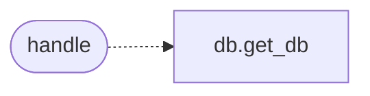

# `skills.mcp_tools.db`

> Source: [skills/mcp_tools/db.py:1](../../skills/mcp_tools/db.py#L1) | language `py` | coverage 100.0% | [API index](../index.md)

MCP tool ``lazyown_db``: query and mutate the LazyOwn SQLite database.

## Contents

- **Functions:** [`handle`](#handle)
- **Constants:** [`TOOL`](#tool)

## Call Graph

Solid arrows stay in this module, dashed arrows leave it.



## Functions

<a id="handle"></a>

### `handle`

`function` | [skills/mcp_tools/db.py:62](../../skills/mcp_tools/db.py#L62)

```python
def handle(arguments: dict[str, Any], tool_name: str, ctx: MCPContext) -> list
```

Dispatch one SQLite campaign-database operation and return its result.

**Parameters**

| Name | Type | Default | Description |
|---|---|---|---|
| `arguments` | `dict[str, Any]` |  | Tool arguments with an ``operation`` key and per-operation fields. |
| `tool_name` | `str` |  | MCP tool name for the text envelope. |
| `ctx` | `MCPContext` |  | Injected runtime helpers. |

**Returns:** `list` - A ``TextContent`` payload with the operation result as JSON.

*Calls:* [`get_db`](modules.db.py.md#get_db)

---

## Constants

<a id="tool"></a>

### `TOOL`

`constant` | [skills/mcp_tools/db.py:12](../../skills/mcp_tools/db.py#L12)

```python
TOOL
```

---
