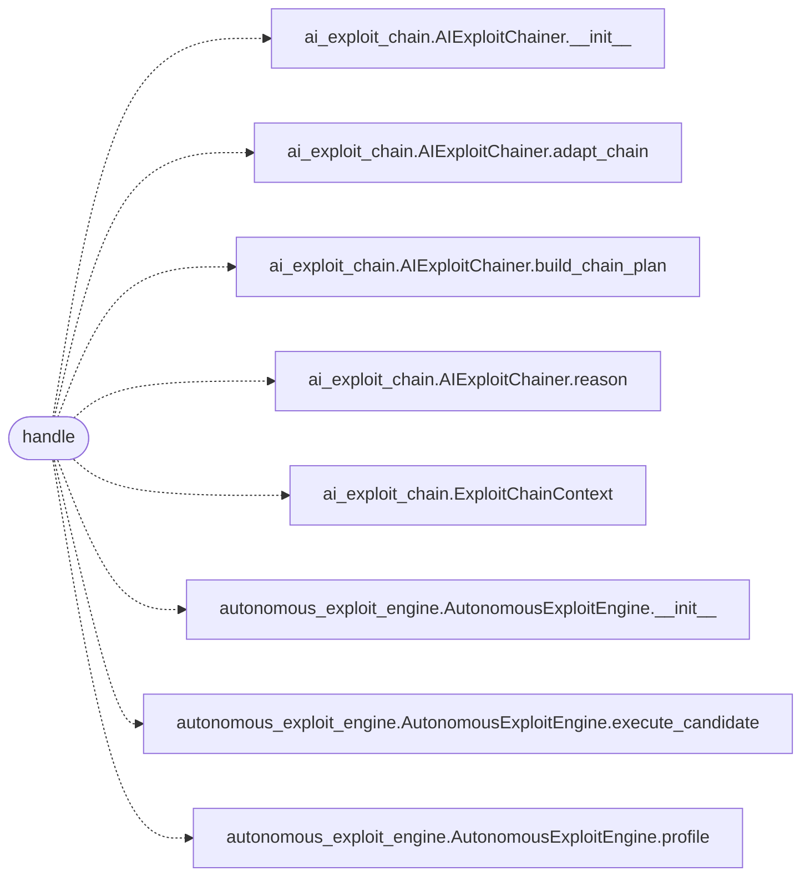

# `skills.mcp_tools.exploit_chain`

> Source: [skills/mcp_tools/exploit_chain.py:1](../../skills/mcp_tools/exploit_chain.py#L1) | language `py` | coverage 100.0% | [API index](../index.md)

MCP tool ``lazyown_exploit_chain``: AI-driven multi-step exploit chaining.

## Contents

- **Functions:** [`handle`](#handle)
- **Constants:** [`TOOL`](#tool)

## Call Graph

Solid arrows stay in this module, dashed arrows leave it.



## Functions

<a id="handle"></a>

### `handle`

`function` `async` | [skills/mcp_tools/exploit_chain.py:41](../../skills/mcp_tools/exploit_chain.py#L41)

```python
async def handle(arguments: dict[str, Any], tool_name: str, ctx: MCPContext) -> list
```

Build and run an adaptive exploit chain, returning plan and results.

**Parameters**

| Name | Type | Default | Description |
|---|---|---|---|
| `arguments` | `dict[str, Any]` |  |  |
| `tool_name` | `str` |  |  |
| `ctx` | `MCPContext` |  |  |

**Returns:** `list`

*Calls:* [`AIExploitChainer.__init__`](modules.ai_exploit_chain.py.md#aiexploitchainer-__init__), [`AIExploitChainer.adapt_chain`](modules.ai_exploit_chain.py.md#aiexploitchainer-adapt_chain), [`AIExploitChainer.build_chain_plan`](modules.ai_exploit_chain.py.md#aiexploitchainer-build_chain_plan), [`AIExploitChainer.reason`](modules.ai_exploit_chain.py.md#aiexploitchainer-reason), [`ExploitChainContext`](modules.ai_exploit_chain.py.md#exploitchaincontext), [`AutonomousExploitEngine.__init__`](modules.autonomous_exploit_engine.py.md#autonomousexploitengine-__init__), [`AutonomousExploitEngine.execute_candidate`](modules.autonomous_exploit_engine.py.md#autonomousexploitengine-execute_candidate), [`AutonomousExploitEngine.profile`](modules.autonomous_exploit_engine.py.md#autonomousexploitengine-profile)

---

## Constants

<a id="tool"></a>

### `TOOL`

`constant` | [skills/mcp_tools/exploit_chain.py:16](../../skills/mcp_tools/exploit_chain.py#L16)

```python
TOOL
```

---
