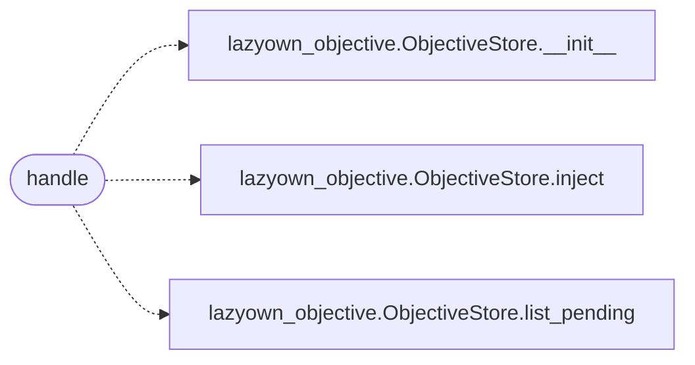

# `skills.mcp_tools.inject_objective`

> Source: [skills/mcp_tools/inject_objective.py:1](../../skills/mcp_tools/inject_objective.py#L1) | language `py` | coverage 100.0% | [API index](../index.md)

MCP tool ``lazyown_inject_objective``: queue a new attack objective.

## Contents

- **Functions:** [`handle`](#handle)
- **Constants:** [`TOOL`](#tool)

## Call Graph

Solid arrows stay in this module, dashed arrows leave it.



## Functions

<a id="handle"></a>

### `handle`

`function` `async` | [skills/mcp_tools/inject_objective.py:52](../../skills/mcp_tools/inject_objective.py#L52)

```python
async def handle(arguments: dict[str, Any], tool_name: str, ctx: MCPContext) -> list
```

Inject one objective into the queue and report the new pending count.

**Parameters**

| Name | Type | Default | Description |
|---|---|---|---|
| `arguments` | `dict[str, Any]` |  |  |
| `tool_name` | `str` |  |  |
| `ctx` | `MCPContext` |  |  |

**Returns:** `list`

*Calls:* [`ObjectiveStore.__init__`](skills.lazyown_objective.py.md#objectivestore-__init__), [`ObjectiveStore.inject`](skills.lazyown_objective.py.md#objectivestore-inject), [`ObjectiveStore.list_pending`](skills.lazyown_objective.py.md#objectivestore-list_pending)

---

## Constants

<a id="tool"></a>

### `TOOL`

`constant` | [skills/mcp_tools/inject_objective.py:15](../../skills/mcp_tools/inject_objective.py#L15)

```python
TOOL
```

---
