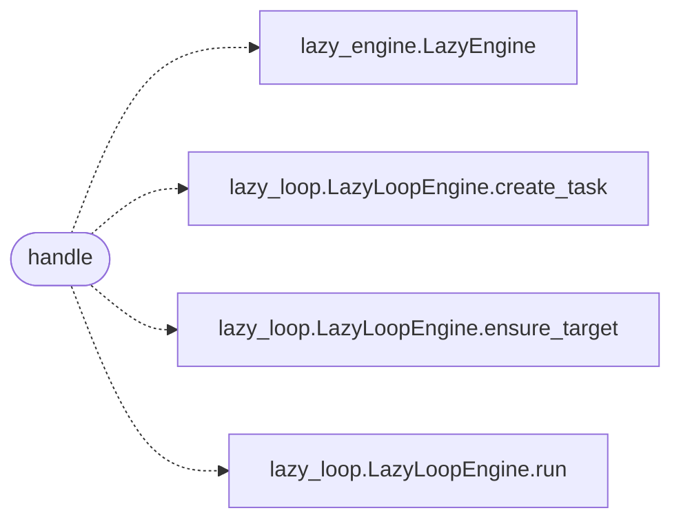

# `skills.mcp_tools.loop_smoke`

> Source: [skills/mcp_tools/loop_smoke.py:1](../../skills/mcp_tools/loop_smoke.py#L1) | language `py` | coverage 100.0% | [API index](../index.md)

MCP tool ``lazyown_loop_smoke``: single-leg autonomous loop smoke test.

## Contents

- **Functions:** [`handle`](#handle)
- **Constants:** [`TOOL`](#tool)

## Call Graph

Solid arrows stay in this module, dashed arrows leave it.



## Functions

<a id="handle"></a>

### `handle`

`function` | [skills/mcp_tools/loop_smoke.py:65](../../skills/mcp_tools/loop_smoke.py#L65)

```python
def handle(arguments: dict[str, Any], tool_name: str, ctx: MCPContext) -> list
```

Run a one-leg loop smoke test and return the goal verdict.

**Parameters**

| Name | Type | Default | Description |
|---|---|---|---|
| `arguments` | `dict[str, Any]` |  |  |
| `tool_name` | `str` |  |  |
| `ctx` | `MCPContext` |  |  |

**Returns:** `list`

*Calls:* [`LazyEngine`](modules.lazy_engine.py.md#lazyengine), [`LazyLoopEngine.create_task`](modules.lazy_loop.py.md#lazyloopengine-create_task), [`LazyLoopEngine.ensure_target`](modules.lazy_loop.py.md#lazyloopengine-ensure_target), [`LazyLoopEngine.run`](modules.lazy_loop.py.md#lazyloopengine-run)

---

## Constants

<a id="tool"></a>

### `TOOL`

`constant` | [skills/mcp_tools/loop_smoke.py:20](../../skills/mcp_tools/loop_smoke.py#L20)

```python
TOOL
```

---
