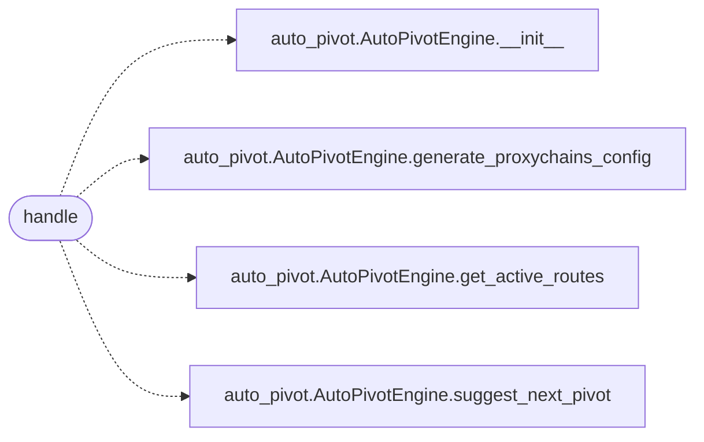

# `skills.mcp_tools.pivot_status`

> Source: [skills/mcp_tools/pivot_status.py:1](../../skills/mcp_tools/pivot_status.py#L1) | language `py` | coverage 100.0% | [API index](../index.md)

MCP tool ``lazyown_pivot_status``: view pivot routes and suggestions.

## Contents

- **Functions:** [`handle`](#handle)
- **Constants:** [`TOOL`](#tool)

## Call Graph

Solid arrows stay in this module, dashed arrows leave it.



## Functions

<a id="handle"></a>

### `handle`

`function` `async` | [skills/mcp_tools/pivot_status.py:27](../../skills/mcp_tools/pivot_status.py#L27)

```python
async def handle(arguments: dict[str, Any], tool_name: str, ctx: MCPContext) -> list
```

Return active routes, proxychains config and next-pivot suggestion.

**Parameters**

| Name | Type | Default | Description |
|---|---|---|---|
| `arguments` | `dict[str, Any]` |  |  |
| `tool_name` | `str` |  |  |
| `ctx` | `MCPContext` |  |  |

**Returns:** `list`

*Calls:* [`AutoPivotEngine.__init__`](modules.auto_pivot.py.md#autopivotengine-__init__), [`AutoPivotEngine.generate_proxychains_config`](modules.auto_pivot.py.md#autopivotengine-generate_proxychains_config), [`AutoPivotEngine.get_active_routes`](modules.auto_pivot.py.md#autopivotengine-get_active_routes), [`AutoPivotEngine.suggest_next_pivot`](modules.auto_pivot.py.md#autopivotengine-suggest_next_pivot)

---

## Constants

<a id="tool"></a>

### `TOOL`

`constant` | [skills/mcp_tools/pivot_status.py:12](../../skills/mcp_tools/pivot_status.py#L12)

```python
TOOL
```

---
