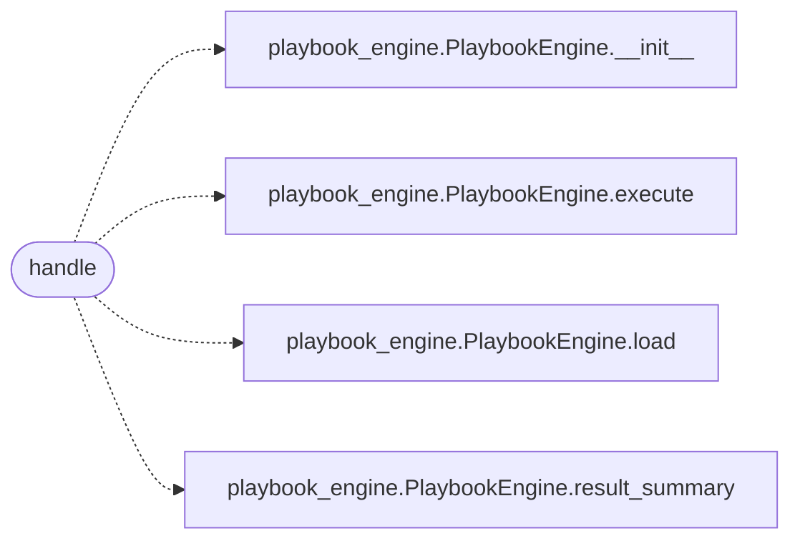

# `skills.mcp_tools.playbook_run`

> Source: [skills/mcp_tools/playbook_run.py:1](../../skills/mcp_tools/playbook_run.py#L1) | language `py` | coverage 100.0% | [API index](../index.md)

MCP tool ``lazyown_playbook_run`` (migrated from the call_tool dispatch chain).

## Contents

- **Functions:** [`handle`](#handle)
- **Constants:** [`TOOL`](#tool)

## Call Graph

Solid arrows stay in this module, dashed arrows leave it.



## Functions

<a id="handle"></a>

### `handle`

`function` `async` | [skills/mcp_tools/playbook_run.py:55](../../skills/mcp_tools/playbook_run.py#L55)

```python
async def handle(arguments: dict[str, Any], tool_name: str, ctx: MCPContext) -> list
```

Handle the lazyown_playbook_run MCP tool.

**Parameters**

| Name | Type | Default | Description |
|---|---|---|---|
| `arguments` | `dict[str, Any]` |  |  |
| `tool_name` | `str` |  |  |
| `ctx` | `MCPContext` |  |  |

**Returns:** `list`

*Calls:* [`PlaybookEngine.__init__`](modules.playbook_engine.py.md#playbookengine-__init__), [`PlaybookEngine.execute`](modules.playbook_engine.py.md#playbookengine-execute), [`PlaybookEngine.load`](modules.playbook_engine.py.md#playbookengine-load), [`PlaybookEngine.result_summary`](modules.playbook_engine.py.md#playbookengine-result_summary)

---

## Constants

<a id="tool"></a>

### `TOOL`

`constant` | [skills/mcp_tools/playbook_run.py:21](../../skills/mcp_tools/playbook_run.py#L21)

```python
TOOL
```

---
