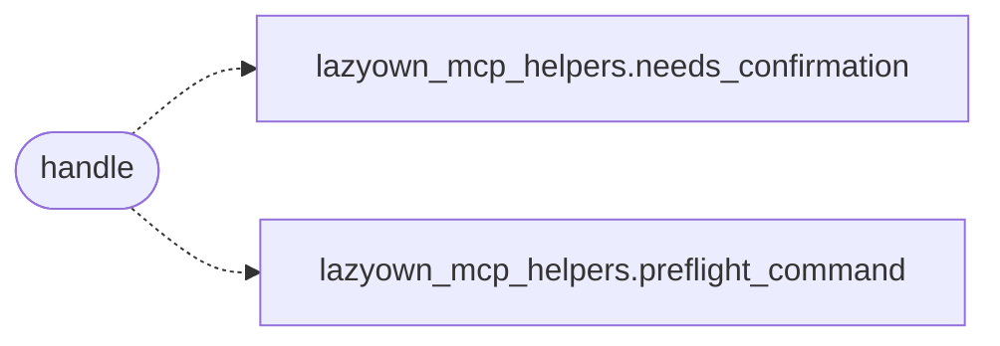

# `skills.mcp_tools.run_command`

> Source: [skills/mcp_tools/run_command.py:1](../../skills/mcp_tools/run_command.py#L1) | language `py` | coverage 100.0% | [API index](../index.md)

MCP tool ``lazyown_run_command``: execute LazyOwn shell commands.

The central execution tool. It pre-flights on request, gates destructive
commands behind confirmation, runs via the C2 ``/api/run`` endpoint with a
subprocess fallback, publishes a command event, and reports the outcome to
the policy layer. All runtime dependencies arrive through the injected
`mcp_tools._context.MCPContext`, so this file never imports the MCP
runtime module.

## Contents

- **Functions:** [`handle`](#handle)
- **Constants:** [`TOOL`](#tool)

## Call Graph

Solid arrows stay in this module, dashed arrows leave it.



## Functions

<a id="handle"></a>

### `handle`

`function` `async` | [skills/mcp_tools/run_command.py:82](../../skills/mcp_tools/run_command.py#L82)

```python
async def handle(arguments: dict[str, Any], tool_name: str, ctx: MCPContext) -> list
```

Pre-flight, confirm, execute and record one or more shell commands.

**Parameters**

| Name | Type | Default | Description |
|---|---|---|---|
| `arguments` | `dict[str, Any]` |  |  |
| `tool_name` | `str` |  |  |
| `ctx` | `MCPContext` |  |  |

**Returns:** `list`

*Calls:* [`needs_confirmation`](skills.lazyown_mcp_helpers.py.md#needs_confirmation), [`preflight_command`](skills.lazyown_mcp_helpers.py.md#preflight_command)

---

## Constants

<a id="tool"></a>

### `TOOL`

`constant` | [skills/mcp_tools/run_command.py:24](../../skills/mcp_tools/run_command.py#L24)

```python
TOOL
```

---
