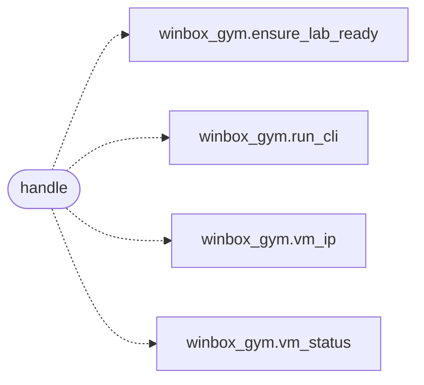

# `skills.mcp_tools.winbox_vm`

> Source: [skills/mcp_tools/winbox_vm.py:1](../../skills/mcp_tools/winbox_vm.py#L1) | language `py` | coverage 100.0% | [API index](../index.md)

MCP tool ``lazyown_winbox_vm``: drive the WinBox lab VM lifecycle.

## Contents

- **Functions:** [`handle`](#handle)
- **Constants:** [`TOOL`](#tool)

## Call Graph

Solid arrows stay in this module, dashed arrows leave it.



## Functions

<a id="handle"></a>

### `handle`

`function` | [skills/mcp_tools/winbox_vm.py:36](../../skills/mcp_tools/winbox_vm.py#L36)

```python
def handle(arguments: dict[str, Any], tool_name: str, ctx: MCPContext) -> list
```

Drive WinBox VM lifecycle: bootstrap, up, down, suspend, status.

**Parameters**

| Name | Type | Default | Description |
|---|---|---|---|
| `arguments` | `dict[str, Any]` |  |  |
| `tool_name` | `str` |  |  |
| `ctx` | `MCPContext` |  |  |

**Returns:** `list`

*Calls:* [`ensure_lab_ready`](modules.winbox_gym.py.md#ensure_lab_ready), [`run_cli`](modules.winbox_gym.py.md#run_cli), [`vm_ip`](modules.winbox_gym.py.md#vm_ip), [`vm_status`](modules.winbox_gym.py.md#vm_status)

---

## Constants

<a id="tool"></a>

### `TOOL`

`constant` | [skills/mcp_tools/winbox_vm.py:12](../../skills/mcp_tools/winbox_vm.py#L12)

```python
TOOL
```

---
