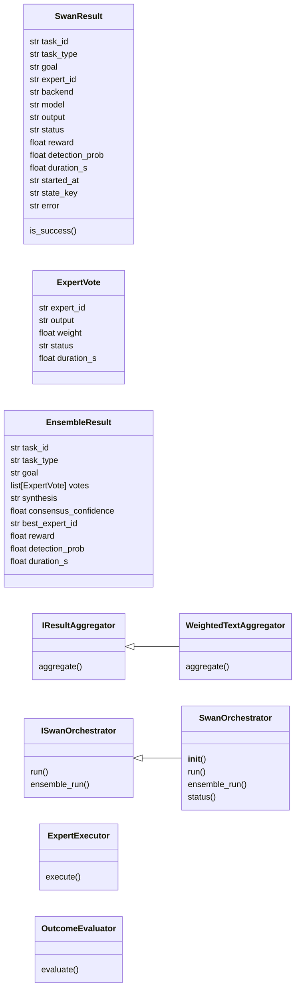
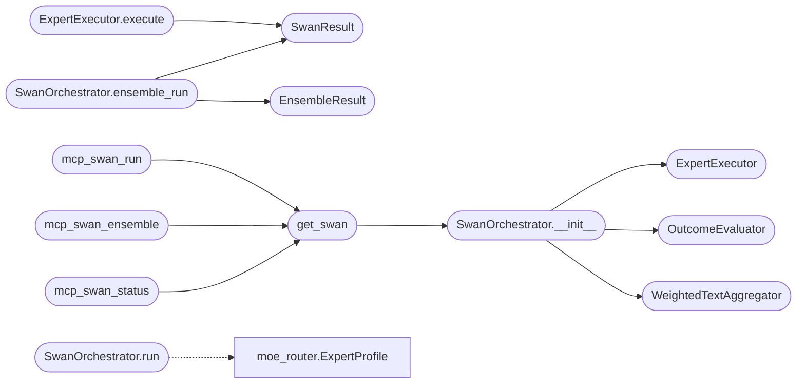

# `skills.swan_agent`

> Source: [skills/swan_agent.py:1](../../skills/swan_agent.py#L1) | language `py` | coverage 92.3% | [API index](../index.md)

skills/swan_agent.py — LazyOwn SWAN Agent ========================================== Scalable Weighted Adaptive Network agent coordinator.

SWAN unifies the Mixture-of-Experts router, the RL trainer, and the existing
Groq/Ollama agent infrastructure (GroqAgentPool + LLMBridge) into a single
self-improving multi-model execution layer.

Properties
----------
  Scalable   — new expert models added to moe_router._DEFAULT_EXPERTS list only
  Weighted   — each expert's routing probability is weighted by RL-learned Q-values
               and EMA performance scores from completed engagements
  Adaptive   — weights update automatically after every task execution via Q-learning
  Network    — ensemble mode runs multiple experts in parallel and synthesizes results

Architecture
------------

        operator prompt / autonomous loop
                     |
              SwanOrchestrator.run()
              /          \
     route()               ensemble()
        |                      |
   best expert           top-N experts
        |               (parallel threads)
  DroneAgent / LLMBridge    |
  (existing infrastructure) EnsembleAggregator
        |                      |
     result                synthesis (Claude or best expert)
        |                      |
        +------  outcome  -----+
                     |
           RLTrainer.update()        ExpertPerformanceStore.record()
           MoERouter.record_outcome()
                     |
           HiveMemory.store()   (lesson for future recall)

Design principles
-----------------
- Single Responsibility : each class owns one concept
- Open/Closed           : new aggregation strategies via IResultAggregator
- Liskov Substitution   : SwanOrchestrator satisfies ISwanOrchestrator
- Interface Segregation : ISwanOrchestrator exposes only run() and ensemble_run()
- Dependency Inversion  : all deps injected; defaults wired in get_swan()

Usage
-----
    from skills.swan_agent import get_swan

    swan = get_swan()

    # Single-expert execution
    result = swan.run("exploit", "Find RCE on Apache 2.4.49 at 10.10.11.78")
    print(result.output)
    print(f"Expert used: {result.expert_id}, reward: {result.reward}")

    # Ensemble: top-3 experts vote, then synthesize
    result = swan.ensemble_run(
        "credential",
        "Dump NTLM hashes from domain controller 10.10.11.78",
        n_experts=3,
    )
    print(result.synthesis)
    print(f"Consensus confidence: {result.consensus_confidence:.0%}")

    # Check SWAN status
    status = swan.status()
    print(status)

## Contents

- **Classes:** [`SwanResult`](#swanresult), [`ExpertVote`](#expertvote), [`EnsembleResult`](#ensembleresult), [`IResultAggregator`](#iresultaggregator), [`ISwanOrchestrator`](#iswanorchestrator), [`WeightedTextAggregator`](#weightedtextaggregator), [`ExpertExecutor`](#expertexecutor), [`OutcomeEvaluator`](#outcomeevaluator), [`SwanOrchestrator`](#swanorchestrator)
- **Functions:** [`mcp_swan_run`](#mcp_swan_run), [`mcp_swan_ensemble`](#mcp_swan_ensemble), [`mcp_swan_status`](#mcp_swan_status), [`mcp_swan_route`](#mcp_swan_route), [`get_swan`](#get_swan)
- **Constants:** [`SKILLS_DIR`](#skills_dir), [`LAZYOWN_DIR`](#lazyown_dir), [`SESSIONS_DIR`](#sessions_dir), [`MODULES_DIR`](#modules_dir)

## Type Diagram



## Call Graph

Solid arrows stay in this module, dashed arrows leave it.



## Classes

<a id="swanresult"></a>

### `SwanResult`

`class` `dataclass` | [skills/swan_agent.py:146](../../skills/swan_agent.py#L146)

Decorators: `@dataclass`

```python
class SwanResult
```

Result from a single-expert SWAN execution.

**Attributes**

| Name | Type | Default | Description |
|---|---|---|---|
| [`task_id`](#swanresult-task_id) | `str` |  |  |
| [`task_type`](#swanresult-task_type) | `str` |  |  |
| [`goal`](#swanresult-goal) | `str` |  |  |
| [`expert_id`](#swanresult-expert_id) | `str` |  |  |
| [`backend`](#swanresult-backend) | `str` |  |  |
| [`model`](#swanresult-model) | `str` |  |  |
| [`output`](#swanresult-output) | `str` |  |  |
| [`status`](#swanresult-status) | `str` |  |  |
| [`reward`](#swanresult-reward) | `float` | `0.0` |  |
| [`detection_prob`](#swanresult-detection_prob) | `float` | `0.0` |  |
| [`duration_s`](#swanresult-duration_s) | `float` | `0.0` |  |
| [`started_at`](#swanresult-started_at) | `str` | `''` |  |
| [`state_key`](#swanresult-state_key) | `str` | `''` |  |
| [`error`](#swanresult-error) | `str` | `''` |  |

**Members**

| Member | Kind | Summary |
|---|---|---|
| [`is_success`](#swanresult-is_success) | property |  |

<a id="swanresult-is_success"></a>

#### `SwanResult.is_success`

`property` | [skills/swan_agent.py:167](../../skills/swan_agent.py#L167)

Decorators: `@property`

```python
def is_success(self) -> bool
```

**Returns:** `bool`

---

<a id="expertvote"></a>

### `ExpertVote`

`class` `dataclass` | [skills/swan_agent.py:172](../../skills/swan_agent.py#L172)

Decorators: `@dataclass`

```python
class ExpertVote
```

One expert's contribution to an ensemble.

**Attributes**

| Name | Type | Default | Description |
|---|---|---|---|
| [`expert_id`](#expertvote-expert_id) | `str` |  |  |
| [`output`](#expertvote-output) | `str` |  |  |
| [`weight`](#expertvote-weight) | `float` |  |  |
| [`status`](#expertvote-status) | `str` |  |  |
| [`duration_s`](#expertvote-duration_s) | `float` |  |  |

---

<a id="ensembleresult"></a>

### `EnsembleResult`

`class` `dataclass` | [skills/swan_agent.py:183](../../skills/swan_agent.py#L183)

Decorators: `@dataclass`

```python
class EnsembleResult
```

Aggregated result from multiple experts.

**Attributes**

| Name | Type | Default | Description |
|---|---|---|---|
| [`task_id`](#ensembleresult-task_id) | `str` |  |  |
| [`task_type`](#ensembleresult-task_type) | `str` |  |  |
| [`goal`](#ensembleresult-goal) | `str` |  |  |
| [`votes`](#ensembleresult-votes) | `list[ExpertVote]` |  |  |
| [`synthesis`](#ensembleresult-synthesis) | `str` |  |  |
| [`consensus_confidence`](#ensembleresult-consensus_confidence) | `float` |  |  |
| [`best_expert_id`](#ensembleresult-best_expert_id) | `str` |  |  |
| [`reward`](#ensembleresult-reward) | `float` |  |  |
| [`detection_prob`](#ensembleresult-detection_prob) | `float` |  |  |
| [`duration_s`](#ensembleresult-duration_s) | `float` |  |  |

---

<a id="iresultaggregator"></a>

### `IResultAggregator`

`class` `abstract` | [skills/swan_agent.py:205](../../skills/swan_agent.py#L205)

```python
class IResultAggregator(ABC)
```

Bases: `ABC`

Subclasses: [`WeightedTextAggregator`](#weightedtextaggregator)

Contract for combining multiple expert outputs into one synthesis.

**Members**

| Member | Kind | Summary |
|---|---|---|
| [`aggregate`](#iresultaggregator-aggregate) | method | Return (synthesis_text, consensus_confidence). |

<a id="iresultaggregator-aggregate"></a>

#### `IResultAggregator.aggregate`

`method` `abstract` | [skills/swan_agent.py:209](../../skills/swan_agent.py#L209)

Decorators: `@abstractmethod`

```python
def aggregate(self, task_type: str, goal: str, votes: list[ExpertVote]) -> tuple[str, float]
```

Return (synthesis_text, consensus_confidence).

consensus_confidence is in [0.0, 1.0] — higher means experts agree more.

**Parameters**

| Name | Type | Default | Description |
|---|---|---|---|
| `task_type` | `str` |  |  |
| `goal` | `str` |  |  |
| `votes` | `list[ExpertVote]` |  |  |

**Returns:** `tuple[str, float]`

---

<a id="iswanorchestrator"></a>

### `ISwanOrchestrator`

`class` `abstract` | [skills/swan_agent.py:222](../../skills/swan_agent.py#L222)

```python
class ISwanOrchestrator(ABC)
```

Bases: `ABC`

Subclasses: [`SwanOrchestrator`](#swanorchestrator)

Top-level SWAN orchestrator contract.

**Members**

| Member | Kind | Summary |
|---|---|---|
| [`run`](#iswanorchestrator-run) | method | Execute with the best single expert and return result. |
| [`ensemble_run`](#iswanorchestrator-ensemble_run) | method | Execute with top-N experts in parallel and synthesize results. |

<a id="iswanorchestrator-run"></a>

#### `ISwanOrchestrator.run`

`method` `abstract` | [skills/swan_agent.py:226](../../skills/swan_agent.py#L226)

Decorators: `@abstractmethod`

```python
def run(self, task_type: str, goal: str, engagement_phase: str = 'exploitation', timeout: float = 300.0) -> SwanResult
```

Execute with the best single expert and return result.

**Parameters**

| Name | Type | Default | Description |
|---|---|---|---|
| `task_type` | `str` |  |  |
| `goal` | `str` |  |  |
| `engagement_phase` | `str` | `'exploitation'` |  |
| `timeout` | `float` | `300.0` |  |

**Returns:** `SwanResult`

<a id="iswanorchestrator-ensemble_run"></a>

#### `ISwanOrchestrator.ensemble_run`

`method` `abstract` | [skills/swan_agent.py:236](../../skills/swan_agent.py#L236)

Decorators: `@abstractmethod`

```python
def ensemble_run(self, task_type: str, goal: str, n_experts: int = 3, engagement_phase: str = 'exploitation', timeout: float = 300.0) -> EnsembleResult
```

Execute with top-N experts in parallel and synthesize results.

**Parameters**

| Name | Type | Default | Description |
|---|---|---|---|
| `task_type` | `str` |  |  |
| `goal` | `str` |  |  |
| `n_experts` | `int` | `3` |  |
| `engagement_phase` | `str` | `'exploitation'` |  |
| `timeout` | `float` | `300.0` |  |

**Returns:** `EnsembleResult`

---

<a id="weightedtextaggregator"></a>

### `WeightedTextAggregator`

`class` | [skills/swan_agent.py:252](../../skills/swan_agent.py#L252)

```python
class WeightedTextAggregator(IResultAggregator)
```

Bases: [`IResultAggregator`](#iresultaggregator)

Aggregates expert outputs by building a weighted synthesis prompt and invoking the highest-weight expert as the synthesizer.

When only one expert succeeded, returns its output directly.
When multiple experts succeeded, prompts the synthesizer to combine them.

Consensus confidence is approximated as the fraction of experts that
completed successfully (not failed or timed out).

**Members**

| Member | Kind | Summary |
|---|---|---|
| [`aggregate`](#weightedtextaggregator-aggregate) | method | Return (synthesis_text, consensus_confidence). |

<a id="weightedtextaggregator-aggregate"></a>

#### `WeightedTextAggregator.aggregate`

`method` | [skills/swan_agent.py:264](../../skills/swan_agent.py#L264)

```python
def aggregate(self, task_type: str, goal: str, votes: list[ExpertVote]) -> tuple[str, float]
```

Return (synthesis_text, consensus_confidence).

consensus_confidence is in [0.0, 1.0] — higher means experts agree more.

**Parameters**

| Name | Type | Default | Description |
|---|---|---|---|
| `task_type` | `str` |  |  |
| `goal` | `str` |  |  |
| `votes` | `list[ExpertVote]` |  |  |

**Returns:** `tuple[str, float]`

> **Inherited:** Documentation from [`IResultAggregator.aggregate`](#iresultaggregator-aggregate) (skills/swan_agent.py:209).

---

<a id="expertexecutor"></a>

### `ExpertExecutor`

`class` | [skills/swan_agent.py:332](../../skills/swan_agent.py#L332)

```python
class ExpertExecutor
```

Runs a single expert (backend + model) for a given goal.

Uses the existing GroqAgentPool / LLMBridge infrastructure.
Supports both groq and ollama backends.

**Members**

| Member | Kind | Summary |
|---|---|---|
| [`execute`](#expertexecutor-execute) | method | Run the expert and return a SwanResult. |

<a id="expertexecutor-execute"></a>

#### `ExpertExecutor.execute`

`method` | [skills/swan_agent.py:351](../../skills/swan_agent.py#L351)

```python
def execute(self, expert_id: str, backend: str, model: str, goal: str, task_type: str, timeout: float = 300.0, api_key: str = '') -> SwanResult
```

Run the expert and return a SwanResult.

**Parameters**

| Name | Type | Default | Description |
|---|---|---|---|
| `expert_id` | `str` |  |  |
| `backend` | `str` |  |  |
| `model` | `str` |  |  |
| `goal` | `str` |  |  |
| `task_type` | `str` |  |  |
| `timeout` | `float` | `300.0` |  |
| `api_key` | `str` | `''` |  |

**Returns:** `SwanResult`

*Calls:* [`SwanResult`](#swanresult)

---

<a id="outcomeevaluator"></a>

### `OutcomeEvaluator`

`class` | [skills/swan_agent.py:464](../../skills/swan_agent.py#L464)

```python
class OutcomeEvaluator
```

Evaluates the outcome of an expert execution: - Determines reward via the policy engine reward table. - Queries the detection oracle for detection probability.

Fails gracefully when optional modules are unavailable.

**Members**

| Member | Kind | Summary |
|---|---|---|
| [`evaluate`](#outcomeevaluator-evaluate) | method | Return (reward, detection_prob). |

<a id="outcomeevaluator-evaluate"></a>

#### `OutcomeEvaluator.evaluate`

`method` | [skills/swan_agent.py:479](../../skills/swan_agent.py#L479)

```python
def evaluate(self, result: SwanResult, task_type: str) -> tuple[float, float]
```

Return (reward, detection_prob).

reward:         scalar reward for RL update
detection_prob: detection probability from oracle

**Parameters**

| Name | Type | Default | Description |
|---|---|---|---|
| `result` | `SwanResult` |  |  |
| `task_type` | `str` |  |  |

**Returns:** `tuple[float, float]`

---

<a id="swanorchestrator"></a>

### `SwanOrchestrator`

`class` | [skills/swan_agent.py:555](../../skills/swan_agent.py#L555)

```python
class SwanOrchestrator(ISwanOrchestrator)
```

Bases: [`ISwanOrchestrator`](#iswanorchestrator)

Scalable Weighted Adaptive Network orchestrator.

Coordinates MoERouter, RLTrainer, ExpertExecutor, OutcomeEvaluator,
and EnsembleAggregator into a unified self-improving execution layer.

After each execution:
  1. Evaluates the outcome (reward + detection probability).
  2. Updates the MoE router's performance store.
  3. Updates the RL trainer's Q-values.
  4. Stores a lesson in hive memory (if available).

Single Responsibility: orchestration only — delegates to specialists.
Dependency Inversion: all collaborators injected via constructor.

**Members**

| Member | Kind | Summary |
|---|---|---|
| [`__init__`](#swanorchestrator-__init__) | constructor |  |
| [`run`](#swanorchestrator-run) | method | Execute the task with the best single expert selected by the MoE+RL router. |
| [`ensemble_run`](#swanorchestrator-ensemble_run) | method | Execute with top-N experts in parallel and synthesize results. |
| [`status`](#swanorchestrator-status) | method | Return a diagnostic snapshot of the SWAN system. |

<a id="swanorchestrator-__init__"></a>

#### `SwanOrchestrator.__init__`

`constructor` | [skills/swan_agent.py:572](../../skills/swan_agent.py#L572)

```python
def __init__(self, executor: ExpertExecutor | None = None, evaluator: OutcomeEvaluator | None = None, aggregator: IResultAggregator | None = None, api_key: str = '') -> None
```

**Parameters**

| Name | Type | Default | Description |
|---|---|---|---|
| `executor` | `ExpertExecutor \| None` | `None` |  |
| `evaluator` | `OutcomeEvaluator \| None` | `None` |  |
| `aggregator` | `IResultAggregator \| None` | `None` |  |
| `api_key` | `str` | `''` |  |

*Calls:* [`ExpertExecutor`](#expertexecutor), [`OutcomeEvaluator`](#outcomeevaluator), [`WeightedTextAggregator`](#weightedtextaggregator)

*Called by:* [`get_swan`](#get_swan)

<a id="swanorchestrator-run"></a>

#### `SwanOrchestrator.run`

`method` | [skills/swan_agent.py:592](../../skills/swan_agent.py#L592)

```python
def run(self, task_type: str, goal: str, engagement_phase: str = 'exploitation', timeout: float = 300.0) -> SwanResult
```

Execute the task with the best single expert selected by the MoE+RL router.

1. Encodes current state for RL.
2. Retrieves expert candidates from MoE router.
3. Selects expert via RL epsilon-greedy policy.
4. Executes the expert.
5. Evaluates outcome and updates RL + performance store.
6. Returns SwanResult.

**Parameters**

| Name | Type | Default | Description |
|---|---|---|---|
| `task_type` | `str` |  |  |
| `goal` | `str` |  |  |
| `engagement_phase` | `str` | `'exploitation'` |  |
| `timeout` | `float` | `300.0` |  |

**Returns:** `SwanResult`

*Calls:* [`ExpertProfile`](modules.moe_router.py.md#expertprofile)

<a id="swanorchestrator-ensemble_run"></a>

#### `SwanOrchestrator.ensemble_run`

`method` | [skills/swan_agent.py:680](../../skills/swan_agent.py#L680)

```python
def ensemble_run(self, task_type: str, goal: str, n_experts: int = 3, engagement_phase: str = 'exploitation', timeout: float = 300.0) -> EnsembleResult
```

Execute with top-N experts in parallel and synthesize results.

All experts receive the same goal concurrently. The aggregator then
produces a synthesis combining their outputs with confidence weighting.

**Parameters**

| Name | Type | Default | Description |
|---|---|---|---|
| `task_type` | `str` |  |  |
| `goal` | `str` |  |  |
| `n_experts` | `int` | `3` |  |
| `engagement_phase` | `str` | `'exploitation'` |  |
| `timeout` | `float` | `300.0` |  |

**Returns:** `EnsembleResult`

**Raises**

- `RuntimeError`: (raised in the body, not documented)

*Calls:* [`EnsembleResult`](#ensembleresult), [`SwanResult`](#swanresult)

<a id="swanorchestrator-status"></a>

#### `SwanOrchestrator.status`

`method` | [skills/swan_agent.py:763](../../skills/swan_agent.py#L763)

```python
def status(self) -> dict
```

Return a diagnostic snapshot of the SWAN system.

**Returns:** `dict`

---

## Functions

<a id="mcp_swan_run"></a>

### `mcp_swan_run`

`function` | [skills/swan_agent.py:945](../../skills/swan_agent.py#L945)

```python
def mcp_swan_run(task_type: str, goal: str, phase: str = 'exploitation') -> str
```

Route and execute a task with the best MoE+RL-selected expert.

Returns the expert's output as a string.

**Parameters**

| Name | Type | Default | Description |
|---|---|---|---|
| `task_type` | `str` |  |  |
| `goal` | `str` |  |  |
| `phase` | `str` | `'exploitation'` |  |

**Returns:** `str`

*Calls:* [`get_swan`](#get_swan)

---

<a id="mcp_swan_ensemble"></a>

### `mcp_swan_ensemble`

`function` | [skills/swan_agent.py:968](../../skills/swan_agent.py#L968)

```python
def mcp_swan_ensemble(task_type: str, goal: str, n_experts: int = 3, phase: str = 'exploitation') -> str
```

Run top-N experts in parallel and return a synthesized result.

Higher confidence = more expert agreement.

**Parameters**

| Name | Type | Default | Description |
|---|---|---|---|
| `task_type` | `str` |  |  |
| `goal` | `str` |  |  |
| `n_experts` | `int` | `3` |  |
| `phase` | `str` | `'exploitation'` |  |

**Returns:** `str`

*Calls:* [`get_swan`](#get_swan)

---

<a id="mcp_swan_status"></a>

### `mcp_swan_status`

`function` | [skills/swan_agent.py:996](../../skills/swan_agent.py#L996)

```python
def mcp_swan_status() -> str
```

Return SWAN system status: expert weights, RL epsilon, performance.

**Returns:** `str`

*Calls:* [`get_swan`](#get_swan)

---

<a id="mcp_swan_route"></a>

### `mcp_swan_route`

`function` | [skills/swan_agent.py:1003](../../skills/swan_agent.py#L1003)

```python
def mcp_swan_route(task_type: str, goal: str = '') -> str
```

Show which expert would be selected for a task without executing.

**Parameters**

| Name | Type | Default | Description |
|---|---|---|---|
| `task_type` | `str` |  |  |
| `goal` | `str` | `''` |  |

**Returns:** `str`

---

<a id="get_swan"></a>

### `get_swan`

`function` | [skills/swan_agent.py:1039](../../skills/swan_agent.py#L1039)

```python
def get_swan(api_key: str = '') -> SwanOrchestrator
```

Return (or create) the module-level singleton SwanOrchestrator.

**Parameters**

| Name | Type | Default | Description |
|---|---|---|---|
| `api_key` | `str` | `''` |  |

**Returns:** `SwanOrchestrator`

*Calls:* [`SwanOrchestrator.__init__`](#swanorchestrator-__init__)

*Called by:* [`swan_available`](modules.loop_ai_bridge.py.md#swan_available), [`mcp_swan_ensemble`](#mcp_swan_ensemble), [`mcp_swan_run`](#mcp_swan_run), [`mcp_swan_status`](#mcp_swan_status)

---

## Constants

<a id="skills_dir"></a>

### `SKILLS_DIR`

`constant` | [skills/swan_agent.py:92](../../skills/swan_agent.py#L92)

```python
SKILLS_DIR = Path(__file__).parent
```

---

<a id="lazyown_dir"></a>

### `LAZYOWN_DIR`

`constant` | [skills/swan_agent.py:93](../../skills/swan_agent.py#L93)

```python
LAZYOWN_DIR = Path(os.environ.get('LAZYOWN_DIR', str(SKILLS_DIR.parent)))
```

---

<a id="sessions_dir"></a>

### `SESSIONS_DIR`

`constant` | [skills/swan_agent.py:94](../../skills/swan_agent.py#L94)

```python
SESSIONS_DIR = LAZYOWN_DIR / 'sessions'
```

---

<a id="modules_dir"></a>

### `MODULES_DIR`

`constant` | [skills/swan_agent.py:95](../../skills/swan_agent.py#L95)

```python
MODULES_DIR = LAZYOWN_DIR / 'modules'
```

---
