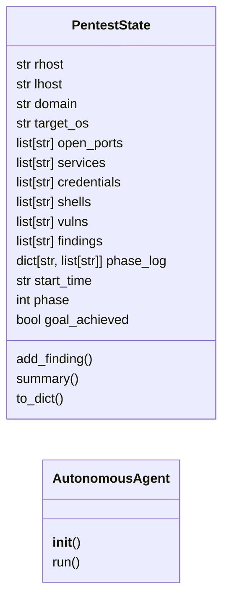
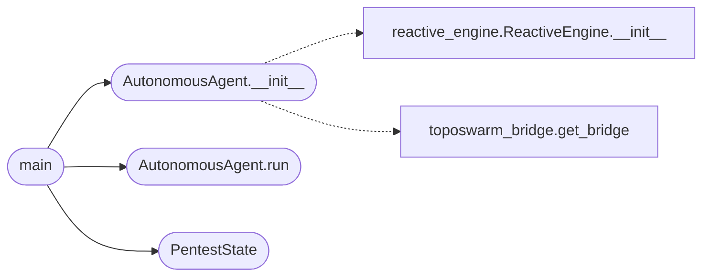

# `skills.toposwarm_autonomous`

> Source: [skills/toposwarm_autonomous.py:1](../../skills/toposwarm_autonomous.py#L1) | language `py` | coverage 22.2% | [API index](../index.md)

skills/toposwarm_autonomous.py ================================ TopoSwarm Autonomous Red Team Agent ==================================== Drives LazyOwn through a full pentest kill-chain using TopoSwarm as the local AI router, with no dependency on Groq, Ollama, or Claude Code.

Architecture
------------
  payload.json  →  AutonomousAgent
                        │
                   phase loop (ReAct style)
                        │
                ┌───────┴───────┐
                ▼               ▼
         TopoSwarmBridge    ReactiveEngine
         route(goal)        analyse(output)
                │               │
                ▼               │
         LazyOwn PTY ───────────┘
         execute tool
                │
                ▼
         StateTracker
         (discoveries, creds, phase)
                │
                ▼
         next goal decided

Phase sequence
--------------
  0. INIT       — session init, set rhost/lhost from payload.json
  1. RECON      — port scan (lazynmap), web probe, fingerprint OS
  2. ENUM       — service-specific enum (SMB, LDAP, web dirs, etc.)
  3. VULN       — searchsploit + CVE analysis on discovered services
  4. EXPLOIT    — attempt exploitation of best candidate vuln
  5. POST       — credential dump, privesc, persistence
  6. LATERAL    — move to adjacent hosts if creds found
  7. REPORT     — generate final report + MISP export

Usage
-----
  python3 skills/toposwarm_autonomous.py [OPTIONS]

  Options:
    --rhost IP          Target IP (overrides payload.json)
    --lhost IP          Listener IP (overrides payload.json)
    --objective TEXT    High-level goal (default: "compromise the target")
    --max-steps N       Max actions per phase (default: 5)
    --max-phases N      Max phases to run (default: 7 = all)
    --no-model          Use keyword routing only (no GPU needed)
    --phase PHASE       Start from specific phase (0-7)
    --verbose           Print full tool output
    --json-out FILE     Write structured results to JSON file
    --effort low|med|high|max  How hard to try (default: high)

Author: Gris Iscomeback — GPL v3

## Contents

- **Classes:** [`PentestState`](#penteststate), [`AutonomousAgent`](#autonomousagent)
- **Functions:** [`main`](#main)
- **Constants:** [`PHASES`](#phases), [`EFFORT_STEPS`](#effort_steps)

## Type Diagram



## Call Graph

Solid arrows stay in this module, dashed arrows leave it.



## Classes

<a id="penteststate"></a>

### `PentestState`

`class` `dataclass` | [skills/toposwarm_autonomous.py:127](../../skills/toposwarm_autonomous.py#L127)

Decorators: `@dataclass`

```python
class PentestState
```

Tracks everything discovered during the autonomous run.

**Attributes**

| Name | Type | Default | Description |
|---|---|---|---|
| [`rhost`](#penteststate-rhost) | `str` | `''` |  |
| [`lhost`](#penteststate-lhost) | `str` | `''` |  |
| [`domain`](#penteststate-domain) | `str` | `''` |  |
| [`target_os`](#penteststate-target_os) | `str` | `'unknown'` |  |
| [`open_ports`](#penteststate-open_ports) | `list[str]` | `field(default_factory=list)` |  |
| [`services`](#penteststate-services) | `list[str]` | `field(default_factory=list)` |  |
| [`credentials`](#penteststate-credentials) | `list[str]` | `field(default_factory=list)` |  |
| [`shells`](#penteststate-shells) | `list[str]` | `field(default_factory=list)` |  |
| [`vulns`](#penteststate-vulns) | `list[str]` | `field(default_factory=list)` |  |
| [`findings`](#penteststate-findings) | `list[str]` | `field(default_factory=list)` |  |
| [`phase_log`](#penteststate-phase_log) | `dict[str, list[str]]` | `field(default_factory=dict)` |  |
| [`start_time`](#penteststate-start_time) | `str` | `field(default_factory=lambda: datetime.now(UTC).isoformat())` |  |
| [`phase`](#penteststate-phase) | `int` | `0` |  |
| [`goal_achieved`](#penteststate-goal_achieved) | `bool` | `False` |  |

**Members**

| Member | Kind | Summary |
|---|---|---|
| [`add_finding`](#penteststate-add_finding) | method |  |
| [`summary`](#penteststate-summary) | method |  |
| [`to_dict`](#penteststate-to_dict) | method |  |

<a id="penteststate-add_finding"></a>

#### `PentestState.add_finding`

`method` | [skills/toposwarm_autonomous.py:145](../../skills/toposwarm_autonomous.py#L145)

```python
def add_finding(self, phase_name: str, text: str) -> None
```

**Parameters**

| Name | Type | Default | Description |
|---|---|---|---|
| `phase_name` | `str` |  |  |
| `text` | `str` |  |  |

<a id="penteststate-summary"></a>

#### `PentestState.summary`

`method` | [skills/toposwarm_autonomous.py:149](../../skills/toposwarm_autonomous.py#L149)

```python
def summary(self) -> str
```

**Returns:** `str`

<a id="penteststate-to_dict"></a>

#### `PentestState.to_dict`

`method` | [skills/toposwarm_autonomous.py:160](../../skills/toposwarm_autonomous.py#L160)

```python
def to_dict(self) -> dict[str, Any]
```

**Returns:** `dict[str, Any]`

---

<a id="autonomousagent"></a>

### `AutonomousAgent`

`class` | [skills/toposwarm_autonomous.py:309](../../skills/toposwarm_autonomous.py#L309)

```python
class AutonomousAgent
```

**Members**

| Member | Kind | Summary |
|---|---|---|
| [`__init__`](#autonomousagent-__init__) | constructor |  |
| [`run`](#autonomousagent-run) | method |  |

<a id="autonomousagent-__init__"></a>

#### `AutonomousAgent.__init__`

`constructor` | [skills/toposwarm_autonomous.py:310](../../skills/toposwarm_autonomous.py#L310)

```python
def __init__(self, state: PentestState, no_model: bool = False, verbose: bool = False, effort: str = 'high', max_phases: int = 8, json_out: Path | None = None) -> None
```

**Parameters**

| Name | Type | Default | Description |
|---|---|---|---|
| `state` | `PentestState` |  |  |
| `no_model` | `bool` | `False` |  |
| `verbose` | `bool` | `False` |  |
| `effort` | `str` | `'high'` |  |
| `max_phases` | `int` | `8` |  |
| `json_out` | `Path \| None` | `None` |  |

*Calls:* [`ReactiveEngine.__init__`](modules.reactive_engine.py.md#reactiveengine-__init__), [`get_bridge`](modules.toposwarm_bridge.py.md#get_bridge)

*Called by:* [`main`](#main)

<a id="autonomousagent-run"></a>

#### `AutonomousAgent.run`

`method` | [skills/toposwarm_autonomous.py:432](../../skills/toposwarm_autonomous.py#L432)

```python
def run(self, start_phase: int = 0) -> PentestState
```

**Parameters**

| Name | Type | Default | Description |
|---|---|---|---|
| `start_phase` | `int` | `0` |  |

**Returns:** `PentestState`

*Called by:* [`main`](#main)

---

## Functions

<a id="main"></a>

### `main`

`function` | [skills/toposwarm_autonomous.py:489](../../skills/toposwarm_autonomous.py#L489)

```python
def main(argv: list[str] | None = None) -> int
```

**Parameters**

| Name | Type | Default | Description |
|---|---|---|---|
| `argv` | `list[str] \| None` | `None` |  |

**Returns:** `int`

*Calls:* [`AutonomousAgent.__init__`](#autonomousagent-__init__), [`AutonomousAgent.run`](#autonomousagent-run), [`PentestState`](#penteststate)

---

## Constants

<a id="phases"></a>

### `PHASES`

`constant` | [skills/toposwarm_autonomous.py:109](../../skills/toposwarm_autonomous.py#L109)

```python
PHASES
```

---

<a id="effort_steps"></a>

### `EFFORT_STEPS`

`constant` | [skills/toposwarm_autonomous.py:120](../../skills/toposwarm_autonomous.py#L120)

```python
EFFORT_STEPS = {'low': 2, 'med': 3, 'medium': 3, 'high': 5, 'max': 8}
```

---
