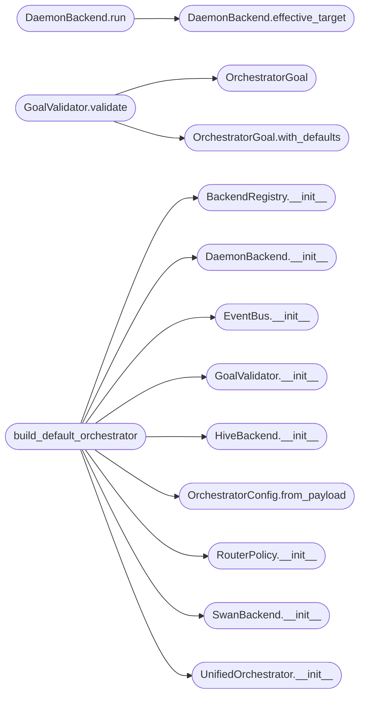

# `skills.unified_orchestrator`

> Source: [skills/unified_orchestrator.py:1](../../skills/unified_orchestrator.py#L1) | language `py` | coverage 100.0% | [API index](../index.md)

Unified orchestrator facade collapsing daemon, hive and SWAN into one surface.

The framework historically exposes three independent autonomous heads:

* [`skills.autonomous_daemon.EngageOrchestrator`](skills.autonomous_daemon.py.md#engageorchestrator) — single-target
  kill-chain executor.
* [`skills.hive_mind.QueenBrain`](skills.hive_mind.py.md#queenbrain) — drone swarm coordinator.
* [`skills.swan_agent.SwanOrchestrator`](skills.swan_agent.py.md#swanorchestrator) — MoE+RL expert ensemble.

Each ships its own input shape, result shape, event format and lifecycle.
That overlap forces the operator (and the LLM) to know which head to use
before they can ask a question. This module re-frames them as
interchangeable [`IOrchestratorBackend`](#iorchestratorbackend) implementations behind a
single [`UnifiedOrchestrator`](#unifiedorchestrator) entry point that:

1. Normalises the input into an [`OrchestratorGoal`](#orchestratorgoal).
2. Picks a backend via [`RouterPolicy`](#routerpolicy).
3. Executes through the backend's lazily-imported real engine.
4. Normalises the output into [`OrchestratorResult`](#orchestratorresult).
5. Emits a structured record onto the shared event bus.

The originals are untouched — this is a façade in the Gang-of-Four sense,
not a rewrite. New code calls this module; the legacy entry points keep
working until they are deprecated.

## Contents

- **Classes:** [`OrchestratorConfig`](#orchestratorconfig), [`OrchestratorGoal`](#orchestratorgoal), [`OrchestratorResult`](#orchestratorresult), [`EventBus`](#eventbus), [`BackendRegistry`](#backendregistry), [`RouterPolicy`](#routerpolicy), [`DaemonBackend`](#daemonbackend), [`HiveBackend`](#hivebackend), [`SwanBackend`](#swanbackend), [`GoalValidator`](#goalvalidator), [`UnifiedOrchestrator`](#unifiedorchestrator)
- **Protocols:** [`IOrchestratorBackend`](#iorchestratorbackend)
- **Functions:** [`build_default_orchestrator`](#build_default_orchestrator)

## Type Diagram

```mermaid
classDiagram
    direction LR
    class OrchestratorConfig
    OrchestratorConfig : str sessions_dir
    OrchestratorConfig : str events_filename
    OrchestratorConfig : str default_mode
    OrchestratorConfig : str default_phase
    OrchestratorConfig : str default_task_type
    OrchestratorConfig : int default_drones
    OrchestratorConfig : int daemon_default_max_switches
    OrchestratorConfig : float swan_default_timeout
    OrchestratorConfig : int hive_default_max_iterations
    OrchestratorConfig : int max_goal_chars
    OrchestratorConfig : int max_event_bytes
    OrchestratorConfig : int file_mode
    OrchestratorConfig : str bus_filename_encoding
    OrchestratorConfig : tuple[str, ] enabled_modes
    OrchestratorConfig : tuple[str, ] hive_role_keywords
    OrchestratorConfig : tuple[str, ] swan_task_keywords
    OrchestratorConfig : tuple[str, ] swan_phase_keywords
    OrchestratorConfig : tuple[str, ] daemon_target_keys
    OrchestratorConfig : str autonomous_event_kind
    OrchestratorConfig : int daemon_target_score
    OrchestratorConfig : int hive_drones_bonus
    OrchestratorConfig : int hive_drones_threshold
    OrchestratorConfig : int swan_phase_bonus
    OrchestratorConfig : int swan_keyword_weight
    class OrchestratorGoal
    OrchestratorGoal : str goal
    OrchestratorGoal : str mode
    OrchestratorGoal : str phase
    OrchestratorGoal : str task_type
    OrchestratorGoal : str target
    OrchestratorGoal : int drones
    OrchestratorGoal : float timeout
    OrchestratorGoal : str api_key
    OrchestratorGoal : Mapping[str, Any] metadata
    OrchestratorGoal : with_defaults()
    class OrchestratorResult
    OrchestratorResult : str request_id
    OrchestratorResult : str backend
    OrchestratorResult : str status
    OrchestratorResult : str summary
    OrchestratorResult : Mapping[str, Any] artefacts
    OrchestratorResult : Sequence[Mapping[str, Any]] events
    OrchestratorResult : float duration
    OrchestratorResult : Any raw
    OrchestratorResult : to_dict()
    class IOrchestratorBackend
    <<protocol>> IOrchestratorBackend
    IOrchestratorBackend : str name
    IOrchestratorBackend : available()
    IOrchestratorBackend : run()
    class EventBus
    EventBus : __init__()
    EventBus : path()
    EventBus : emit()
    class BackendRegistry
    BackendRegistry : __init__()
    BackendRegistry : names()
    BackendRegistry : get()
    BackendRegistry : available()
    class RouterPolicy
    RouterPolicy : __init__()
    RouterPolicy : choose()
    class DaemonBackend
    DaemonBackend : name
    DaemonBackend : __init__()
    DaemonBackend : available()
    DaemonBackend : run()
    DaemonBackend : effective_target()
    class HiveBackend
    HiveBackend : name
    HiveBackend : __init__()
    HiveBackend : available()
    HiveBackend : run()
    class SwanBackend
    SwanBackend : name
    SwanBackend : __init__()
    SwanBackend : available()
    SwanBackend : run()
    class GoalValidator
    GoalValidator : __init__()
    GoalValidator : validate()
    class UnifiedOrchestrator
    UnifiedOrchestrator : __init__()
    UnifiedOrchestrator : backends()
    UnifiedOrchestrator : execute()
```



## Call Graph

Solid arrows stay in this module, dashed arrows leave it.



## Classes

<a id="orchestratorconfig"></a>

### `OrchestratorConfig`

`class` `dataclass` | [skills/unified_orchestrator.py:51](../../skills/unified_orchestrator.py#L51)

Decorators: `@dataclass(frozen=True)`

```python
class OrchestratorConfig
```

Configuration container for [`UnifiedOrchestrator`](#unifiedorchestrator).

Every tunable lives here so the orchestrator can be reconfigured from
``payload.json`` without code edits.

**Attributes**

| Name | Type | Default | Description |
|---|---|---|---|
| [`sessions_dir`](#orchestratorconfig-sessions_dir) | `str` | `'sessions'` |  |
| [`events_filename`](#orchestratorconfig-events_filename) | `str` | `'autonomous_events.jsonl'` |  |
| [`default_mode`](#orchestratorconfig-default_mode) | `str` | `_MODE_AUTO` |  |
| [`default_phase`](#orchestratorconfig-default_phase) | `str` | `'exploitation'` |  |
| [`default_task_type`](#orchestratorconfig-default_task_type) | `str` | `'exploit_generation'` |  |
| [`default_drones`](#orchestratorconfig-default_drones) | `int` | `4` |  |
| [`daemon_default_max_switches`](#orchestratorconfig-daemon_default_max_switches) | `int` | `3` |  |
| [`swan_default_timeout`](#orchestratorconfig-swan_default_timeout) | `float` | `300.0` |  |
| [`hive_default_max_iterations`](#orchestratorconfig-hive_default_max_iterations) | `int` | `10` |  |
| [`max_goal_chars`](#orchestratorconfig-max_goal_chars) | `int` | `4096` |  |
| [`max_event_bytes`](#orchestratorconfig-max_event_bytes) | `int` | `65536` |  |
| [`file_mode`](#orchestratorconfig-file_mode) | `int` | `384` |  |
| [`bus_filename_encoding`](#orchestratorconfig-bus_filename_encoding) | `str` | `'utf-8'` |  |
| [`enabled_modes`](#orchestratorconfig-enabled_modes) | `tuple[str, ...]` | `(_MODE_AUTO, _BACKEND_DAEMON, _BACKEND_HIVE, _BACKEND_SWAN)` |  |
| [`hive_role_keywords`](#orchestratorconfig-hive_role_keywords) | `tuple[str, ...]` | `('swarm', 'parallel', 'many', 'multiple', 'drones', 'team', 'concurrent')` |  |
| [`swan_task_keywords`](#orchestratorconfig-swan_task_keywords) | `tuple[str, ...]` | `('exploit', 'shell', 'rce', 'payload', 'lateral', 'escalat')` |  |
| [`swan_phase_keywords`](#orchestratorconfig-swan_phase_keywords) | `tuple[str, ...]` | `('exploit', 'postexp', 'lateral')` |  |
| [`daemon_target_keys`](#orchestratorconfig-daemon_target_keys) | `tuple[str, ...]` | `('target', 'rhost', 'host')` |  |
| [`autonomous_event_kind`](#orchestratorconfig-autonomous_event_kind) | `str` | `'orchestrator'` |  |
| [`daemon_target_score`](#orchestratorconfig-daemon_target_score) | `int` | `7` |  |
| [`hive_drones_bonus`](#orchestratorconfig-hive_drones_bonus) | `int` | `10` |  |
| [`hive_drones_threshold`](#orchestratorconfig-hive_drones_threshold) | `int` | `1` |  |
| [`swan_phase_bonus`](#orchestratorconfig-swan_phase_bonus) | `int` | `5` |  |
| [`swan_keyword_weight`](#orchestratorconfig-swan_keyword_weight) | `int` | `3` |  |
| [`invalid_modes_message`](#orchestratorconfig-invalid_modes_message) | `str` | `'mode must be one of: auto, daemon, hive, swan'` |  |
| [`empty_goal_message`](#orchestratorconfig-empty_goal_message) | `str` | `'goal must be a non-empty string'` |  |
| [`backend_missing_message`](#orchestratorconfig-backend_missing_message) | `str` | `'no backend available for the requested mode'` |  |

**Members**

| Member | Kind | Summary |
|---|---|---|
| [`from_payload`](#orchestratorconfig-from_payload) | classmethod | Return a config with ``payload.json`` overrides applied. |

<a id="orchestratorconfig-from_payload"></a>

#### `OrchestratorConfig.from_payload`

`classmethod` | [skills/unified_orchestrator.py:111](../../skills/unified_orchestrator.py#L111)

Decorators: `@classmethod`

```python
def from_payload(cls, payload: Mapping[str, Any] | None) -> OrchestratorConfig
```

Return a config with ``payload.json`` overrides applied.

**Parameters**

| Name | Type | Default | Description |
|---|---|---|---|
| `payload` | `Mapping[str, Any] \| None` |  | Loaded payload mapping. ``None`` returns the defaults. |

**Returns:** `OrchestratorConfig` - A new [`OrchestratorConfig`](#orchestratorconfig) instance.

*Called by:* [`build_default_orchestrator`](#build_default_orchestrator)

---

<a id="orchestratorgoal"></a>

### `OrchestratorGoal`

`class` `dataclass` | [skills/unified_orchestrator.py:143](../../skills/unified_orchestrator.py#L143)

Decorators: `@dataclass(frozen=True)`

```python
class OrchestratorGoal
```

Validated request shape consumed by every backend.

**Attributes**

| Name | Type | Default | Description |
|---|---|---|---|
| [`goal`](#orchestratorgoal-goal) | `str` |  |  |
| [`mode`](#orchestratorgoal-mode) | `str` |  |  |
| [`phase`](#orchestratorgoal-phase) | `str` |  |  |
| [`task_type`](#orchestratorgoal-task_type) | `str` |  |  |
| [`target`](#orchestratorgoal-target) | `str` | `''` |  |
| [`drones`](#orchestratorgoal-drones) | `int` | `0` |  |
| [`timeout`](#orchestratorgoal-timeout) | `float` | `0.0` |  |
| [`api_key`](#orchestratorgoal-api_key) | `str` | `''` |  |
| [`metadata`](#orchestratorgoal-metadata) | `Mapping[str, Any]` | `field(default_factory=dict)` |  |

**Members**

| Member | Kind | Summary |
|---|---|---|
| [`with_defaults`](#orchestratorgoal-with_defaults) | method | Return a copy with empty fields populated from ``config``. |

<a id="orchestratorgoal-with_defaults"></a>

#### `OrchestratorGoal.with_defaults`

`method` | [skills/unified_orchestrator.py:156](../../skills/unified_orchestrator.py#L156)

```python
def with_defaults(self, config: OrchestratorConfig) -> OrchestratorGoal
```

Return a copy with empty fields populated from ``config``.

Only fields whose absence is unambiguous are populated here.
`[`task_type`](#orchestratorgoal-task_type)` is intentionally left blank when the caller did
not specify one so the router scores routing purely on the goal
text; SWAN's backend defaults the task type internally. The
numeric fields `[`drones`](#orchestratorgoal-drones)` and `[`timeout`](#orchestratorgoal-timeout)` are likewise left at
zero so backends can apply their own defaults.

**Parameters**

| Name | Type | Default | Description |
|---|---|---|---|
| `config` | `OrchestratorConfig` |  |  |

**Returns:** `OrchestratorGoal`

*Called by:* [`GoalValidator.validate`](#goalvalidator-validate)

---

<a id="orchestratorresult"></a>

### `OrchestratorResult`

`class` `dataclass` | [skills/unified_orchestrator.py:174](../../skills/unified_orchestrator.py#L174)

Decorators: `@dataclass(frozen=True)`

```python
class OrchestratorResult
```

Canonical result shape returned by [`UnifiedOrchestrator`](#unifiedorchestrator).

**Attributes**

| Name | Type | Default | Description |
|---|---|---|---|
| [`request_id`](#orchestratorresult-request_id) | `str` |  | Stable id for correlating events with this run. |
| [`backend`](#orchestratorresult-backend) | `str` |  | Identifier of the backend that handled the request. |
| [`status`](#orchestratorresult-status) | `str` |  | One of `[`ok`](scripts.top_tier_check.py.md#ok)`, ``error``, ``unavailable``, ``invalid``. |
| [`summary`](#orchestratorresult-summary) | `str` |  | Short single-line human-readable description. |
| [`artefacts`](#orchestratorresult-artefacts) | `Mapping[str, Any]` | `field(default_factory=dict)` | Mapping of optional output paths or identifiers. |
| [`events`](#orchestratorresult-events) | `Sequence[Mapping[str, Any]]` | `field(default_factory=tuple)` | Structured event entries emitted during the run. |
| [`duration`](#orchestratorresult-duration) | `float` | `0.0` | Wall-clock seconds spent in [`IOrchestratorBackend.run`](#iorchestratorbackend-run). |
| [`raw`](#orchestratorresult-raw) | `Any` | `None` | Backend-native payload (kept opaque to callers). |

**Members**

| Member | Kind | Summary |
|---|---|---|
| [`to_dict`](#orchestratorresult-to_dict) | method | Return a JSON-serialisable dictionary of the result. |

<a id="orchestratorresult-to_dict"></a>

#### `OrchestratorResult.to_dict`

`method` | [skills/unified_orchestrator.py:197](../../skills/unified_orchestrator.py#L197)

```python
def to_dict(self) -> dict[str, Any]
```

Return a JSON-serialisable dictionary of the result.

**Returns:** `dict[str, Any]`

---

<a id="eventbus"></a>

### `EventBus`

`class` | [skills/unified_orchestrator.py:224](../../skills/unified_orchestrator.py#L224)

```python
class EventBus
```

Atomic append-only writer for orchestrator events.

The bus appends one JSON line per event to
``sessions/<events_filename>``. Writes are serialised with a process-
level lock and use ``O_APPEND`` to avoid interleaving when multiple
orchestrators share the same file.

**Members**

| Member | Kind | Summary |
|---|---|---|
| [`__init__`](#eventbus-__init__) | constructor | Bind the bus to the active config. |
| [`path`](#eventbus-path) | property | Return the resolved event file path. |
| [`emit`](#eventbus-emit) | method | Append a single sanitised event to the bus. |

<a id="eventbus-__init__"></a>

#### `EventBus.__init__`

`constructor` | [skills/unified_orchestrator.py:233](../../skills/unified_orchestrator.py#L233)

```python
def __init__(self, config: OrchestratorConfig, root: Path | None = None) -> None
```

Bind the bus to the active config.

**Parameters**

| Name | Type | Default | Description |
|---|---|---|---|
| `config` | `OrchestratorConfig` |  | Active orchestrator configuration. |
| `root` | `Path \| None` | `None` | Optional explicit sessions directory. Resolved against the current working directory. |

**Raises**

- `ValueError`: When ``config.max_event_bytes`` is non-positive.

*Called by:* [`build_default_orchestrator`](#build_default_orchestrator)

<a id="eventbus-path"></a>

#### `EventBus.path`

`property` | [skills/unified_orchestrator.py:252](../../skills/unified_orchestrator.py#L252)

Decorators: `@property`

```python
def path(self) -> Path
```

Return the resolved event file path.

**Returns:** `Path`

<a id="eventbus-emit"></a>

#### `EventBus.emit`

`method` | [skills/unified_orchestrator.py:256](../../skills/unified_orchestrator.py#L256)

```python
def emit(self, event: Mapping[str, Any]) -> bool
```

Append a single sanitised event to the bus.

**Parameters**

| Name | Type | Default | Description |
|---|---|---|---|
| `event` | `Mapping[str, Any]` |  | Event mapping. Must serialise to a JSON object whose encoded form fits within ``config.max_event_bytes``. |

**Returns:** `bool` - ``True`` when the event was persisted, ``False`` when the
event was rejected (oversize, unserialisable) or the write
failed.

---

<a id="backendregistry"></a>

### `BackendRegistry`

`class` | [skills/unified_orchestrator.py:300](../../skills/unified_orchestrator.py#L300)

```python
class BackendRegistry
```

Ordered registry of [`IOrchestratorBackend`](#iorchestratorbackend) implementations.

**Members**

| Member | Kind | Summary |
|---|---|---|
| [`__init__`](#backendregistry-__init__) | constructor | Bind the registry to a fixed-order tuple of backends. |
| [`names`](#backendregistry-names) | property | Return the registered backend names in declaration order. |
| [`get`](#backendregistry-get) | method | Return the backend registered as `[`name`](#iorchestratorbackend-name)` or ``None``. |
| [`available`](#backendregistry-available) | method | Return every backend that currently reports availability. |

<a id="backendregistry-__init__"></a>

#### `BackendRegistry.__init__`

`constructor` | [skills/unified_orchestrator.py:303](../../skills/unified_orchestrator.py#L303)

```python
def __init__(self, backends: Sequence[IOrchestratorBackend]) -> None
```

Bind the registry to a fixed-order tuple of backends.

**Parameters**

| Name | Type | Default | Description |
|---|---|---|---|
| `backends` | `Sequence[IOrchestratorBackend]` |  | Sequence of backends. Order is preserved so the router can iterate by priority. |

**Raises**

- `ValueError`: When two backends share a name.

*Called by:* [`build_default_orchestrator`](#build_default_orchestrator)

<a id="backendregistry-names"></a>

#### `BackendRegistry.names`

`property` | [skills/unified_orchestrator.py:327](../../skills/unified_orchestrator.py#L327)

Decorators: `@property`

```python
def names(self) -> tuple[str, ...]
```

Return the registered backend names in declaration order.

**Returns:** `tuple[str, ...]`

<a id="backendregistry-get"></a>

#### `BackendRegistry.get`

`method` | [skills/unified_orchestrator.py:331](../../skills/unified_orchestrator.py#L331)

```python
def get(self, name: str) -> IOrchestratorBackend | None
```

Return the backend registered as `[`name`](#iorchestratorbackend-name)` or ``None``.

**Parameters**

| Name | Type | Default | Description |
|---|---|---|---|
| `name` | `str` |  |  |

**Returns:** `IOrchestratorBackend | None`

<a id="backendregistry-available"></a>

#### `BackendRegistry.available`

`method` | [skills/unified_orchestrator.py:335](../../skills/unified_orchestrator.py#L335)

```python
def available(self) -> list[IOrchestratorBackend]
```

Return every backend that currently reports availability.

**Returns:** `list[IOrchestratorBackend]`

---

<a id="routerpolicy"></a>

### `RouterPolicy`

`class` | [skills/unified_orchestrator.py:340](../../skills/unified_orchestrator.py#L340)

```python
class RouterPolicy
```

Pick the best backend for a given [`OrchestratorGoal`](#orchestratorgoal).

The policy is deliberately small and explicit so the operator can
predict routing decisions without reading the source.

**Members**

| Member | Kind | Summary |
|---|---|---|
| [`__init__`](#routerpolicy-__init__) | constructor | Bind the policy to config and backend registry. |
| [`choose`](#routerpolicy-choose) | method | Return the backend that should execute `[`goal`](#orchestratorgoal-goal)`. |

<a id="routerpolicy-__init__"></a>

#### `RouterPolicy.__init__`

`constructor` | [skills/unified_orchestrator.py:347](../../skills/unified_orchestrator.py#L347)

```python
def __init__(self, config: OrchestratorConfig, registry: BackendRegistry) -> None
```

Bind the policy to config and backend registry.

**Parameters**

| Name | Type | Default | Description |
|---|---|---|---|
| `config` | `OrchestratorConfig` |  |  |
| `registry` | `BackendRegistry` |  |  |

*Called by:* [`build_default_orchestrator`](#build_default_orchestrator)

<a id="routerpolicy-choose"></a>

#### `RouterPolicy.choose`

`method` | [skills/unified_orchestrator.py:352](../../skills/unified_orchestrator.py#L352)

```python
def choose(self, goal: OrchestratorGoal) -> IOrchestratorBackend | None
```

Return the backend that should execute `[`goal`](#orchestratorgoal-goal)`.

**Parameters**

| Name | Type | Default | Description |
|---|---|---|---|
| `goal` | `OrchestratorGoal` |  |  |

**Returns:** `IOrchestratorBackend | None`

---

<a id="daemonbackend"></a>

### `DaemonBackend`

`class` | [skills/unified_orchestrator.py:408](../../skills/unified_orchestrator.py#L408)

```python
class DaemonBackend
```

Adapter onto [`skills.autonomous_daemon.EngageOrchestrator`](skills.autonomous_daemon.py.md#engageorchestrator).

**Attributes**

| Name | Type | Default | Description |
|---|---|---|---|
| [`name`](#daemonbackend-name) |  | `_BACKEND_DAEMON` |  |

**Members**

| Member | Kind | Summary |
|---|---|---|
| [`__init__`](#daemonbackend-__init__) | constructor | Bind to config, optional engine factory and payload mapping. |
| [`available`](#daemonbackend-available) | method | Return ``True`` when the underlying engine can be imported. |
| [`run`](#daemonbackend-run) | method | Execute a single-target kill-chain engagement. |
| [`effective_target`](#daemonbackend-effective_target) | method | Return the daemon target this backend would use for `[`goal`](#orchestratorgoal-goal)`. |

<a id="daemonbackend-__init__"></a>

#### `DaemonBackend.__init__`

`constructor` | [skills/unified_orchestrator.py:413](../../skills/unified_orchestrator.py#L413)

```python
def __init__(self, config: OrchestratorConfig, factory: Callable[[OrchestratorGoal], Any] | None = None, payload: Mapping[str, Any] | None = None) -> None
```

Bind to config, optional engine factory and payload mapping.

**Parameters**

| Name | Type | Default | Description |
|---|---|---|---|
| `config` | `OrchestratorConfig` |  | Active configuration. |
| `factory` | `Callable[[OrchestratorGoal], Any] \| None` | `None` | Optional callable that returns an object exposing ``run() -> dict``. Injected for tests; in production the adapter constructs the real `[`EngageOrchestrator`](skills.autonomous_daemon.py.md#engageorchestrator)` lazily. |
| `payload` | `Mapping[str, Any] \| None` | `None` | Optional ``payload.json`` mapping used to derive a fallback target (``active_target`` / ``rhost`` / ``host``) when the goal does not carry one explicitly. |

*Called by:* [`build_default_orchestrator`](#build_default_orchestrator)

<a id="daemonbackend-available"></a>

#### `DaemonBackend.available`

`method` | [skills/unified_orchestrator.py:435](../../skills/unified_orchestrator.py#L435)

```python
def available(self) -> bool
```

Return ``True`` when the underlying engine can be imported.

**Returns:** `bool`

<a id="daemonbackend-run"></a>

#### `DaemonBackend.run`

`method` | [skills/unified_orchestrator.py:445](../../skills/unified_orchestrator.py#L445)

```python
def run(self, goal: OrchestratorGoal) -> OrchestratorResult
```

Execute a single-target kill-chain engagement.

**Parameters**

| Name | Type | Default | Description |
|---|---|---|---|
| `goal` | `OrchestratorGoal` |  | The validated request shape. |

**Returns:** `OrchestratorResult` - A normalised [`OrchestratorResult`](#orchestratorresult). `[`status`](#orchestratorresult-status)` reflects
backend-side failures without raising.

*Calls:* [`DaemonBackend.effective_target`](#daemonbackend-effective_target)

<a id="daemonbackend-effective_target"></a>

#### `DaemonBackend.effective_target`

`method` | [skills/unified_orchestrator.py:489](../../skills/unified_orchestrator.py#L489)

```python
def effective_target(self, goal: OrchestratorGoal) -> str
```

Return the daemon target this backend would use for `[`goal`](#orchestratorgoal-goal)`.

Resolution order:
    1. ``goal.target`` when set.
    2. ``goal.metadata[<daemon_target_keys>]``.
    3. ``payload[<daemon_target_keys>]``.
Returns an empty string when no candidate is available.

**Parameters**

| Name | Type | Default | Description |
|---|---|---|---|
| `goal` | `OrchestratorGoal` |  |  |

**Returns:** `str`

*Called by:* [`DaemonBackend.run`](#daemonbackend-run)

---

<a id="hivebackend"></a>

### `HiveBackend`

`class` | [skills/unified_orchestrator.py:605](../../skills/unified_orchestrator.py#L605)

```python
class HiveBackend
```

Adapter onto [`skills.hive_mind.QueenBrain`](skills.hive_mind.py.md#queenbrain).

**Attributes**

| Name | Type | Default | Description |
|---|---|---|---|
| [`name`](#hivebackend-name) |  | `_BACKEND_HIVE` |  |

**Members**

| Member | Kind | Summary |
|---|---|---|
| [`__init__`](#hivebackend-__init__) | constructor | Bind to config and an optional queen factory. |
| [`available`](#hivebackend-available) | method | Return ``True`` when the hive engine is importable. |
| [`run`](#hivebackend-run) | method | Plan, dispatch, collect and synthesise via the hive. |

<a id="hivebackend-__init__"></a>

#### `HiveBackend.__init__`

`constructor` | [skills/unified_orchestrator.py:610](../../skills/unified_orchestrator.py#L610)

```python
def __init__(self, config: OrchestratorConfig, factory: Callable[[], Any] | None = None) -> None
```

Bind to config and an optional queen factory.

**Parameters**

| Name | Type | Default | Description |
|---|---|---|---|
| `config` | `OrchestratorConfig` |  |  |
| `factory` | `Callable[[], Any] \| None` | `None` |  |

*Called by:* [`build_default_orchestrator`](#build_default_orchestrator)

<a id="hivebackend-available"></a>

#### `HiveBackend.available`

`method` | [skills/unified_orchestrator.py:619](../../skills/unified_orchestrator.py#L619)

```python
def available(self) -> bool
```

Return ``True`` when the hive engine is importable.

**Returns:** `bool`

<a id="hivebackend-run"></a>

#### `HiveBackend.run`

`method` | [skills/unified_orchestrator.py:629](../../skills/unified_orchestrator.py#L629)

```python
def run(self, goal: OrchestratorGoal) -> OrchestratorResult
```

Plan, dispatch, collect and synthesise via the hive.

**Parameters**

| Name | Type | Default | Description |
|---|---|---|---|
| `goal` | `OrchestratorGoal` |  |  |

**Returns:** `OrchestratorResult`

---

<a id="swanbackend"></a>

### `SwanBackend`

`class` | [skills/unified_orchestrator.py:706](../../skills/unified_orchestrator.py#L706)

```python
class SwanBackend
```

Adapter onto [`skills.swan_agent.SwanOrchestrator`](skills.swan_agent.py.md#swanorchestrator).

**Attributes**

| Name | Type | Default | Description |
|---|---|---|---|
| [`name`](#swanbackend-name) |  | `_BACKEND_SWAN` |  |

**Members**

| Member | Kind | Summary |
|---|---|---|
| [`__init__`](#swanbackend-__init__) | constructor | Bind to config and an optional orchestrator factory. |
| [`available`](#swanbackend-available) | method | Return ``True`` when the SWAN engine is importable. |
| [`run`](#swanbackend-run) | method | Execute a single SWAN task and normalise the result. |

<a id="swanbackend-__init__"></a>

#### `SwanBackend.__init__`

`constructor` | [skills/unified_orchestrator.py:711](../../skills/unified_orchestrator.py#L711)

```python
def __init__(self, config: OrchestratorConfig, factory: Callable[[str], Any] | None = None) -> None
```

Bind to config and an optional orchestrator factory.

**Parameters**

| Name | Type | Default | Description |
|---|---|---|---|
| `config` | `OrchestratorConfig` |  |  |
| `factory` | `Callable[[str], Any] \| None` | `None` |  |

*Called by:* [`build_default_orchestrator`](#build_default_orchestrator)

<a id="swanbackend-available"></a>

#### `SwanBackend.available`

`method` | [skills/unified_orchestrator.py:720](../../skills/unified_orchestrator.py#L720)

```python
def available(self) -> bool
```

Return ``True`` when the SWAN engine is importable.

**Returns:** `bool`

<a id="swanbackend-run"></a>

#### `SwanBackend.run`

`method` | [skills/unified_orchestrator.py:730](../../skills/unified_orchestrator.py#L730)

```python
def run(self, goal: OrchestratorGoal) -> OrchestratorResult
```

Execute a single SWAN task and normalise the result.

**Parameters**

| Name | Type | Default | Description |
|---|---|---|---|
| `goal` | `OrchestratorGoal` |  |  |

**Returns:** `OrchestratorResult`

---

<a id="goalvalidator"></a>

### `GoalValidator`

`class` | [skills/unified_orchestrator.py:806](../../skills/unified_orchestrator.py#L806)

```python
class GoalValidator
```

Boundary validator: raw input → [`OrchestratorGoal`](#orchestratorgoal).

The validator is the single place where user-controlled strings are
bounded and the mode whitelist is enforced. Everything downstream
works with already-validated values.

**Members**

| Member | Kind | Summary |
|---|---|---|
| [`__init__`](#goalvalidator-__init__) | constructor | Bind the validator to the active configuration. |
| [`validate`](#goalvalidator-validate) | method | Return a normalised goal or raise `ValueError`. |

<a id="goalvalidator-__init__"></a>

#### `GoalValidator.__init__`

`constructor` | [skills/unified_orchestrator.py:814](../../skills/unified_orchestrator.py#L814)

```python
def __init__(self, config: OrchestratorConfig) -> None
```

Bind the validator to the active configuration.

**Parameters**

| Name | Type | Default | Description |
|---|---|---|---|
| `config` | `OrchestratorConfig` |  |  |

*Called by:* [`build_default_orchestrator`](#build_default_orchestrator)

<a id="goalvalidator-validate"></a>

#### `GoalValidator.validate`

`method` | [skills/unified_orchestrator.py:818](../../skills/unified_orchestrator.py#L818)

```python
def validate(self, goal: str, mode: str = '', phase: str = '', task_type: str = '', target: str = '', drones: int = 0, timeout: float = 0.0, api_key: str = '', metadata: Mapping[str, Any] | None = None) -> OrchestratorGoal
```

Return a normalised goal or raise `ValueError`.

**Parameters**

| Name | Type | Default | Description |
|---|---|---|---|
| `goal` | `str` |  | Free-form objective string. |
| `mode` | `str` | `''` | Routing mode (``auto`` / ``daemon`` / ``hive`` / ``swan``). |
| `phase` | `str` | `''` | Kill-chain phase identifier. |
| `task_type` | `str` | `''` | SWAN task type identifier. |
| `target` | `str` | `''` | Single-target identifier for the daemon backend. |
| `drones` | `int` | `0` | Hive drone count. |
| `timeout` | `float` | `0.0` | SWAN timeout in seconds. |
| `api_key` | `str` | `''` | Optional API key forwarded to the backend. |
| `metadata` | `Mapping[str, Any] \| None` | `None` | Optional metadata mapping carried alongside the goal (used by tests to inject a stable `[`request_id`](#orchestratorresult-request_id)`). |

**Returns:** `OrchestratorGoal` - A validated [`OrchestratorGoal`](#orchestratorgoal).

**Raises**

- `ValueError`: When `[`goal`](#orchestratorgoal-goal)` is empty or `[`mode`](#orchestratorgoal-mode)` is unknown.

*Calls:* [`OrchestratorGoal`](#orchestratorgoal), [`OrchestratorGoal.with_defaults`](#orchestratorgoal-with_defaults)

---

<a id="unifiedorchestrator"></a>

### `UnifiedOrchestrator`

`class` | [skills/unified_orchestrator.py:871](../../skills/unified_orchestrator.py#L871)

```python
class UnifiedOrchestrator
```

Single entry point that routes a goal through one of the backends.

**Members**

| Member | Kind | Summary |
|---|---|---|
| [`__init__`](#unifiedorchestrator-__init__) | constructor | Bind the orchestrator to its collaborators. |
| [`backends`](#unifiedorchestrator-backends) | property | Return the registered backend names in declaration order. |
| [`execute`](#unifiedorchestrator-execute) | method | Validate, route, execute and emit one goal end-to-end. |

<a id="unifiedorchestrator-__init__"></a>

#### `UnifiedOrchestrator.__init__`

`constructor` | [skills/unified_orchestrator.py:874](../../skills/unified_orchestrator.py#L874)

```python
def __init__(self, config: OrchestratorConfig, registry: BackendRegistry, router: RouterPolicy, validator: GoalValidator, bus: EventBus) -> None
```

Bind the orchestrator to its collaborators.

**Parameters**

| Name | Type | Default | Description |
|---|---|---|---|
| `config` | `OrchestratorConfig` |  |  |
| `registry` | `BackendRegistry` |  |  |
| `router` | `RouterPolicy` |  |  |
| `validator` | `GoalValidator` |  |  |
| `bus` | `EventBus` |  |  |

*Called by:* [`build_default_orchestrator`](#build_default_orchestrator)

<a id="unifiedorchestrator-backends"></a>

#### `UnifiedOrchestrator.backends`

`property` | [skills/unified_orchestrator.py:890](../../skills/unified_orchestrator.py#L890)

Decorators: `@property`

```python
def backends(self) -> tuple[str, ...]
```

Return the registered backend names in declaration order.

**Returns:** `tuple[str, ...]`

<a id="unifiedorchestrator-execute"></a>

#### `UnifiedOrchestrator.execute`

`method` | [skills/unified_orchestrator.py:894](../../skills/unified_orchestrator.py#L894)

```python
def execute(self, goal: str, mode: str = '', phase: str = '', task_type: str = '', target: str = '', drones: int = 0, timeout: float = 0.0, api_key: str = '', metadata: Mapping[str, Any] | None = None) -> OrchestratorResult
```

Validate, route, execute and emit one goal end-to-end.

**Parameters**

| Name | Type | Default | Description |
|---|---|---|---|
| `goal` | `str` |  |  |
| `mode` | `str` | `''` |  |
| `phase` | `str` | `''` |  |
| `task_type` | `str` | `''` |  |
| `target` | `str` | `''` |  |
| `drones` | `int` | `0` |  |
| `timeout` | `float` | `0.0` |  |
| `api_key` | `str` | `''` |  |
| `metadata` | `Mapping[str, Any] \| None` | `None` |  |

**Returns:** `OrchestratorResult` - The normalised [`OrchestratorResult`](#orchestratorresult). Validation errors
and missing backends are returned as results with the
corresponding status — this method never raises.

---

## Protocols

<a id="iorchestratorbackend"></a>

### `IOrchestratorBackend`

`protocol` | [skills/unified_orchestrator.py:210](../../skills/unified_orchestrator.py#L210)

```python
class IOrchestratorBackend(Protocol)
```

Bases: `Protocol`

Backend contract.

Implementations must be side-effect-free on import.

**Attributes**

| Name | Type | Default | Description |
|---|---|---|---|
| [`name`](#iorchestratorbackend-name) | `str` |  |  |

**Members**

| Member | Kind | Summary |
|---|---|---|
| [`available`](#iorchestratorbackend-available) | method | Return ``True`` when this backend can satisfy a request. |
| [`run`](#iorchestratorbackend-run) | method | Execute `[`goal`](#orchestratorgoal-goal)` and return a normalised [`OrchestratorResult`](#orchestratorresult). |

<a id="iorchestratorbackend-available"></a>

#### `IOrchestratorBackend.available`

`method` | [skills/unified_orchestrator.py:215](../../skills/unified_orchestrator.py#L215)

```python
def available(self) -> bool
```

Return ``True`` when this backend can satisfy a request.

**Returns:** `bool`

<a id="iorchestratorbackend-run"></a>

#### `IOrchestratorBackend.run`

`method` | [skills/unified_orchestrator.py:219](../../skills/unified_orchestrator.py#L219)

```python
def run(self, goal: OrchestratorGoal) -> OrchestratorResult
```

Execute `[`goal`](#orchestratorgoal-goal)` and return a normalised [`OrchestratorResult`](#orchestratorresult).

**Parameters**

| Name | Type | Default | Description |
|---|---|---|---|
| `goal` | `OrchestratorGoal` |  |  |

**Returns:** `OrchestratorResult`

---

## Functions

<a id="build_default_orchestrator"></a>

### `build_default_orchestrator`

`function` | [skills/unified_orchestrator.py:995](../../skills/unified_orchestrator.py#L995)

```python
def build_default_orchestrator(payload: Mapping[str, Any] | None, sessions_dir: str | None = None) -> UnifiedOrchestrator
```

Wire the canonical three-backend orchestrator.

**Parameters**

| Name | Type | Default | Description |
|---|---|---|---|
| `payload` | `Mapping[str, Any] \| None` |  | ``payload.json`` mapping. Used to derive the config and forwarded to per-backend defaults. |
| `sessions_dir` | `str \| None` | `None` | Optional override for the sessions directory. |

**Returns:** `UnifiedOrchestrator` - A ready-to-use [`UnifiedOrchestrator`](#unifiedorchestrator).

*Calls:* [`BackendRegistry.__init__`](#backendregistry-__init__), [`DaemonBackend.__init__`](#daemonbackend-__init__), [`EventBus.__init__`](#eventbus-__init__), [`GoalValidator.__init__`](#goalvalidator-__init__), [`HiveBackend.__init__`](#hivebackend-__init__), [`OrchestratorConfig.from_payload`](#orchestratorconfig-from_payload), [`RouterPolicy.__init__`](#routerpolicy-__init__), [`SwanBackend.__init__`](#swanbackend-__init__), [`UnifiedOrchestrator.__init__`](#unifiedorchestrator-__init__)

---
