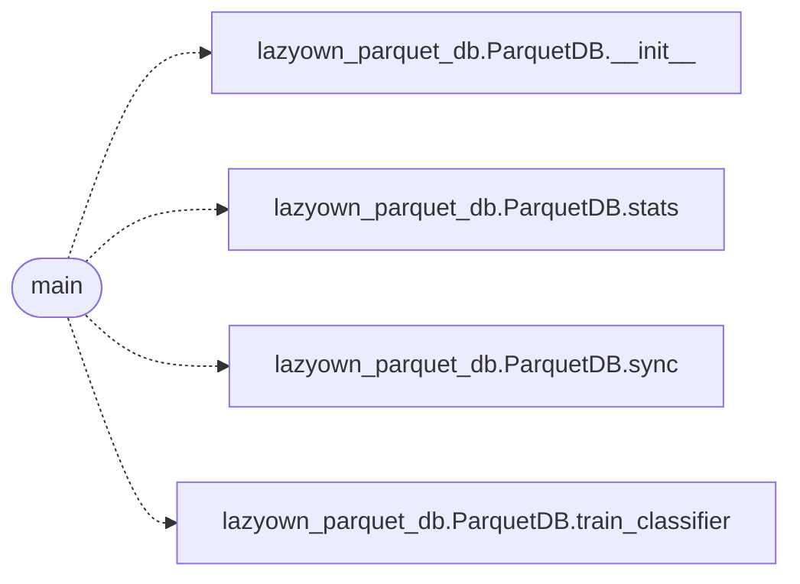

# `skills.update_knowledge`

> Source: [skills/update_knowledge.py:1](../../skills/update_knowledge.py#L1) | language `py` | coverage 50.0% | [API index](../index.md)

LazyOwn Knowledge Refresh ========================== Refreshes the session_knowledge.parquet from the current CSV and optionally trains the sklearn classifier.

Usage:
    python3 skills/update_knowledge.py [--train] [--min-rows N]

Suitable for cron / post-op automation:
    0 * * * * python3 $(dirname "$0")/update_knowledge.py --train 2>&1

## Contents

- **Functions:** [`main`](#main)
- **Constants:** [`SKILLS_DIR`](#skills_dir), [`LAZYOWN_DIR`](#lazyown_dir), [`BASE_DIR`](#base_dir)

## Call Graph

Solid arrows stay in this module, dashed arrows leave it.



## Functions

<a id="main"></a>

### `main`

`function` | [skills/update_knowledge.py:40](../../skills/update_knowledge.py#L40)

```python
def main(argv: list[str] | None = None) -> int
```

**Parameters**

| Name | Type | Default | Description |
|---|---|---|---|
| `argv` | `list[str] \| None` | `None` |  |

**Returns:** `int`

*Calls:* [`ParquetDB.__init__`](skills.lazyown_parquet_db.py.md#parquetdb-__init__), [`ParquetDB.stats`](skills.lazyown_parquet_db.py.md#parquetdb-stats), [`ParquetDB.sync`](skills.lazyown_parquet_db.py.md#parquetdb-sync), [`ParquetDB.train_classifier`](skills.lazyown_parquet_db.py.md#parquetdb-train_classifier)

---

## Constants

<a id="skills_dir"></a>

### `SKILLS_DIR`

`constant` | [skills/update_knowledge.py:31](../../skills/update_knowledge.py#L31)

```python
SKILLS_DIR = Path(__file__).parent
```

---

<a id="lazyown_dir"></a>

### `LAZYOWN_DIR`

`constant` | [skills/update_knowledge.py:32](../../skills/update_knowledge.py#L32)

```python
LAZYOWN_DIR = SKILLS_DIR.parent
```

---

<a id="base_dir"></a>

### `BASE_DIR`

`constant` | [skills/update_knowledge.py:33](../../skills/update_knowledge.py#L33)

```python
BASE_DIR = LAZYOWN_DIR
```

---
