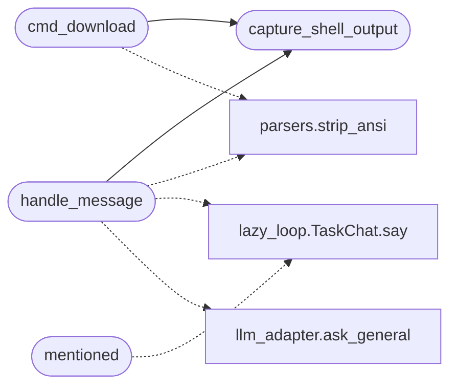

# `slack_c2_bot`

> Source: [slack_c2_bot.py:1](../../slack_c2_bot.py#L1) | language `py` | coverage 5.9% | [API index](../index.md)

slack_c2_bot_socket.py

## Contents

- **Classes:** [`SecureSessionManager`](#securesessionmanager)
- **Functions:** [`capture_shell_output`](#capture_shell_output), [`handle_message`](#handle_message), [`cmd_addcli`](#cmd_addcli), [`cmd_clients`](#cmd_clients), [`cmd_download`](#cmd_download), [`handle_file`](#handle_file), [`mentioned`](#mentioned)
- **Constants:** [`SLACK_BOT_TOKEN`](#slack_bot_token), [`SLACK_APP_TOKEN`](#slack_app_token), [`SLACK_SIGNING_SECRET`](#slack_signing_secret), [`ENTABLEIA`](#entableia)

## Call Graph

Solid arrows stay in this module, dashed arrows leave it.



## Classes

<a id="securesessionmanager"></a>

### `SecureSessionManager`

`class` | [slack_c2_bot.py:28](../../slack_c2_bot.py#L28)

```python
class SecureSessionManager
```

**Members**

| Member | Kind | Summary |
|---|---|---|
| [`__init__`](#securesessionmanager-__init__) | constructor |  |
| [`register_failed_attempt`](#securesessionmanager-register_failed_attempt) | method |  |
| [`check_lockout`](#securesessionmanager-check_lockout) | method |  |
| [`check_rate_limit`](#securesessionmanager-check_rate_limit) | method |  |
| [`create_session`](#securesessionmanager-create_session) | method |  |
| [`validate_session`](#securesessionmanager-validate_session) | method |  |
| [`set_client`](#securesessionmanager-set_client) | method |  |
| [`get_client`](#securesessionmanager-get_client) | method |  |

<a id="securesessionmanager-__init__"></a>

#### `SecureSessionManager.__init__`

`constructor` | [slack_c2_bot.py:29](../../slack_c2_bot.py#L29)

```python
def __init__(self)
```

<a id="securesessionmanager-register_failed_attempt"></a>

#### `SecureSessionManager.register_failed_attempt`

`method` | [slack_c2_bot.py:34](../../slack_c2_bot.py#L34)

```python
def register_failed_attempt(self, user_id: str)
```

**Parameters**

| Name | Type | Default | Description |
|---|---|---|---|
| `user_id` | `str` |  |  |

<a id="securesessionmanager-check_lockout"></a>

#### `SecureSessionManager.check_lockout`

`method` | [slack_c2_bot.py:42](../../slack_c2_bot.py#L42)

```python
def check_lockout(self, user_id: str) -> bool
```

**Parameters**

| Name | Type | Default | Description |
|---|---|---|---|
| `user_id` | `str` |  |  |

**Returns:** `bool`

<a id="securesessionmanager-check_rate_limit"></a>

#### `SecureSessionManager.check_rate_limit`

`method` | [slack_c2_bot.py:52](../../slack_c2_bot.py#L52)

```python
def check_rate_limit(self, user_id: str) -> bool
```

**Parameters**

| Name | Type | Default | Description |
|---|---|---|---|
| `user_id` | `str` |  |  |

**Returns:** `bool`

<a id="securesessionmanager-create_session"></a>

#### `SecureSessionManager.create_session`

`method` | [slack_c2_bot.py:63](../../slack_c2_bot.py#L63)

```python
def create_session(self, user_id: str)
```

**Parameters**

| Name | Type | Default | Description |
|---|---|---|---|
| `user_id` | `str` |  |  |

<a id="securesessionmanager-validate_session"></a>

#### `SecureSessionManager.validate_session`

`method` | [slack_c2_bot.py:71](../../slack_c2_bot.py#L71)

```python
def validate_session(self, user_id: str) -> bool
```

**Parameters**

| Name | Type | Default | Description |
|---|---|---|---|
| `user_id` | `str` |  |  |

**Returns:** `bool`

<a id="securesessionmanager-set_client"></a>

#### `SecureSessionManager.set_client`

`method` | [slack_c2_bot.py:81](../../slack_c2_bot.py#L81)

```python
def set_client(self, user_id: str, client_id: str)
```

**Parameters**

| Name | Type | Default | Description |
|---|---|---|---|
| `user_id` | `str` |  |  |
| `client_id` | `str` |  |  |

<a id="securesessionmanager-get_client"></a>

#### `SecureSessionManager.get_client`

`method` | [slack_c2_bot.py:85](../../slack_c2_bot.py#L85)

```python
def get_client(self, user_id: str) -> str
```

**Parameters**

| Name | Type | Default | Description |
|---|---|---|---|
| `user_id` | `str` |  |  |

**Returns:** `str`

---

## Functions

<a id="capture_shell_output"></a>

### `capture_shell_output`

`function` | [slack_c2_bot.py:95](../../slack_c2_bot.py#L95)

```python
def capture_shell_output(cmd: str) -> str
```

**Parameters**

| Name | Type | Default | Description |
|---|---|---|---|
| `cmd` | `str` |  |  |

**Returns:** `str`

*Called by:* [`cmd_download`](#cmd_download), [`handle_message`](#handle_message)

---

<a id="handle_message"></a>

### `handle_message`

`function` | [slack_c2_bot.py:113](../../slack_c2_bot.py#L113)

Decorators: `@app.event('message')`

```python
def handle_message(event, say, logger)
```

**Parameters**

| Name | Type | Default | Description |
|---|---|---|---|
| `event` |  |  |  |
| `say` |  |  |  |
| `logger` |  |  |  |

*Calls:* [`strip_ansi`](core.parsers.py.md#strip_ansi), [`TaskChat.say`](modules.lazy_loop.py.md#taskchat-say), [`ask_general`](modules.llm_adapter.py.md#ask_general), [`capture_shell_output`](#capture_shell_output)

---

<a id="cmd_addcli"></a>

### `cmd_addcli`

`function` | [slack_c2_bot.py:177](../../slack_c2_bot.py#L177)

Decorators: `@app.command('/addcli')`

```python
def cmd_addcli(ack, respond, command)
```

**Parameters**

| Name | Type | Default | Description |
|---|---|---|---|
| `ack` |  |  |  |
| `respond` |  |  |  |
| `command` |  |  |  |

---

<a id="cmd_clients"></a>

### `cmd_clients`

`function` | [slack_c2_bot.py:195](../../slack_c2_bot.py#L195)

Decorators: `@app.command('/clients')`

```python
def cmd_clients(ack, respond, command)
```

**Parameters**

| Name | Type | Default | Description |
|---|---|---|---|
| `ack` |  |  |  |
| `respond` |  |  |  |
| `command` |  |  |  |

---

<a id="cmd_download"></a>

### `cmd_download`

`function` | [slack_c2_bot.py:209](../../slack_c2_bot.py#L209)

Decorators: `@app.command('/download_c2')`

```python
def cmd_download(ack, respond, command)
```

**Parameters**

| Name | Type | Default | Description |
|---|---|---|---|
| `ack` |  |  |  |
| `respond` |  |  |  |
| `command` |  |  |  |

*Calls:* [`strip_ansi`](core.parsers.py.md#strip_ansi), [`capture_shell_output`](#capture_shell_output)

---

<a id="handle_file"></a>

### `handle_file`

`function` | [slack_c2_bot.py:240](../../slack_c2_bot.py#L240)

Decorators: `@app.event('file_shared')`

```python
def handle_file(event, say, logger)
```

**Parameters**

| Name | Type | Default | Description |
|---|---|---|---|
| `event` |  |  |  |
| `say` |  |  |  |
| `logger` |  |  |  |

---

<a id="mentioned"></a>

### `mentioned`

`function` | [slack_c2_bot.py:252](../../slack_c2_bot.py#L252)

Decorators: `@app.event('app_mention')`

```python
def mentioned(ack, say, event)
```

**Parameters**

| Name | Type | Default | Description |
|---|---|---|---|
| `ack` |  |  |  |
| `say` |  |  |  |
| `event` |  |  |  |

*Calls:* [`TaskChat.say`](modules.lazy_loop.py.md#taskchat-say)

---

## Constants

<a id="slack_bot_token"></a>

### `SLACK_BOT_TOKEN`

`constant` | [slack_c2_bot.py:16](../../slack_c2_bot.py#L16)

```python
SLACK_BOT_TOKEN = config.slack_bot_token or ''
```

---

<a id="slack_app_token"></a>

### `SLACK_APP_TOKEN`

`constant` | [slack_c2_bot.py:17](../../slack_c2_bot.py#L17)

```python
SLACK_APP_TOKEN = config.slack_app_token or ''
```

---

<a id="slack_signing_secret"></a>

### `SLACK_SIGNING_SECRET`

`constant` | [slack_c2_bot.py:18](../../slack_c2_bot.py#L18)

```python
SLACK_SIGNING_SECRET = config.slack_signing_secret or ''
```

---

<a id="entableia"></a>

### `ENTABLEIA`

`constant` | [slack_c2_bot.py:21](../../slack_c2_bot.py#L21)

```python
ENTABLEIA = config.enable_ia
```

---
