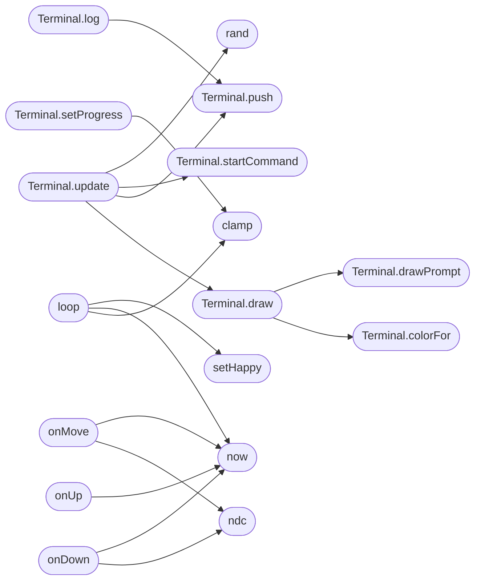

# `static/hexabot/hexabot-spinner.js`

> Source: [static/hexabot/hexabot-spinner.js:1](../../static/hexabot/hexabot-spinner.js#L1) | language `js` | coverage 0.0% | [API index](../index.md)

## Contents

- **Classes:** [`Terminal`](#terminal)
- **Functions:** [`rand`](#rand), [`clamp`](#clamp), [`radialTexture`](#radialtexture), [`createHexabotSpinner`](#createhexabotspinner), [`setHappy`](#sethappy), [`ndc`](#ndc), [`now`](#now), [`onDown`](#ondown), [`onMove`](#onmove), [`onUp`](#onup), [`resize`](#resize), [`loop`](#loop)

## Call Graph

Solid arrows stay in this module, dashed arrows leave it.



## Classes

<a id="terminal"></a>

### `Terminal`

`class` | [static/hexabot/hexabot-spinner.js:49](../../static/hexabot/hexabot-spinner.js#L49)

```javascript
class Terminal
```

**Members**

| Member | Kind | Summary |
|---|---|---|
| [`constructor`](#terminal-constructor) | method |  |
| [`push`](#terminal-push) | method |  |
| [`log`](#terminal-log) | method |  |
| [`run`](#terminal-run) | method |  |
| [`setProgress`](#terminal-setprogress) | method |  |
| [`startCommand`](#terminal-startcommand) | method |  |
| [`update`](#terminal-update) | method |  |
| [`colorFor`](#terminal-colorfor) | method |  |
| [`drawPrompt`](#terminal-drawprompt) | method |  |
| [`draw`](#terminal-draw) | method |  |
| [`dispose`](#terminal-dispose) | method |  |

<a id="terminal-constructor"></a>

#### `Terminal.constructor`

`method` | [static/hexabot/hexabot-spinner.js:50](../../static/hexabot/hexabot-spinner.js#L50)

```javascript
constructor({ commands, autoScript = true, user = 'hexabot', host = 'solarpunk' })
```

**Parameters**

| Name | Type | Default | Description |
|---|---|---|---|
| `autoScript` | `{ commands,` | `true, user = 'hexabot', host = 'solarpunk' }` |  |

*Called by:* [`Ct.G.I.J.L.M.N.N.Ot.Q.R.S.S.St.T.X.Y.Z.a.b.c.c.d.et.extends.extends.extends.extends.extends.extends.extends.extends.extends.extends.extends.f.g.h.h.h.i.i.i.i.i.j.jt.k.k.m.m.n.o.o.o.o.ot.qt.rt.s.s.t.t.t.t.t.tt.u.u.w`](static.js.quill-2.0.3.js.md#ct-g-i-j-l-m-n-n-ot-q-r-s-s-st-t-x-y-z-a-b-c-c-d-et-extends-extends-extends-extends-extends-extends-extends-extends-extends-extends-extends-f-g-h-h-h-i-i-i-i-i-j-jt-k-k-m-m-n-o-o-o-o-ot-qt-rt-s-s-t-t-t-t-t-tt-u-u-w), [`P.S.a.a.a.c.c.c.c.d.d.e.extends.extends.extends.extends.extends.extends.extends.extends.extends.extends.extends.extends.extends.extends.extends.h.i.i.i.k.l.l.n.n.n.n.n.n.o.o.o.o.r.r.s.s.t`](static.js.xterm.js.md#p-s-a-a-a-c-c-c-c-d-d-e-extends-extends-extends-extends-extends-extends-extends-extends-extends-extends-extends-extends-extends-extends-extends-h-i-i-i-k-l-l-n-n-n-n-n-n-o-o-o-o-r-r-s-s-t)

<a id="terminal-push"></a>

#### `Terminal.push`

`method` | [static/hexabot/hexabot-spinner.js:84](../../static/hexabot/hexabot-spinner.js#L84)

```javascript
push(text, color)
```

**Parameters**

| Name | Type | Default | Description |
|---|---|---|---|
| `text` |  |  |  |
| `color` |  |  |  |

*Called by:* [`Terminal.log`](#terminal-log), [`Terminal.update`](#terminal-update)

<a id="terminal-log"></a>

#### `Terminal.log`

`method` | [static/hexabot/hexabot-spinner.js:92](../../static/hexabot/hexabot-spinner.js#L92)

```javascript
log(text) { String(text).split('\n').forEach((l) => this.push(l, null)); }
```

**Parameters**

| Name | Type | Default | Description |
|---|---|---|---|
| `text` |  |  |  |

*Calls:* [`Terminal.push`](#terminal-push)

<a id="terminal-run"></a>

#### `Terminal.run`

`method` | [static/hexabot/hexabot-spinner.js:94](../../static/hexabot/hexabot-spinner.js#L94)

```javascript
run(cmd, out = []) { this.userQueue.push({ cmd, out }); }
```

**Parameters**

| Name | Type | Default | Description |
|---|---|---|---|
| `cmd` |  |  |  |
| `out` |  | `[]` |  |

<a id="terminal-setprogress"></a>

#### `Terminal.setProgress`

`method` | [static/hexabot/hexabot-spinner.js:96](../../static/hexabot/hexabot-spinner.js#L96)

```javascript
setProgress(p, label)
```

**Parameters**

| Name | Type | Default | Description |
|---|---|---|---|
| `p` |  |  |  |
| `label` |  |  |  |

*Calls:* [`clamp`](#clamp)

<a id="terminal-startcommand"></a>

#### `Terminal.startCommand`

`method` | [static/hexabot/hexabot-spinner.js:102](../../static/hexabot/hexabot-spinner.js#L102)

```javascript
startCommand(item)
```

**Parameters**

| Name | Type | Default | Description |
|---|---|---|---|
| `item` |  |  |  |

*Called by:* [`Terminal.update`](#terminal-update)

<a id="terminal-update"></a>

#### `Terminal.update`

`method` | [static/hexabot/hexabot-spinner.js:107](../../static/hexabot/hexabot-spinner.js#L107)

```javascript
update(dt)
```

**Parameters**

| Name | Type | Default | Description |
|---|---|---|---|
| `dt` |  |  |  |

*Calls:* [`Terminal.draw`](#terminal-draw), [`Terminal.push`](#terminal-push), [`Terminal.startCommand`](#terminal-startcommand), [`rand`](#rand)

<a id="terminal-colorfor"></a>

#### `Terminal.colorFor`

`method` | [static/hexabot/hexabot-spinner.js:139](../../static/hexabot/hexabot-spinner.js#L139)

```javascript
colorFor(text)
```

**Parameters**

| Name | Type | Default | Description |
|---|---|---|---|
| `text` |  |  |  |

*Called by:* [`Terminal.draw`](#terminal-draw)

<a id="terminal-drawprompt"></a>

#### `Terminal.drawPrompt`

`method` | [static/hexabot/hexabot-spinner.js:146](../../static/hexabot/hexabot-spinner.js#L146)

```javascript
drawPrompt(ctx, x, y, text, cursor)
```

**Parameters**

| Name | Type | Default | Description |
|---|---|---|---|
| `ctx` |  |  |  |
| `x` |  |  |  |
| `y` |  |  |  |
| `text` |  |  |  |
| `cursor` |  |  |  |

*Called by:* [`Terminal.draw`](#terminal-draw)

<a id="terminal-draw"></a>

#### `Terminal.draw`

`method` | [static/hexabot/hexabot-spinner.js:152](../../static/hexabot/hexabot-spinner.js#L152)

```javascript
draw()
```

*Calls:* [`Terminal.colorFor`](#terminal-colorfor), [`Terminal.drawPrompt`](#terminal-drawprompt)

*Called by:* [`Terminal.update`](#terminal-update)

<a id="terminal-dispose"></a>

#### `Terminal.dispose`

`method` | [static/hexabot/hexabot-spinner.js:206](../../static/hexabot/hexabot-spinner.js#L206)

```javascript
dispose() { this.texture.dispose(); }
```

*Called by:* [`P.S.a.a.a.c.c.c.c.d.d.e.extends.extends.extends.extends.extends.extends.extends.extends.extends.extends.extends.extends.extends.extends.extends.h.i.i.i.k.l.l.n.n.n.n.n.n.o.o.o.o.r.r.s.s.t`](static.js.xterm.js.md#p-s-a-a-a-c-c-c-c-d-d-e-extends-extends-extends-extends-extends-extends-extends-extends-extends-extends-extends-extends-extends-extends-extends-h-i-i-i-k-l-l-n-n-n-n-n-n-o-o-o-o-r-r-s-s-t)

---

## Functions

<a id="rand"></a>

### `rand`

`function` `const` | [static/hexabot/hexabot-spinner.js:46](../../static/hexabot/hexabot-spinner.js#L46)

```javascript
const rand = (a, b) => a + Math.random() * (b - a);
```

**Parameters**

| Name | Type | Default | Description |
|---|---|---|---|
| `a` |  |  |  |
| `b` |  |  |  |

*Called by:* [`generate_random_string`](modules.rootkit.mr.c.md#generate_random_string), [`Terminal.update`](#terminal-update)

---

<a id="clamp"></a>

### `clamp`

`function` `const` | [static/hexabot/hexabot-spinner.js:47](../../static/hexabot/hexabot-spinner.js#L47)

```javascript
const clamp = (v, a, b) => Math.min(b, Math.max(a, v));
```

**Parameters**

| Name | Type | Default | Description |
|---|---|---|---|
| `v` |  |  |  |
| `a` |  |  |  |
| `b` |  |  |  |

*Called by:* [`Terminal.setProgress`](#terminal-setprogress), [`loop`](#loop)

---

<a id="radialtexture"></a>

### `radialTexture`

`function` | [static/hexabot/hexabot-spinner.js:209](../../static/hexabot/hexabot-spinner.js#L209)

```javascript
function radialTexture(inner, outer)
```

**Parameters**

| Name | Type | Default | Description |
|---|---|---|---|
| `inner` |  |  |  |
| `outer` |  |  |  |

---

<a id="createhexabotspinner"></a>

### `createHexabotSpinner`

`function` | [static/hexabot/hexabot-spinner.js:223](../../static/hexabot/hexabot-spinner.js#L223)

```javascript
export function createHexabotSpinner(container, opts = {})
```

**Parameters**

| Name | Type | Default | Description |
|---|---|---|---|
| `container` |  |  |  |
| `opts` |  | `{}` |  |

---

<a id="sethappy"></a>

### `setHappy`

`function` `const` | [static/hexabot/hexabot-spinner.js:365](../../static/hexabot/hexabot-spinner.js#L365)

```javascript
const setHappy = (on) =>
```

**Parameters**

| Name | Type | Default | Description |
|---|---|---|---|
| `on` |  |  |  |

*Called by:* [`loop`](#loop)

---

<a id="ndc"></a>

### `ndc`

`function` `const` | [static/hexabot/hexabot-spinner.js:371](../../static/hexabot/hexabot-spinner.js#L371)

```javascript
const ndc = (e) =>
```

**Parameters**

| Name | Type | Default | Description |
|---|---|---|---|
| `e` |  |  |  |

*Called by:* [`onDown`](#ondown), [`onMove`](#onmove)

---

<a id="now"></a>

### `now`

`function` `const` | [static/hexabot/hexabot-spinner.js:375](../../static/hexabot/hexabot-spinner.js#L375)

```javascript
const now = () => performance.now() / 1000;
```

*Called by:* [`loop`](#loop), [`onDown`](#ondown), [`onMove`](#onmove), [`onUp`](#onup)

---

<a id="ondown"></a>

### `onDown`

`function` `const` | [static/hexabot/hexabot-spinner.js:377](../../static/hexabot/hexabot-spinner.js#L377)

```javascript
const onDown = (e) =>
```

**Parameters**

| Name | Type | Default | Description |
|---|---|---|---|
| `e` |  |  |  |

*Calls:* [`ndc`](#ndc), [`now`](#now)

---

<a id="onmove"></a>

### `onMove`

`function` `const` | [static/hexabot/hexabot-spinner.js:395](../../static/hexabot/hexabot-spinner.js#L395)

```javascript
const onMove = (e) =>
```

**Parameters**

| Name | Type | Default | Description |
|---|---|---|---|
| `e` |  |  |  |

*Calls:* [`ndc`](#ndc), [`now`](#now)

---

<a id="onup"></a>

### `onUp`

`function` `const` | [static/hexabot/hexabot-spinner.js:407](../../static/hexabot/hexabot-spinner.js#L407)

```javascript
const onUp = (e) =>
```

**Parameters**

| Name | Type | Default | Description |
|---|---|---|---|
| `e` |  |  |  |

*Calls:* [`now`](#now)

---

<a id="resize"></a>

### `resize`

`function` `const` | [static/hexabot/hexabot-spinner.js:423](../../static/hexabot/hexabot-spinner.js#L423)

```javascript
const resize = () =>
```

---

<a id="loop"></a>

### `loop`

`function` `const` | [static/hexabot/hexabot-spinner.js:439](../../static/hexabot/hexabot-spinner.js#L439)

```javascript
const loop = () =>
```

*Calls:* [`clamp`](#clamp), [`now`](#now), [`setHappy`](#sethappy)

---
