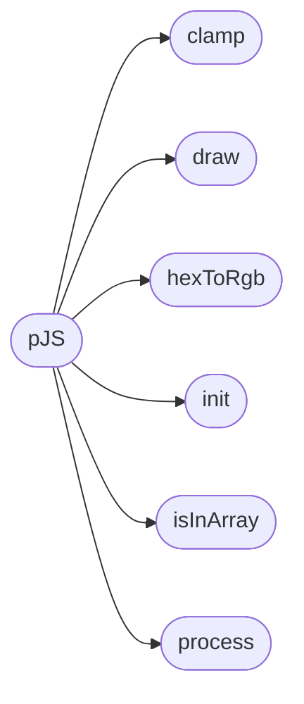

# `static/js/particles.js`

> Source: [static/js/particles.js:1](../../static/js/particles.js#L1) | language `js` | coverage 8.3% | [API index](../index.md)

----------------------------------------------- Author : Vincent Garreau  - vincentgarreau.com MIT license: http://opensource.org/licenses/MIT Demo / Generator : vincentgarreau.com/particles.js GitHub : github.com/VincentGarreau/particles.js How to use? : Check the GitHub README v2.0.0 -----------------------------------------------

## Contents

- **Functions:** [`pJS`](#pjs), [`draw`](#draw), [`d`](#d), [`init`](#init), [`process`](#process), [`process`](#process), [`interiorAngleDegrees`](#interiorangledegrees), [`hexToRgb`](#hextorgb), [`clamp`](#clamp), [`isInArray`](#isinarray)
- **Other Members:** [`setTimeout`](#settimeout)

## Call Graph

Solid arrows stay in this module, dashed arrows leave it.



## Functions

<a id="pjs"></a>

### `pJS`

`function` | [static/js/particles.js:10](../../static/js/particles.js#L10)

```javascript
var pJS = function(tag_id, params)
```

**Parameters**

| Name | Type | Default | Description |
|---|---|---|---|
| `tag_id` |  |  |  |
| `params` |  |  |  |

*Calls:* [`clamp`](#clamp), [`draw`](#draw), [`hexToRgb`](#hextorgb), [`init`](#init), [`isInArray`](#isinarray), [`process`](#process)

---

<a id="draw"></a>

### `draw`

`function` | [static/js/particles.js:463](../../static/js/particles.js#L463)

```javascript
function draw()
```

*Called by:* [`pJS`](#pjs)

---

<a id="d"></a>

### `d`

`function` | [static/js/particles.js:513](../../static/js/particles.js#L513)

```javascript
// var d = ( dx = pJS.interactivity.mouse.click_pos_x - p.x ) * dx + ( dy = pJS.interactivity.mouse.click_pos_y - p.y ) * dy;
```

**Parameters**

| Name | Type | Default | Description |
|---|---|---|---|
| `dx` |  | `pJS.interactivity.mouse.click_pos_x - p.x` |  |

**Returns:** `//`

---

<a id="init"></a>

### `init`

`function` | [static/js/particles.js:799](../../static/js/particles.js#L799)

```javascript
function init()
```

*Called by:* [`pJS`](#pjs)

---

<a id="process"></a>

### `process`

`function` | [static/js/particles.js:881](../../static/js/particles.js#L881)

```javascript
function process(bubble_param, particles_param, p_obj_bubble, p_obj, id)
```

**Parameters**

| Name | Type | Default | Description |
|---|---|---|---|
| `bubble_param` |  |  |  |
| `particles_param` |  |  |  |
| `p_obj_bubble` |  |  |  |
| `p_obj` |  |  |  |
| `id` |  |  |  |

*Called by:* [`pJS`](#pjs)

---

<a id="process"></a>

### `process`

`function` | [static/js/particles.js:972](../../static/js/particles.js#L972)

```javascript
function process()
```

---

<a id="interiorangledegrees"></a>

### `interiorAngleDegrees`

`function` | [static/js/particles.js:1248](../../static/js/particles.js#L1248)

```javascript
var interiorAngleDegrees = (180 * (decimalSides - 2)) / decimalSides;
```

**Parameters**

| Name | Type | Default | Description |
|---|---|---|---|
| `decimalSides` |  |  |  |

---

<a id="hextorgb"></a>

### `hexToRgb`

`function` | [static/js/particles.js:1449](../../static/js/particles.js#L1449)

```javascript
function hexToRgb(hex)
```

**Parameters**

| Name | Type | Default | Description |
|---|---|---|---|
| `hex` |  |  |  |

*Called by:* [`pJS`](#pjs)

---

<a id="clamp"></a>

### `clamp`

`function` | [static/js/particles.js:1464](../../static/js/particles.js#L1464)

```javascript
function clamp(number, min, max)
```

**Parameters**

| Name | Type | Default | Description |
|---|---|---|---|
| `number` |  |  |  |
| `min` |  |  |  |
| `max` |  |  |  |

*Called by:* [`pJS`](#pjs)

---

<a id="isinarray"></a>

### `isInArray`

`function` | [static/js/particles.js:1468](../../static/js/particles.js#L1468)

```javascript
function isInArray(value, array)
```

**Parameters**

| Name | Type | Default | Description |
|---|---|---|---|
| `value` |  |  |  |
| `array` |  |  |  |

*Called by:* [`pJS`](#pjs)

---

## Other Members

<a id="settimeout"></a>

### `setTimeout`

`method` | [static/js/particles.js:1148](../../static/js/particles.js#L1148)

```javascript
setTimeout(function()
```

**Parameters**

| Name | Type | Default | Description |
|---|---|---|---|
| `function` |  |  |  |

---
