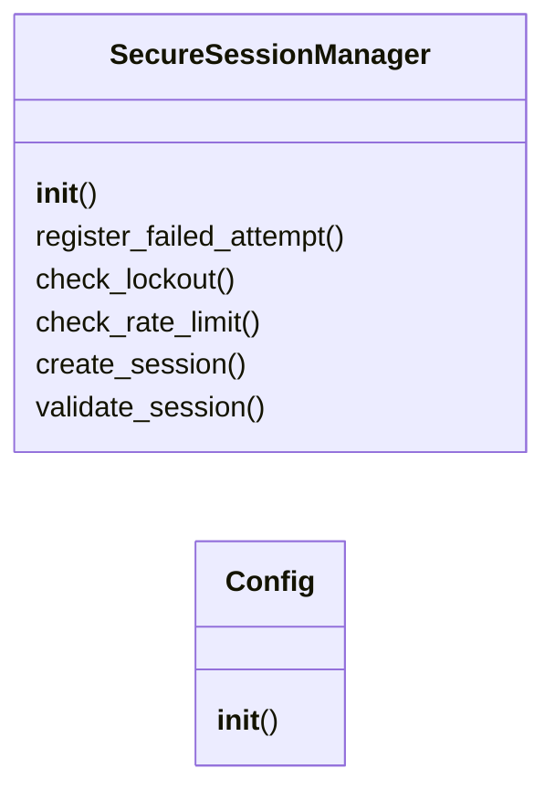
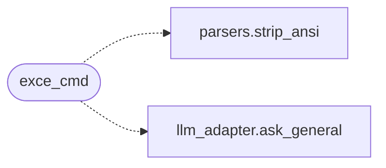

# `telegram_c2`

> Source: [telegram_c2.py:1](../../telegram_c2.py#L1) | language `py` | coverage 5.6% | [API index](../index.md)

## Contents

- **Classes:** [`SecureSessionManager`](#securesessionmanager), [`Config`](#config)
- **Functions:** [`load_payload`](#load_payload), [`start`](#start), [`exce_cmd`](#exce_cmd), [`add_cli`](#add_cli), [`handle_file`](#handle_file), [`download_c2`](#download_c2), [`send_connected_clients`](#send_connected_clients), [`main`](#main)
- **Constants:** [`ENTABLEIA`](#entableia), [`SESSION_TIMEOUT`](#session_timeout), [`MAX_FAILED_ATTEMPTS`](#max_failed_attempts), [`RATE_LIMIT`](#rate_limit), [`FLASK_API_URL`](#flask_api_url)

## Type Diagram



## Call Graph

Solid arrows stay in this module, dashed arrows leave it.



## Classes

<a id="securesessionmanager"></a>

### `SecureSessionManager`

`class` | [telegram_c2.py:18](../../telegram_c2.py#L18)

```python
class SecureSessionManager
```

**Members**

| Member | Kind | Summary |
|---|---|---|
| [`__init__`](#securesessionmanager-__init__) | constructor |  |
| [`register_failed_attempt`](#securesessionmanager-register_failed_attempt) | method |  |
| [`check_lockout`](#securesessionmanager-check_lockout) | method |  |
| [`check_rate_limit`](#securesessionmanager-check_rate_limit) | method |  |
| [`create_session`](#securesessionmanager-create_session) | method |  |
| [`validate_session`](#securesessionmanager-validate_session) | method |  |

<a id="securesessionmanager-__init__"></a>

#### `SecureSessionManager.__init__`

`constructor` | [telegram_c2.py:19](../../telegram_c2.py#L19)

```python
def __init__(self)
```

<a id="securesessionmanager-register_failed_attempt"></a>

#### `SecureSessionManager.register_failed_attempt`

`method` | [telegram_c2.py:24](../../telegram_c2.py#L24)

```python
def register_failed_attempt(self, user_id: int)
```

**Parameters**

| Name | Type | Default | Description |
|---|---|---|---|
| `user_id` | `int` |  |  |

<a id="securesessionmanager-check_lockout"></a>

#### `SecureSessionManager.check_lockout`

`method` | [telegram_c2.py:31](../../telegram_c2.py#L31)

```python
def check_lockout(self, user_id: int) -> bool
```

**Parameters**

| Name | Type | Default | Description |
|---|---|---|---|
| `user_id` | `int` |  |  |

**Returns:** `bool`

<a id="securesessionmanager-check_rate_limit"></a>

#### `SecureSessionManager.check_rate_limit`

`method` | [telegram_c2.py:40](../../telegram_c2.py#L40)

```python
def check_rate_limit(self, user_id: int) -> bool
```

**Parameters**

| Name | Type | Default | Description |
|---|---|---|---|
| `user_id` | `int` |  |  |

**Returns:** `bool`

<a id="securesessionmanager-create_session"></a>

#### `SecureSessionManager.create_session`

`method` | [telegram_c2.py:53](../../telegram_c2.py#L53)

```python
def create_session(self, user_id: int, client_id: str)
```

**Parameters**

| Name | Type | Default | Description |
|---|---|---|---|
| `user_id` | `int` |  |  |
| `client_id` | `str` |  |  |

<a id="securesessionmanager-validate_session"></a>

#### `SecureSessionManager.validate_session`

`method` | [telegram_c2.py:61](../../telegram_c2.py#L61)

```python
def validate_session(self, user_id: int) -> bool
```

**Parameters**

| Name | Type | Default | Description |
|---|---|---|---|
| `user_id` | `int` |  |  |

**Returns:** `bool`

---

<a id="config"></a>

### `Config`

`class` | [telegram_c2.py:77](../../telegram_c2.py#L77)

```python
class Config
```

**Members**

| Member | Kind | Summary |
|---|---|---|
| [`__init__`](#config-__init__) | constructor |  |

<a id="config-__init__"></a>

#### `Config.__init__`

`constructor` | [telegram_c2.py:78](../../telegram_c2.py#L78)

```python
def __init__(self, config_dict)
```

**Parameters**

| Name | Type | Default | Description |
|---|---|---|---|
| `config_dict` |  |  |  |

---

## Functions

<a id="load_payload"></a>

### `load_payload`

`function` | [telegram_c2.py:87](../../telegram_c2.py#L87)

```python
def load_payload()
```

---

<a id="start"></a>

### `start`

`function` `async` | [telegram_c2.py:93](../../telegram_c2.py#L93)

```python
async def start(update: Update, context: CallbackContext) -> None
```

**Parameters**

| Name | Type | Default | Description |
|---|---|---|---|
| `update` | `Update` |  |  |
| `context` | `CallbackContext` |  |  |

---

<a id="exce_cmd"></a>

### `exce_cmd`

`function` `async` | [telegram_c2.py:116](../../telegram_c2.py#L116)

```python
async def exce_cmd(update: Update, context: CallbackContext) -> None
```

**Parameters**

| Name | Type | Default | Description |
|---|---|---|---|
| `update` | `Update` |  |  |
| `context` | `CallbackContext` |  |  |

*Calls:* [`strip_ansi`](core.parsers.py.md#strip_ansi), [`ask_general`](modules.llm_adapter.py.md#ask_general)

---

<a id="add_cli"></a>

### `add_cli`

`function` `async` | [telegram_c2.py:191](../../telegram_c2.py#L191)

```python
async def add_cli(update: Update, context: CallbackContext) -> None
```

**Parameters**

| Name | Type | Default | Description |
|---|---|---|---|
| `update` | `Update` |  |  |
| `context` | `CallbackContext` |  |  |

---

<a id="handle_file"></a>

### `handle_file`

`function` `async` | [telegram_c2.py:203](../../telegram_c2.py#L203)

```python
async def handle_file(update: Update, context: CallbackContext) -> None
```

**Parameters**

| Name | Type | Default | Description |
|---|---|---|---|
| `update` | `Update` |  |  |
| `context` | `CallbackContext` |  |  |

---

<a id="download_c2"></a>

### `download_c2`

`function` `async` | [telegram_c2.py:230](../../telegram_c2.py#L230)

```python
async def download_c2(update: Update, context: CallbackContext) -> None
```

Handle the /download_c2 command to download a file from the C2.

update (Update): The Telegram update object.
context (CallbackContext): The context object.

None

**Parameters**

| Name | Type | Default | Description |
|---|---|---|---|
| `update` | `Update` |  |  |
| `context` | `CallbackContext` |  |  |

---

<a id="send_connected_clients"></a>

### `send_connected_clients`

`function` `async` | [telegram_c2.py:271](../../telegram_c2.py#L271)

```python
async def send_connected_clients(update: Update, context: CallbackContext)
```

**Parameters**

| Name | Type | Default | Description |
|---|---|---|---|
| `update` | `Update` |  |  |
| `context` | `CallbackContext` |  |  |

---

<a id="main"></a>

### `main`

`function` `async` | [telegram_c2.py:286](../../telegram_c2.py#L286)

```python
async def main() -> None
```

---

## Constants

<a id="entableia"></a>

### `ENTABLEIA`

`constant` | [telegram_c2.py:305](../../telegram_c2.py#L305)

```python
ENTABLEIA = config.enable_ia
```

---

<a id="session_timeout"></a>

### `SESSION_TIMEOUT`

`constant` | [telegram_c2.py:312](../../telegram_c2.py#L312)

```python
SESSION_TIMEOUT = 1800
```

---

<a id="max_failed_attempts"></a>

### `MAX_FAILED_ATTEMPTS`

`constant` | [telegram_c2.py:313](../../telegram_c2.py#L313)

```python
MAX_FAILED_ATTEMPTS = 3
```

---

<a id="rate_limit"></a>

### `RATE_LIMIT`

`constant` | [telegram_c2.py:314](../../telegram_c2.py#L314)

```python
RATE_LIMIT = 5
```

---

<a id="flask_api_url"></a>

### `FLASK_API_URL`

`constant` | [telegram_c2.py:317](../../telegram_c2.py#L317)

```python
FLASK_API_URL = f'https://{lhost}:{c2_port}/get_connected_clients'
```

---
