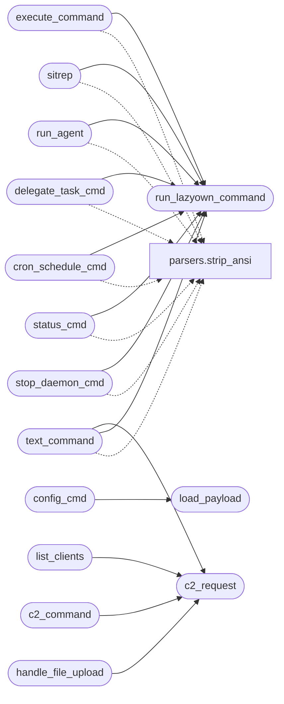

# `telegram_hermes`

> Source: [telegram_hermes.py:1](../../telegram_hermes.py#L1) | language `py` | coverage 10.0% | [API index](../index.md)

telegram_hermes.py LazyOwn Telegram Bot with Hermes Gateway Integration

This bot bridges Telegram to the full LazyOwn framework via the MCP layer
and Hermes gateway for autonomous task execution. It supports:
- Direct LazyOwn shell command execution
- Autonomous agent delegation (Groq/Ollama)
- Cron-scheduled tasks
- C2 beacon interaction
- Cross-platform messaging via Hermes gateway

Usage:
    python3 telegram_hermes.py

Configuration (payload.json keys):
    telegram_token       - Telegram bot token from @BotFather
    c2_pass              - Authentication secret for /start (required,
                           min 16 chars, never a documented default)
    telegram_allowlist   - Optional list of Telegram user ids allowed
                           to authenticate (extra authorization barrier)
    enable_ia            - Enable Groq AI processing (default: false)
    api_key              - Groq API key (if enable_ia is true)
    lhost, c2_port       - C2 server coordinates

## Contents

- **Classes:** [`SecureSessionManager`](#securesessionmanager)
- **Functions:** [`run_lazyown_command`](#run_lazyown_command), [`c2_request`](#c2_request), [`load_payload`](#load_payload), [`start`](#start), [`help_cmd`](#help_cmd), [`execute_command`](#execute_command), [`sitrep`](#sitrep), [`config_cmd`](#config_cmd), [`add_cli`](#add_cli), [`list_clients`](#list_clients), [`c2_command`](#c2_command), [`run_agent`](#run_agent), [`delegate_task_cmd`](#delegate_task_cmd), [`cron_schedule_cmd`](#cron_schedule_cmd), [`status_cmd`](#status_cmd), [`stop_daemon_cmd`](#stop_daemon_cmd), [`download_file_cmd`](#download_file_cmd), [`handle_file_upload`](#handle_file_upload), [`text_command`](#text_command), [`main`](#main)
- **Constants:** [`LAZYOWN_DIR`](#lazyown_dir), [`SESSIONS_DIR`](#sessions_dir), [`PAYLOAD_FILE`](#payload_file), [`SESSION_TIMEOUT`](#session_timeout), [`MAX_FAILED_ATTEMPTS`](#max_failed_attempts), [`RATE_LIMIT`](#rate_limit)

## Call Graph

Solid arrows stay in this module, dashed arrows leave it.



## Classes

<a id="securesessionmanager"></a>

### `SecureSessionManager`

`class` | [telegram_hermes.py:190](../../telegram_hermes.py#L190)

```python
class SecureSessionManager
```

**Members**

| Member | Kind | Summary |
|---|---|---|
| [`__init__`](#securesessionmanager-__init__) | constructor |  |
| [`register_failed_attempt`](#securesessionmanager-register_failed_attempt) | method |  |
| [`check_lockout`](#securesessionmanager-check_lockout) | method |  |
| [`check_rate_limit`](#securesessionmanager-check_rate_limit) | method |  |
| [`create_session`](#securesessionmanager-create_session) | method |  |
| [`validate_session`](#securesessionmanager-validate_session) | method |  |
| [`get_client_id`](#securesessionmanager-get_client_id) | method |  |
| [`set_client_id`](#securesessionmanager-set_client_id) | method |  |

<a id="securesessionmanager-__init__"></a>

#### `SecureSessionManager.__init__`

`constructor` | [telegram_hermes.py:191](../../telegram_hermes.py#L191)

```python
def __init__(self)
```

<a id="securesessionmanager-register_failed_attempt"></a>

#### `SecureSessionManager.register_failed_attempt`

`method` | [telegram_hermes.py:196](../../telegram_hermes.py#L196)

```python
def register_failed_attempt(self, user_id: int)
```

**Parameters**

| Name | Type | Default | Description |
|---|---|---|---|
| `user_id` | `int` |  |  |

<a id="securesessionmanager-check_lockout"></a>

#### `SecureSessionManager.check_lockout`

`method` | [telegram_hermes.py:203](../../telegram_hermes.py#L203)

```python
def check_lockout(self, user_id: int) -> bool
```

**Parameters**

| Name | Type | Default | Description |
|---|---|---|---|
| `user_id` | `int` |  |  |

**Returns:** `bool`

<a id="securesessionmanager-check_rate_limit"></a>

#### `SecureSessionManager.check_rate_limit`

`method` | [telegram_hermes.py:212](../../telegram_hermes.py#L212)

```python
def check_rate_limit(self, user_id: int) -> bool
```

**Parameters**

| Name | Type | Default | Description |
|---|---|---|---|
| `user_id` | `int` |  |  |

**Returns:** `bool`

<a id="securesessionmanager-create_session"></a>

#### `SecureSessionManager.create_session`

`method` | [telegram_hermes.py:225](../../telegram_hermes.py#L225)

```python
def create_session(self, user_id: int, client_id: str | None = None)
```

**Parameters**

| Name | Type | Default | Description |
|---|---|---|---|
| `user_id` | `int` |  |  |
| `client_id` | `str \| None` | `None` |  |

<a id="securesessionmanager-validate_session"></a>

#### `SecureSessionManager.validate_session`

`method` | [telegram_hermes.py:233](../../telegram_hermes.py#L233)

```python
def validate_session(self, user_id: int) -> bool
```

**Parameters**

| Name | Type | Default | Description |
|---|---|---|---|
| `user_id` | `int` |  |  |

**Returns:** `bool`

<a id="securesessionmanager-get_client_id"></a>

#### `SecureSessionManager.get_client_id`

`method` | [telegram_hermes.py:245](../../telegram_hermes.py#L245)

```python
def get_client_id(self, user_id: int) -> str | None
```

**Parameters**

| Name | Type | Default | Description |
|---|---|---|---|
| `user_id` | `int` |  |  |

**Returns:** `str | None`

<a id="securesessionmanager-set_client_id"></a>

#### `SecureSessionManager.set_client_id`

`method` | [telegram_hermes.py:249](../../telegram_hermes.py#L249)

```python
def set_client_id(self, user_id: int, client_id: str)
```

**Parameters**

| Name | Type | Default | Description |
|---|---|---|---|
| `user_id` | `int` |  |  |
| `client_id` | `str` |  |  |

---

## Functions

<a id="run_lazyown_command"></a>

### `run_lazyown_command`

`function` | [telegram_hermes.py:65](../../telegram_hermes.py#L65)

```python
def run_lazyown_command(command: str, timeout: int = 30) -> str
```

Execute one or more LazyOwn shell commands non-interactively via PTY.

Replicates the MCP server's _run_lazyown_command logic.

**Parameters**

| Name | Type | Default | Description |
|---|---|---|---|
| `command` | `str` |  |  |
| `timeout` | `int` | `30` |  |

**Returns:** `str`

*Called by:* [`cron_schedule_cmd`](#cron_schedule_cmd), [`delegate_task_cmd`](#delegate_task_cmd), [`execute_command`](#execute_command), [`run_agent`](#run_agent), [`sitrep`](#sitrep), [`status_cmd`](#status_cmd), [`stop_daemon_cmd`](#stop_daemon_cmd), [`text_command`](#text_command)

---

<a id="c2_request"></a>

### `c2_request`

`function` | [telegram_hermes.py:149](../../telegram_hermes.py#L149)

```python
def c2_request(path: str, method: str = 'GET', body: dict | None = None) -> dict
```

**Parameters**

| Name | Type | Default | Description |
|---|---|---|---|
| `path` | `str` |  |  |
| `method` | `str` | `'GET'` |  |
| `body` | `dict \| None` | `None` |  |

**Returns:** `dict`

*Called by:* [`c2_command`](#c2_command), [`handle_file_upload`](#handle_file_upload), [`list_clients`](#list_clients), [`text_command`](#text_command)

---

<a id="load_payload"></a>

### `load_payload`

`function` | [telegram_hermes.py:181](../../telegram_hermes.py#L181)

```python
def load_payload() -> dict
```

**Returns:** `dict`

*Called by:* [`config_cmd`](#config_cmd)

---

<a id="start"></a>

### `start`

`function` `async` | [telegram_hermes.py:259](../../telegram_hermes.py#L259)

```python
async def start(update: Update, context: CallbackContext) -> None
```

**Parameters**

| Name | Type | Default | Description |
|---|---|---|---|
| `update` | `Update` |  |  |
| `context` | `CallbackContext` |  |  |

---

<a id="help_cmd"></a>

### `help_cmd`

`function` `async` | [telegram_hermes.py:288](../../telegram_hermes.py#L288)

```python
async def help_cmd(update: Update, context: CallbackContext) -> None
```

**Parameters**

| Name | Type | Default | Description |
|---|---|---|---|
| `update` | `Update` |  |  |
| `context` | `CallbackContext` |  |  |

---

<a id="execute_command"></a>

### `execute_command`

`function` `async` | [telegram_hermes.py:316](../../telegram_hermes.py#L316)

```python
async def execute_command(update: Update, context: CallbackContext) -> None
```

**Parameters**

| Name | Type | Default | Description |
|---|---|---|---|
| `update` | `Update` |  |  |
| `context` | `CallbackContext` |  |  |

*Calls:* [`strip_ansi`](core.parsers.py.md#strip_ansi), [`run_lazyown_command`](#run_lazyown_command)

---

<a id="sitrep"></a>

### `sitrep`

`function` `async` | [telegram_hermes.py:347](../../telegram_hermes.py#L347)

```python
async def sitrep(update: Update, context: CallbackContext) -> None
```

**Parameters**

| Name | Type | Default | Description |
|---|---|---|---|
| `update` | `Update` |  |  |
| `context` | `CallbackContext` |  |  |

*Calls:* [`strip_ansi`](core.parsers.py.md#strip_ansi), [`run_lazyown_command`](#run_lazyown_command)

---

<a id="config_cmd"></a>

### `config_cmd`

`function` `async` | [telegram_hermes.py:383](../../telegram_hermes.py#L383)

```python
async def config_cmd(update: Update, context: CallbackContext) -> None
```

**Parameters**

| Name | Type | Default | Description |
|---|---|---|---|
| `update` | `Update` |  |  |
| `context` | `CallbackContext` |  |  |

*Calls:* [`load_payload`](#load_payload)

---

<a id="add_cli"></a>

### `add_cli`

`function` `async` | [telegram_hermes.py:432](../../telegram_hermes.py#L432)

```python
async def add_cli(update: Update, context: CallbackContext) -> None
```

**Parameters**

| Name | Type | Default | Description |
|---|---|---|---|
| `update` | `Update` |  |  |
| `context` | `CallbackContext` |  |  |

---

<a id="list_clients"></a>

### `list_clients`

`function` `async` | [telegram_hermes.py:447](../../telegram_hermes.py#L447)

```python
async def list_clients(update: Update, context: CallbackContext) -> None
```

**Parameters**

| Name | Type | Default | Description |
|---|---|---|---|
| `update` | `Update` |  |  |
| `context` | `CallbackContext` |  |  |

*Calls:* [`c2_request`](#c2_request)

---

<a id="c2_command"></a>

### `c2_command`

`function` `async` | [telegram_hermes.py:474](../../telegram_hermes.py#L474)

```python
async def c2_command(update: Update, context: CallbackContext) -> None
```

**Parameters**

| Name | Type | Default | Description |
|---|---|---|---|
| `update` | `Update` |  |  |
| `context` | `CallbackContext` |  |  |

*Calls:* [`c2_request`](#c2_request)

---

<a id="run_agent"></a>

### `run_agent`

`function` `async` | [telegram_hermes.py:514](../../telegram_hermes.py#L514)

```python
async def run_agent(update: Update, context: CallbackContext) -> None
```

**Parameters**

| Name | Type | Default | Description |
|---|---|---|---|
| `update` | `Update` |  |  |
| `context` | `CallbackContext` |  |  |

*Calls:* [`strip_ansi`](core.parsers.py.md#strip_ansi), [`run_lazyown_command`](#run_lazyown_command)

---

<a id="delegate_task_cmd"></a>

### `delegate_task_cmd`

`function` `async` | [telegram_hermes.py:543](../../telegram_hermes.py#L543)

```python
async def delegate_task_cmd(update: Update, context: CallbackContext) -> None
```

**Parameters**

| Name | Type | Default | Description |
|---|---|---|---|
| `update` | `Update` |  |  |
| `context` | `CallbackContext` |  |  |

*Calls:* [`strip_ansi`](core.parsers.py.md#strip_ansi), [`run_lazyown_command`](#run_lazyown_command)

---

<a id="cron_schedule_cmd"></a>

### `cron_schedule_cmd`

`function` `async` | [telegram_hermes.py:574](../../telegram_hermes.py#L574)

```python
async def cron_schedule_cmd(update: Update, context: CallbackContext) -> None
```

**Parameters**

| Name | Type | Default | Description |
|---|---|---|---|
| `update` | `Update` |  |  |
| `context` | `CallbackContext` |  |  |

*Calls:* [`strip_ansi`](core.parsers.py.md#strip_ansi), [`run_lazyown_command`](#run_lazyown_command)

---

<a id="status_cmd"></a>

### `status_cmd`

`function` `async` | [telegram_hermes.py:607](../../telegram_hermes.py#L607)

```python
async def status_cmd(update: Update, context: CallbackContext) -> None
```

**Parameters**

| Name | Type | Default | Description |
|---|---|---|---|
| `update` | `Update` |  |  |
| `context` | `CallbackContext` |  |  |

*Calls:* [`strip_ansi`](core.parsers.py.md#strip_ansi), [`run_lazyown_command`](#run_lazyown_command)

---

<a id="stop_daemon_cmd"></a>

### `stop_daemon_cmd`

`function` `async` | [telegram_hermes.py:640](../../telegram_hermes.py#L640)

```python
async def stop_daemon_cmd(update: Update, context: CallbackContext) -> None
```

**Parameters**

| Name | Type | Default | Description |
|---|---|---|---|
| `update` | `Update` |  |  |
| `context` | `CallbackContext` |  |  |

*Calls:* [`strip_ansi`](core.parsers.py.md#strip_ansi), [`run_lazyown_command`](#run_lazyown_command)

---

<a id="download_file_cmd"></a>

### `download_file_cmd`

`function` `async` | [telegram_hermes.py:657](../../telegram_hermes.py#L657)

```python
async def download_file_cmd(update: Update, context: CallbackContext) -> None
```

**Parameters**

| Name | Type | Default | Description |
|---|---|---|---|
| `update` | `Update` |  |  |
| `context` | `CallbackContext` |  |  |

---

<a id="handle_file_upload"></a>

### `handle_file_upload`

`function` `async` | [telegram_hermes.py:685](../../telegram_hermes.py#L685)

```python
async def handle_file_upload(update: Update, context: CallbackContext) -> None
```

**Parameters**

| Name | Type | Default | Description |
|---|---|---|---|
| `update` | `Update` |  |  |
| `context` | `CallbackContext` |  |  |

*Calls:* [`c2_request`](#c2_request)

---

<a id="text_command"></a>

### `text_command`

`function` `async` | [telegram_hermes.py:722](../../telegram_hermes.py#L722)

```python
async def text_command(update: Update, context: CallbackContext) -> None
```

Handle any text message as a direct LazyOwn command.

**Parameters**

| Name | Type | Default | Description |
|---|---|---|---|
| `update` | `Update` |  |  |
| `context` | `CallbackContext` |  |  |

*Calls:* [`strip_ansi`](core.parsers.py.md#strip_ansi), [`c2_request`](#c2_request), [`run_lazyown_command`](#run_lazyown_command)

---

<a id="main"></a>

### `main`

`function` `async` | [telegram_hermes.py:782](../../telegram_hermes.py#L782)

```python
async def main() -> None
```

---

## Constants

<a id="lazyown_dir"></a>

### `LAZYOWN_DIR`

`constant` | [telegram_hermes.py:56](../../telegram_hermes.py#L56)

```python
LAZYOWN_DIR = Path(__file__).parent.resolve()
```

---

<a id="sessions_dir"></a>

### `SESSIONS_DIR`

`constant` | [telegram_hermes.py:57](../../telegram_hermes.py#L57)

```python
SESSIONS_DIR = LAZYOWN_DIR / 'sessions'
```

---

<a id="payload_file"></a>

### `PAYLOAD_FILE`

`constant` | [telegram_hermes.py:58](../../telegram_hermes.py#L58)

```python
PAYLOAD_FILE = LAZYOWN_DIR / 'payload.json'
```

---

<a id="session_timeout"></a>

### `SESSION_TIMEOUT`

`constant` | [telegram_hermes.py:864](../../telegram_hermes.py#L864)

```python
SESSION_TIMEOUT = 1800
```

---

<a id="max_failed_attempts"></a>

### `MAX_FAILED_ATTEMPTS`

`constant` | [telegram_hermes.py:865](../../telegram_hermes.py#L865)

```python
MAX_FAILED_ATTEMPTS = 3
```

---

<a id="rate_limit"></a>

### `RATE_LIMIT`

`constant` | [telegram_hermes.py:866](../../telegram_hermes.py#L866)

```python
RATE_LIMIT = 5
```

---
