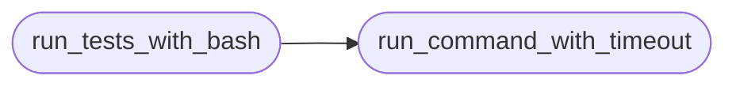

# `testmeneitor`

> Source: [testmeneitor.py:1](../../testmeneitor.py#L1) | language `py` | coverage 0.0% | [API index](../index.md)

## Contents

- **Functions:** [`extract_functions`](#extract_functions), [`run_tests_with_script`](#run_tests_with_script), [`run_command_with_timeout`](#run_command_with_timeout), [`run_tests_with_bash`](#run_tests_with_bash)
- **Constants:** [`EXCLUDED_FUNCTIONS`](#excluded_functions), [`TIMEOUT`](#timeout)

## Call Graph

Solid arrows stay in this module, dashed arrows leave it.



## Functions

<a id="extract_functions"></a>

### `extract_functions`

`function` | [testmeneitor.py:13](../../testmeneitor.py#L13)

```python
def extract_functions(script_path)
```

**Parameters**

| Name | Type | Default | Description |
|---|---|---|---|
| `script_path` |  |  |  |

---

<a id="run_tests_with_script"></a>

### `run_tests_with_script`

`function` | [testmeneitor.py:30](../../testmeneitor.py#L30)

```python
def run_tests_with_script(script_path, functions)
```

**Parameters**

| Name | Type | Default | Description |
|---|---|---|---|
| `script_path` |  |  |  |
| `functions` |  |  |  |

---

<a id="run_command_with_timeout"></a>

### `run_command_with_timeout`

`function` | [testmeneitor.py:54](../../testmeneitor.py#L54)

```python
def run_command_with_timeout(command, timeout)
```

**Parameters**

| Name | Type | Default | Description |
|---|---|---|---|
| `command` |  |  |  |
| `timeout` |  |  |  |

*Called by:* [`run_tests_with_bash`](#run_tests_with_bash)

---

<a id="run_tests_with_bash"></a>

### `run_tests_with_bash`

`function` | [testmeneitor.py:80](../../testmeneitor.py#L80)

```python
def run_tests_with_bash(script_path, functions)
```

**Parameters**

| Name | Type | Default | Description |
|---|---|---|---|
| `script_path` |  |  |  |
| `functions` |  |  |  |

*Calls:* [`run_command_with_timeout`](#run_command_with_timeout)

---

## Constants

<a id="excluded_functions"></a>

### `EXCLUDED_FUNCTIONS`

`constant` | [testmeneitor.py:9](../../testmeneitor.py#L9)

```python
EXCLUDED_FUNCTIONS = {'__init__', 'default', 'one_cmd', 'qa', 'getseclist'}
```

---

<a id="timeout"></a>

### `TIMEOUT`

`constant` | [testmeneitor.py:10](../../testmeneitor.py#L10)

```python
TIMEOUT = 0.1
```

---
