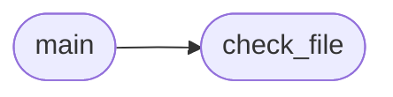

# `tools.contract_check`

> Source: [tools/contract_check.py:1](../../tools/contract_check.py#L1) | language `py` | coverage 100.0% | [API index](../index.md)

Contract conformance checker for single-file LAZY port modules.

Usage:
    python3 /tmp/opencode/contract_check.py modules/intercept.py [files...]

Checks: docstrings on public classes and functions, no absolute
operator paths, presence of a Config class, no emoji bytes.

## Contents

- **Functions:** [`check_file`](#check_file), [`main`](#main)
- **Constants:** [`BANNED_PREFIXES`](#banned_prefixes)

## Call Graph

Solid arrows stay in this module, dashed arrows leave it.



## Functions

<a id="check_file"></a>

### `check_file`

`function` | [tools/contract_check.py:19](../../tools/contract_check.py#L19)

```python
def check_file(path: Path) -> list[str]
```

Validate one module and return human readable violations.

**Parameters**

| Name | Type | Default | Description |
|---|---|---|---|
| `path` | `Path` |  |  |

**Returns:** `list[str]`

*Called by:* [`main`](#main)

---

<a id="main"></a>

### `main`

`function` | [tools/contract_check.py:46](../../tools/contract_check.py#L46)

```python
def main(argv: list[str]) -> int
```

Check each file argument and report violations.

**Parameters**

| Name | Type | Default | Description |
|---|---|---|---|
| `argv` | `list[str]` |  |  |

**Returns:** `int`

*Calls:* [`check_file`](#check_file)

---

## Constants

<a id="banned_prefixes"></a>

### `BANNED_PREFIXES`

`constant` | [tools/contract_check.py:16](../../tools/contract_check.py#L16)

```python
BANNED_PREFIXES = ('/home/', '/Users/', '/root/', 'C:\\', 'C:/')
```

---
