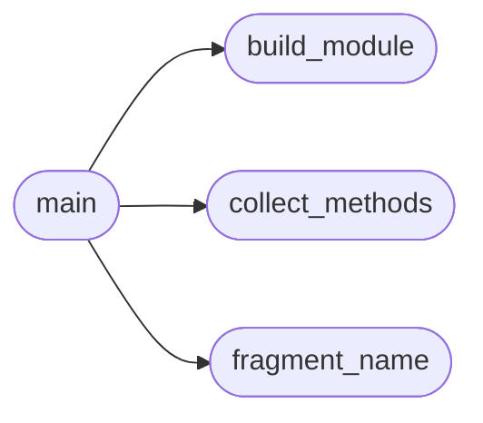

# `tools.extract_cluster`

> Source: [tools/extract_cluster.py:1](../../tools/extract_cluster.py#L1) | language `py` | coverage 100.0% | [API index](../index.md)

Extract a named cluster of do_* methods from a CommandSet module.

Usage:
    python3 tools/extract_cluster.py <source.py> <target.py> <TargetClass>
        <phase> <category> <title> [--extra-imports "line1;line2"] <do_a> [do_b ...]

Copies each method including decorators, verbatim, into a new module
defining a pending `[`PendingCommandSet`](cli.commands._dormancy.py.md#pendingcommandset)` subclass. The emitted module
mirrors the ``*_migrated.py`` runtime contract: a bottom-of-file injector
copies public `[`utils`](utils.py.md)` names into module globals (bare-name references
inside migrated methods resolve through it, since PEP 562
``__getattr__`` does not fire for function-global lookups), plus a
``__getattr__`` fallback for attribute-style access.

Follow the dormancy protocol after generating: verify with a parity
test, delete the originals from the source module, then flip the base
class to `[`LazyOwnCommandSet`](cli.commands._base.py.md#lazyowncommandset)`.

## Contents

- **Functions:** [`fragment_name`](#fragment_name), [`collect_methods`](#collect_methods), [`build_module`](#build_module), [`main`](#main)

## Call Graph

Solid arrows stay in this module, dashed arrows leave it.



## Functions

<a id="fragment_name"></a>

### `fragment_name`

`function` | [tools/extract_cluster.py:29](../../tools/extract_cluster.py#L29)

```python
def fragment_name(fragment: str) -> str
```

Return the function name defined by an extracted source fragment.

**Parameters**

| Name | Type | Default | Description |
|---|---|---|---|
| `fragment` | `str` |  | Raw source text of one decorated method. |

**Returns:** `str` - The ``def`` name declared by the fragment.

*Called by:* [`main`](#main)

---

<a id="collect_methods"></a>

### `collect_methods`

`function` | [tools/extract_cluster.py:41](../../tools/extract_cluster.py#L41)

```python
def collect_methods(source_text: str, wanted: set[str]) -> list[str]
```

Collect verbatim source of wanted methods in class-definition order.

**Parameters**

| Name | Type | Default | Description |
|---|---|---|---|
| `source_text` | `str` |  | Full source of the origin module. |
| `wanted` | `set[str]` |  | Method names to extract. |

**Returns:** `list[str]` - Raw source fragments, decorators included.

*Called by:* [`main`](#main)

---

<a id="build_module"></a>

### `build_module`

`function` | [tools/extract_cluster.py:66](../../tools/extract_cluster.py#L66)

```python
def build_module(target_class: str, phase: str, category: str, title: str, methods: list[str], extra_imports: tuple[str, ...] = ()) -> str
```

Render the new pending CommandSet module source.

**Parameters**

| Name | Type | Default | Description |
|---|---|---|---|
| `target_class` | `str` |  | Name of the generated ``CommandSet`` subclass. |
| `phase` | `str` |  | Kill-chain phase slug for the ``phase`` attribute. |
| `category` | `str` |  | cmd2 help category label. |
| `title` | `str` |  | Short human description used in the docstring. |
| `methods` | `list[str]` |  | Verbatim method fragments in final order. |
| `extra_imports` | `tuple[str, ...]` | `()` | Additional import lines (for underscore-aliased names the `[`utils`](utils.py.md)` injector cannot provide). |

**Returns:** `str` - Complete module source text.

*Called by:* [`main`](#main)

---

<a id="main"></a>

### `main`

`function` | [tools/extract_cluster.py:141](../../tools/extract_cluster.py#L141)

```python
def main() -> int
```

Extract the requested cluster and write the target module.

**Returns:** `int`

*Calls:* [`build_module`](#build_module), [`collect_methods`](#collect_methods), [`fragment_name`](#fragment_name)

---
