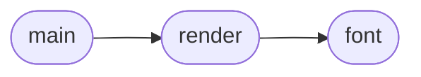

# `tools.gen_demo_gifs`

> Source: [tools/gen_demo_gifs.py:1](../../tools/gen_demo_gifs.py#L1) | language `py` | coverage 100.0% | [API index](../index.md)

Generate LazyOwn demo GIFs without external services.

## Contents

- **Functions:** [`font`](#font), [`render`](#render), [`main`](#main)
- **Constants:** [`BG`](#bg), [`FG`](#fg), [`ACCENT`](#accent), [`DIM`](#dim), [`GOLDEN`](#golden), [`C2`](#c2), [`MCP`](#mcp)

## Call Graph

Solid arrows stay in this module, dashed arrows leave it.



## Functions

<a id="font"></a>

### `font`

`function` | [tools/gen_demo_gifs.py:14](../../tools/gen_demo_gifs.py#L14)

```python
def font(size=20)
```

Resolve a monospace font with stdlib fallback.

**Parameters**

| Name | Type | Default | Description |
|---|---|---|---|
| `size` |  | `20` |  |

*Called by:* [`render`](#render)

---

<a id="render"></a>

### `render`

`function` | [tools/gen_demo_gifs.py:22](../../tools/gen_demo_gifs.py#L22)

```python
def render(lines, path, hold=30)
```

Render terminal line-by-line frames.

**Parameters**

| Name | Type | Default | Description |
|---|---|---|---|
| `lines` |  |  |  |
| `path` |  |  |  |
| `hold` |  | `30` |  |

*Calls:* [`font`](#font)

*Called by:* [`main`](#main), [`main`](tools.gen_demo_gifs_extra.py.md#main)

---

<a id="main"></a>

### `main`

`function` | [tools/gen_demo_gifs.py:70](../../tools/gen_demo_gifs.py#L70)

```python
def main()
```

Render the three core GIFs.

*Calls:* [`render`](#render)

---

## Constants

<a id="bg"></a>

### `BG`

`constant` | [tools/gen_demo_gifs.py:8](../../tools/gen_demo_gifs.py#L8)

```python
BG = (13, 17, 23)
```

---

<a id="fg"></a>

### `FG`

`constant` | [tools/gen_demo_gifs.py:9](../../tools/gen_demo_gifs.py#L9)

```python
FG = (0, 255, 0)
```

---

<a id="accent"></a>

### `ACCENT`

`constant` | [tools/gen_demo_gifs.py:10](../../tools/gen_demo_gifs.py#L10)

```python
ACCENT = (0, 200, 255)
```

---

<a id="dim"></a>

### `DIM`

`constant` | [tools/gen_demo_gifs.py:11](../../tools/gen_demo_gifs.py#L11)

```python
DIM = (140, 140, 140)
```

---

<a id="golden"></a>

### `GOLDEN`

`constant` | [tools/gen_demo_gifs.py:43](../../tools/gen_demo_gifs.py#L43)

```python
GOLDEN
```

---

<a id="c2"></a>

### `C2`

`constant` | [tools/gen_demo_gifs.py:53](../../tools/gen_demo_gifs.py#L53)

```python
C2
```

---

<a id="mcp"></a>

### `MCP`

`constant` | [tools/gen_demo_gifs.py:61](../../tools/gen_demo_gifs.py#L61)

```python
MCP
```

---
