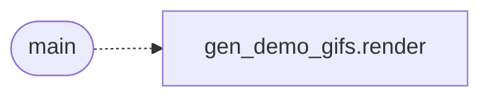

# `tools.gen_demo_gifs_extra`

> Source: [tools/gen_demo_gifs_extra.py:1](../../tools/gen_demo_gifs_extra.py#L1) | language `py` | coverage 100.0% | [API index](../index.md)

Additional LazyOwn demo GIFs.

Every command verified against source.

## Contents

- **Functions:** [`main`](#main)
- **Constants:** [`OUT`](#out)

## Call Graph

Solid arrows stay in this module, dashed arrows leave it.



## Functions

<a id="main"></a>

### `main`

`function` | [tools/gen_demo_gifs_extra.py:49](../../tools/gen_demo_gifs_extra.py#L49)

```python
def main()
```

Render the four extended GIFs.

*Calls:* [`render`](tools.gen_demo_gifs.py.md#render)

---

## Constants

<a id="out"></a>

### `OUT`

`constant` | [tools/gen_demo_gifs_extra.py:9](../../tools/gen_demo_gifs_extra.py#L9)

```python
OUT = 'assets/demo'
```

---
