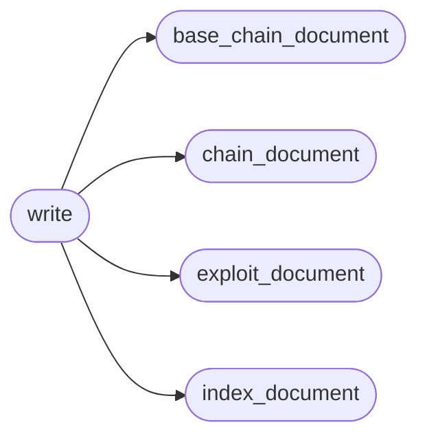

# `tools.generate_metasploitable_gym`

> Source: [tools/generate_metasploitable_gym.py:1](../../tools/generate_metasploitable_gym.py#L1) | language `py` | coverage 100.0% | [API index](../index.md)

Generate the Metasploitable 2 gym catalogue.

The generated YAML is the runtime source of truth: one exploit file per
vector, one chain per vulnerability and one index playbook. This tool
keeps the matrix consistent when a new lab vector is added.

## Contents

- **Functions:** [`exploit_document`](#exploit_document), [`chain_document`](#chain_document), [`base_chain_document`](#base_chain_document), [`index_document`](#index_document), [`write`](#write)
- **Constants:** [`ROOT`](#root), [`EXPLOITS`](#exploits), [`CHAINS`](#chains), [`PLAYBOOKS`](#playbooks), [`BASE_CHAIN`](#base_chain), [`DVWA_LOGIN`](#dvwa_login), [`DVWA_LOGIN_PREFIX`](#dvwa_login_prefix), [`DVWA_CSRF_LOGIN`](#dvwa_csrf_login), [`VULNERABILITIES`](#vulnerabilities)

## Call Graph

Solid arrows stay in this module, dashed arrows leave it.



## Functions

<a id="exploit_document"></a>

### `exploit_document`

`function` | [tools/generate_metasploitable_gym.py:919](../../tools/generate_metasploitable_gym.py#L919)

```python
def exploit_document(item: dict) -> dict
```

Build one exploit YAML document.

**Parameters**

| Name | Type | Default | Description |
|---|---|---|---|
| `item` | `dict` |  |  |

**Returns:** `dict`

*Called by:* [`write`](#write)

---

<a id="chain_document"></a>

### `chain_document`

`function` | [tools/generate_metasploitable_gym.py:942](../../tools/generate_metasploitable_gym.py#L942)

```python
def chain_document(item: dict) -> dict
```

Build one per-vulnerability chain.

**Parameters**

| Name | Type | Default | Description |
|---|---|---|---|
| `item` | `dict` |  |  |

**Returns:** `dict`

*Called by:* [`write`](#write)

---

<a id="base_chain_document"></a>

### `base_chain_document`

`function` | [tools/generate_metasploitable_gym.py:961](../../tools/generate_metasploitable_gym.py#L961)

```python
def base_chain_document() -> dict
```

Build the shared gym chain with scrape, exploit and sync stages.

**Returns:** `dict`

*Called by:* [`write`](#write)

---

<a id="index_document"></a>

### `index_document`

`function` | [tools/generate_metasploitable_gym.py:1034](../../tools/generate_metasploitable_gym.py#L1034)

```python
def index_document() -> dict
```

Build the gym index consumed by the loader and the operator.

**Returns:** `dict`

*Called by:* [`write`](#write)

---

<a id="write"></a>

### `write`

`function` | [tools/generate_metasploitable_gym.py:1074](../../tools/generate_metasploitable_gym.py#L1074)

```python
def write() -> None
```

Write every generated YAML file.

*Calls:* [`base_chain_document`](#base_chain_document), [`chain_document`](#chain_document), [`exploit_document`](#exploit_document), [`index_document`](#index_document)

---

## Constants

<a id="root"></a>

### `ROOT`

`constant` | [tools/generate_metasploitable_gym.py:14](../../tools/generate_metasploitable_gym.py#L14)

```python
ROOT = Path(__file__).resolve().parent.parent
```

---

<a id="exploits"></a>

### `EXPLOITS`

`constant` | [tools/generate_metasploitable_gym.py:15](../../tools/generate_metasploitable_gym.py#L15)

```python
EXPLOITS = ROOT / 'exploits'
```

---

<a id="chains"></a>

### `CHAINS`

`constant` | [tools/generate_metasploitable_gym.py:16](../../tools/generate_metasploitable_gym.py#L16)

```python
CHAINS = ROOT / 'chains'
```

---

<a id="playbooks"></a>

### `PLAYBOOKS`

`constant` | [tools/generate_metasploitable_gym.py:17](../../tools/generate_metasploitable_gym.py#L17)

```python
PLAYBOOKS = ROOT / 'playbooks'
```

---

<a id="base_chain"></a>

### `BASE_CHAIN`

`constant` | [tools/generate_metasploitable_gym.py:19](../../tools/generate_metasploitable_gym.py#L19)

```python
BASE_CHAIN = 'gym_metasploitable_chain'
```

---

<a id="dvwa_login"></a>

### `DVWA_LOGIN`

`constant` | [tools/generate_metasploitable_gym.py:20](../../tools/generate_metasploitable_gym.py#L20)

```python
DVWA_LOGIN
```

---

<a id="dvwa_login_prefix"></a>

### `DVWA_LOGIN_PREFIX`

`constant` | [tools/generate_metasploitable_gym.py:28](../../tools/generate_metasploitable_gym.py#L28)

```python
DVWA_LOGIN_PREFIX
```

---

<a id="dvwa_csrf_login"></a>

### `DVWA_CSRF_LOGIN`

`constant` | [tools/generate_metasploitable_gym.py:33](../../tools/generate_metasploitable_gym.py#L33)

```python
DVWA_CSRF_LOGIN
```

---

<a id="vulnerabilities"></a>

### `VULNERABILITIES`

`constant` | [tools/generate_metasploitable_gym.py:42](../../tools/generate_metasploitable_gym.py#L42)

```python
VULNERABILITIES
```

---
