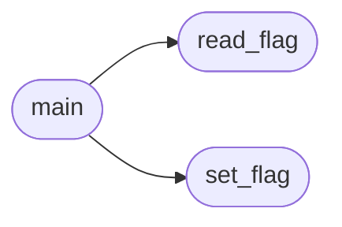

# `tools.set_lazyaddon_updates`

> Source: [tools/set_lazyaddon_updates.py:1](../../tools/set_lazyaddon_updates.py#L1) | language `py` | coverage 75.0% | [API index](../index.md)

Set or check the ``update`` flag on every lazyaddon YAML.

Usage:
    python3 tools/set_lazyaddon_updates.py            # set update: true
    python3 tools/set_lazyaddon_updates.py --check    # report only

## Contents

- **Functions:** [`set_flag`](#set_flag), [`read_flag`](#read_flag), [`main`](#main)
- **Constants:** [`ROOT`](#root), [`LAZYADDONS`](#lazyaddons), [`UPDATE_RE`](#update_re), [`ENABLED_RE`](#enabled_re)

## Call Graph

Solid arrows stay in this module, dashed arrows leave it.



## Functions

<a id="set_flag"></a>

### `set_flag`

`function` | [tools/set_lazyaddon_updates.py:22](../../tools/set_lazyaddon_updates.py#L22)

```python
def set_flag(path: Path, value: bool = True) -> bool
```

Set the root update flag, returning True when the file changed.

**Parameters**

| Name | Type | Default | Description |
|---|---|---|---|
| `path` | `Path` |  |  |
| `value` | `bool` | `True` |  |

**Returns:** `bool`

*Called by:* [`main`](#main)

---

<a id="read_flag"></a>

### `read_flag`

`function` | [tools/set_lazyaddon_updates.py:45](../../tools/set_lazyaddon_updates.py#L45)

```python
def read_flag(path: Path) -> bool | None
```

Return the root update flag, or None when absent.

**Parameters**

| Name | Type | Default | Description |
|---|---|---|---|
| `path` | `Path` |  |  |

**Returns:** `bool | None`

*Called by:* [`main`](#main)

---

<a id="main"></a>

### `main`

`function` | [tools/set_lazyaddon_updates.py:55](../../tools/set_lazyaddon_updates.py#L55)

```python
def main() -> None
```

**Raises**

- `SystemExit`: (raised in the body, not documented)

*Calls:* [`read_flag`](#read_flag), [`set_flag`](#set_flag)

---

## Constants

<a id="root"></a>

### `ROOT`

`constant` | [tools/set_lazyaddon_updates.py:16](../../tools/set_lazyaddon_updates.py#L16)

```python
ROOT = Path(__file__).resolve().parent.parent
```

---

<a id="lazyaddons"></a>

### `LAZYADDONS`

`constant` | [tools/set_lazyaddon_updates.py:17](../../tools/set_lazyaddon_updates.py#L17)

```python
LAZYADDONS = ROOT / 'lazyaddons'
```

---

<a id="update_re"></a>

### `UPDATE_RE`

`constant` | [tools/set_lazyaddon_updates.py:18](../../tools/set_lazyaddon_updates.py#L18)

```python
UPDATE_RE = re.compile('^update\\s*:\\s*(.+)$')
```

---

<a id="enabled_re"></a>

### `ENABLED_RE`

`constant` | [tools/set_lazyaddon_updates.py:19](../../tools/set_lazyaddon_updates.py#L19)

```python
ENABLED_RE = re.compile('^enabled\\s*:')
```

---
