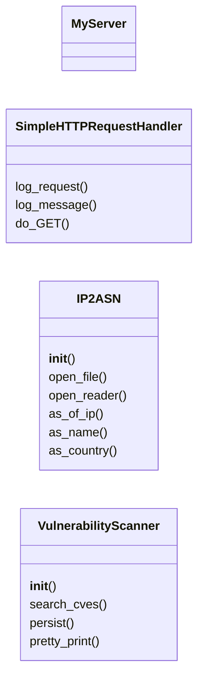
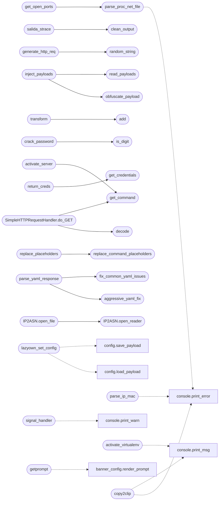

# `utils`

> Source: [utils.py:1](../../utils.py#L1) | language `py` | coverage 85.3% | [API index](../index.md)

utils.py

Author: Gris Iscomeback
Email: grisiscomeback[at]gmail[dot]com
Creation date: 09/06/2024
License: AGPL v3

Description: This file contains the logic for all functions used in the LazyOwnShell class.

██╗      █████╗ ███████╗██╗   ██╗ ██████╗ ██╗    ██╗███╗   ██╗
██║     ██╔══██╗╚══███╔╝╚██╗ ██╔╝██╔═══██╗██║    ██║████╗  ██║
██║     ███████║  ███╔╝  ╚████╔╝ ██║   ██║██║ █╗ ██║██╔██╗ ██║
██║     ██╔══██║ ███╔╝    ╚██╔╝  ██║   ██║██║███╗██║██║╚██╗██║
███████╗██║  ██║███████╗   ██║   ╚██████╔╝╚███╔███╔╝██║ ╚████║
╚══════╝╚═╝  ╚═╝╚══════╝   ╚═╝    ╚═════╝  ╚══╝╚══╝ ╚═╝  ╚═══╝

## Contents

- **Classes:** [`MyServer`](#myserver), [`SimpleHTTPRequestHandler`](#simplehttprequesthandler), [`IP2ASN`](#ip2asn), [`VulnerabilityScanner`](#vulnerabilityscanner)
- **Functions:** [`lazyown_set_config`](#lazyown_set_config), [`needs_sudo`](#needs_sudo), [`sudo_available`](#sudo_available), [`redact_secrets`](#redact_secrets), [`parse_ip_mac`](#parse_ip_mac), [`create_arp_packet`](#create_arp_packet), [`send_packet`](#send_packet), [`load_version`](#load_version), [`parse_bool`](#parse_bool), [`signal_handler`](#signal_handler), [`activate_virtualenv`](#activate_virtualenv), [`parse_proc_net_file`](#parse_proc_net_file), [`get_open_ports`](#get_open_ports), [`rotate_char`](#rotate_char), [`get_network_info`](#get_network_info), [`get_git_info`](#get_git_info), [`get_venv_info`](#get_venv_info), [`getprompt`](#getprompt), [`copy2clip`](#copy2clip), [`clean_output`](#clean_output), [`teclado_usuario`](#teclado_usuario), [`salida_strace`](#salida_strace), [`exploitalert`](#exploitalert), [`packetstormsecurity`](#packetstormsecurity), [`nvddb`](#nvddb), [`find_ss`](#find_ss), [`find_ea`](#find_ea), [`find_ps`](#find_ps), [`run`](#run), [`is_exist`](#is_exist), [`get_domain`](#get_domain), [`generate_random_cve_id`](#generate_random_cve_id), [`generate_certificates`](#generate_certificates), [`generate_emails`](#generate_emails), [`clean_url`](#clean_url), [`random_string`](#random_string), [`generate_http_req`](#generate_http_req), [`format_openssh_key`](#format_openssh_key), [`format_rsa_key`](#format_rsa_key), [`is_package_installed`](#is_package_installed), [`extract`](#extract), [`clean_html`](#clean_html), [`get_credentials`](#get_credentials), [`obfuscate_payload`](#obfuscate_payload), [`read_payloads`](#read_payloads), [`inject_payloads`](#inject_payloads), [`prompt`](#prompt), [`add`](#add), [`detect_delimiter`](#detect_delimiter), [`transform`](#transform), [`handle`](#handle), [`get_users_dic`](#get_users_dic), [`get_hash`](#get_hash), [`is_digit`](#is_digit), [`crack_password`](#crack_password), [`get_terminal_size`](#get_terminal_size), [`halp`](#halp), [`ensure_tmux_session`](#ensure_tmux_session), [`get_xml`](#get_xml), [`get_domain_from_xml`](#get_domain_from_xml), [`shellcode_to_sylk`](#shellcode_to_sylk), [`get_banner`](#get_banner), [`list_binaries`](#list_binaries), [`select_binary`](#select_binary), [`decode`](#decode), [`get_command`](#get_command), [`send_command`](#send_command), [`activate_server`](#activate_server), [`Spray`](#spray), [`ProcessResults`](#processresults), [`generate_index`](#generate_index), [`replace_variables`](#replace_variables), [`create_caldera_config`](#create_caldera_config), [`extract_banners`](#extract_banners), [`scrape_news`](#scrape_news), [`display_news`](#display_news), [`htmlify`](#htmlify), [`de_htmlify`](#de_htmlify), [`is_port_in_use`](#is_port_in_use), [`return_creds`](#return_creds), [`query_arin_ip`](#query_arin_ip), [`get_org`](#get_org), [`load_adversary`](#load_adversary), [`replace_placeholders`](#replace_placeholders), [`replace_command_placeholders`](#replace_command_placeholders), [`parse_nmap_csv`](#parse_nmap_csv), [`query_ollama`](#query_ollama), [`preprocess_llm_response`](#preprocess_llm_response), [`manual_yaml_extraction`](#manual_yaml_extraction), [`create_synthetic_yaml`](#create_synthetic_yaml), [`parse_yaml_response`](#parse_yaml_response), [`fix_common_yaml_issues`](#fix_common_yaml_issues), [`aggressive_yaml_fix`](#aggressive_yaml_fix), [`save_playbook`](#save_playbook), [`load_knowledge_base`](#load_knowledge_base), [`anti_debug`](#anti_debug), [`create_msfshellcoder_parser`](#create_msfshellcoder_parser), [`load_user_aliases`](#load_user_aliases)
- **Constants:** [`AES`](#aes), [`RPC_C_AUTHN_LEVEL_NONE`](#rpc_c_authn_level_none), [`NOBANNER`](#nobanner), [`COMMAND`](#command), [`NOLOGS`](#nologs), [`RUN_AS_ROOT`](#run_as_root), [`USER_ALIASES_FILE`](#user_aliases_file), [`HEADLESS`](#headless), [`REQUIRED_KEYS`](#required_keys), [`OLD_BANNER`](#old_banner), [`BANNER`](#banner), [`SYLK_TEMPLATE`](#sylk_template), [`VULN_SESSION_FILE_TEMPLATE`](#vuln_session_file_template), [`VULN_SCHEMA_VERSION`](#vuln_schema_version), [`VULN_REPORT_PRINT_HEADER`](#vuln_report_print_header), [`VULN_CVSS_UNAVAILABLE`](#vuln_cvss_unavailable), [`VULN_DEFAULT_MAX_WORKERS`](#vuln_default_max_workers), [`VULN_DEFAULT_DESCRIPTION_LANG`](#vuln_default_description_lang), [`VULN_DEFAULT_USER_AGENT`](#vuln_default_user_agent), [`VULN_NVD_URL_TEMPLATE`](#vuln_nvd_url_template), [`VULN_CVE_DETAILS_URL_TEMPLATE`](#vuln_cve_details_url_template), [`VULN_HTTP_OK`](#vuln_http_ok)

## Type Diagram



## Call Graph

Solid arrows stay in this module, dashed arrows leave it.



## Classes

<a id="myserver"></a>

### `MyServer`

`class` | [utils.py:3157](../../utils.py#L3157)

```python
class MyServer(HTTPServer)
```

Bases: `HTTPServer`

Custom HTTP server to handle incoming connections from certutil.

---

<a id="simplehttprequesthandler"></a>

### `SimpleHTTPRequestHandler`

`class` | [utils.py:3165](../../utils.py#L3165)

```python
class SimpleHTTPRequestHandler(BaseHTTPRequestHandler)
```

Bases: `BaseHTTPRequestHandler`

Custom HTTP request handler to intercept and decode GET requests from certutil.

**Members**

| Member | Kind | Summary |
|---|---|---|
| [`log_request`](#simplehttprequesthandler-log_request) | method |  |
| [`log_message`](#simplehttprequesthandler-log_message) | method |  |
| [`do_GET`](#simplehttprequesthandler-do_get) | method | Serve certutil callback using centralized payload config. |

<a id="simplehttprequesthandler-log_request"></a>

#### `SimpleHTTPRequestHandler.log_request`

`method` | [utils.py:3170](../../utils.py#L3170)

```python
def log_request(self, *args, **kwargs)
```

**Parameters**

| Name | Type | Default | Description |
|---|---|---|---|
| `*args` |  |  |  |
| `**kwargs` |  |  |  |

<a id="simplehttprequesthandler-log_message"></a>

#### `SimpleHTTPRequestHandler.log_message`

`method` | [utils.py:3173](../../utils.py#L3173)

```python
def log_message(self, *args, **kwargs)
```

**Parameters**

| Name | Type | Default | Description |
|---|---|---|---|
| `*args` |  |  |  |
| `**kwargs` |  |  |  |

<a id="simplehttprequesthandler-do_get"></a>

#### `SimpleHTTPRequestHandler.do_GET`

`method` | [utils.py:3176](../../utils.py#L3176)

```python
def do_GET(self)
```

Serve certutil callback using centralized payload config.

*Calls:* [`load_payload`](core.config.py.md#load_payload), [`decode`](#decode), [`get_command`](#get_command)

---

<a id="ip2asn"></a>

### `IP2ASN`

`class` | [utils.py:3195](../../utils.py#L3195)

```python
class IP2ASN
```

**Members**

| Member | Kind | Summary |
|---|---|---|
| [`__init__`](#ip2asn-__init__) | constructor |  |
| [`open_file`](#ip2asn-open_file) | method | Open and parse the IP-to-ASN file. |
| [`open_reader`](#ip2asn-open_reader) | method | Parse the reader stream, handling both regular and gzipped files. |
| [`as_of_ip`](#ip2asn-as_of_ip) | method | Return the ASN associated with the given IP address. |
| [`as_name`](#ip2asn-as_name) | method | Get the AS name by ASN. |
| [`as_country`](#ip2asn-as_country) | method | Get the country by ASN. |

<a id="ip2asn-__init__"></a>

#### `IP2ASN.__init__`

`constructor` | [utils.py:3196](../../utils.py#L3196)

```python
def __init__(self)
```

*Called by:* [`LazyOwnShell.__init__`](lazyown.py.md#lazyownshell-__init__)

<a id="ip2asn-open_file"></a>

#### `IP2ASN.open_file`

`method` | [utils.py:3201](../../utils.py#L3201)

```python
def open_file(self, filename)
```

Open and parse the IP-to-ASN file.

**Parameters**

| Name | Type | Default | Description |
|---|---|---|---|
| `filename` |  |  |  |

*Calls:* [`IP2ASN.open_reader`](#ip2asn-open_reader)

<a id="ip2asn-open_reader"></a>

#### `IP2ASN.open_reader`

`method` | [utils.py:3206](../../utils.py#L3206)

```python
def open_reader(self, reader)
```

Parse the reader stream, handling both regular and gzipped files.

**Parameters**

| Name | Type | Default | Description |
|---|---|---|---|
| `reader` |  |  |  |

*Called by:* [`IP2ASN.open_file`](#ip2asn-open_file)

<a id="ip2asn-as_of_ip"></a>

#### `IP2ASN.as_of_ip`

`method` | [utils.py:3246](../../utils.py#L3246)

```python
def as_of_ip(self, ip)
```

Return the ASN associated with the given IP address.

**Parameters**

| Name | Type | Default | Description |
|---|---|---|---|
| `ip` |  |  |  |

<a id="ip2asn-as_name"></a>

#### `IP2ASN.as_name`

`method` | [utils.py:3261](../../utils.py#L3261)

```python
def as_name(self, asn)
```

Get the AS name by ASN.

**Parameters**

| Name | Type | Default | Description |
|---|---|---|---|
| `asn` |  |  |  |

<a id="ip2asn-as_country"></a>

#### `IP2ASN.as_country`

`method` | [utils.py:3265](../../utils.py#L3265)

```python
def as_country(self, asn)
```

Get the country by ASN.

**Parameters**

| Name | Type | Default | Description |
|---|---|---|---|
| `asn` |  |  |  |

---

<a id="vulnerabilityscanner"></a>

### `VulnerabilityScanner`

`class` | [utils.py:3284](../../utils.py#L3284)

```python
class VulnerabilityScanner
```

Search the NVD for CVEs matching a service banner and persist results.

The scanner exposes three orthogonal capabilities:

1. [`search_cves`](#vulnerabilityscanner-search_cves) queries the NVD keyword API and enriches each
   record with CVSS data scraped from cvedetails.com.
2. [`persist`](modules.rootkit.mr.c.md#persist) writes a JSON document under ``sessions/`` so
   downstream consumers (reactive_engine, FactStore, the report
   generator) can read structured findings without re-scanning.
3. [`pretty_print`](#vulnerabilityscanner-pretty_print) renders a human-readable summary in the
   operator shell.

Side-effects are bounded to the configured sessions directory.
Network access uses a configurable User-Agent so the framework
avoids hardcoded browser strings duplicated across modules.

**Members**

| Member | Kind | Summary |
|---|---|---|
| [`__init__`](#vulnerabilityscanner-__init__) | constructor | Initialize the scanner with configurable network and storage knobs. |
| [`search_cves`](#vulnerabilityscanner-search_cves) | method | Return CVE records matching the supplied service banner. |
| [`persist`](#vulnerabilityscanner-persist) | method | Persist ``cves`` to ``sessions/vulns_<target>.json``. |
| [`pretty_print`](#vulnerabilityscanner-pretty_print) | method | Render ``cves_details`` as semicolon-separated rows in the shell. |

<a id="vulnerabilityscanner-__init__"></a>

#### `VulnerabilityScanner.__init__`

`constructor` | [utils.py:3302](../../utils.py#L3302)

```python
def __init__(self, user_agent: str | None = None, max_workers: int = VULN_DEFAULT_MAX_WORKERS, sessions_dir: str | None = None, description_language: str = VULN_DEFAULT_DESCRIPTION_LANG) -> None
```

Initialize the scanner with configurable network and storage knobs.

**Parameters**

| Name | Type | Default | Description |
|---|---|---|---|
| `user_agent` | `str \| None` | `None` | HTTP ``User-Agent`` header sent to the NVD and cvedetails.com. When ``None`` the default desktop UA is used so every NVD request remains identifiable. |
| `max_workers` | `int` | `VULN_DEFAULT_MAX_WORKERS` | Upper bound on concurrent cvedetails enrichment requests. Higher values shorten wall-clock time at the cost of being rate-limited. |
| `sessions_dir` | `str \| None` | `None` | Directory where JSON reports are persisted. Defaults to ``<cwd>/sessions``. |
| `description_language` | `str` | `VULN_DEFAULT_DESCRIPTION_LANG` | ISO 639-1 language code used to pick the human-readable CVE description from the NVD payload. |

<a id="vulnerabilityscanner-search_cves"></a>

#### `VulnerabilityScanner.search_cves`

`method` | [utils.py:3328](../../utils.py#L3328)

```python
def search_cves(self, service: str) -> list[dict]
```

Return CVE records matching the supplied service banner.

Each record contains ``cve_id``, ``description``, ``cvss`` and
``url`` keys. CVSS data is fetched concurrently from
cvedetails.com using a bounded thread pool.

**Parameters**

| Name | Type | Default | Description |
|---|---|---|---|
| `service` | `str` |  | The service banner or keyword to query (for example ``"ProFTPD 1.3.5"``). |

**Returns:** `list[dict]` - A list of CVE dictionaries. Empty when the upstream API is
unreachable or returns no matches.

*Calls:* [`print_error`](core.console.py.md#print_error)

<a id="vulnerabilityscanner-persist"></a>

#### `VulnerabilityScanner.persist`

`method` | [utils.py:3398](../../utils.py#L3398)

```python
def persist(self, service: str, target: str, cves: list[dict]) -> str
```

Persist ``cves`` to ``sessions/vulns_<target>.json``.

The schema is intentionally stable so reactive engines and
report generators can rely on the field names without
re-deriving them from CLI output. When the file already exists
the latest report supersedes the previous one — callers that
need history should retain the prior file out of band.

**Parameters**

| Name | Type | Default | Description |
|---|---|---|---|
| `service` | `str` |  | The original service banner that produced the findings. Stored under ``service`` so consumers can attribute results to a recon step. |
| `target` | `str` |  | The target identifier (typically ``rhost``). Used both as the filename component and the ``target`` field. |
| `cves` | `list[dict]` |  | The CVE records returned by [`search_cves`](#vulnerabilityscanner-search_cves). |

**Returns:** `str` - The absolute path of the JSON document written.

<a id="vulnerabilityscanner-pretty_print"></a>

#### `VulnerabilityScanner.pretty_print`

`method` | [utils.py:3435](../../utils.py#L3435)

```python
def pretty_print(self, cves_details: list[dict]) -> None
```

Render ``cves_details`` as semicolon-separated rows in the shell.

Sorts the records by ascending CVSS so the operator sees the
lowest-impact rows first and the most dangerous CVEs sit at the
bottom of the scroll buffer, closest to the prompt.

**Parameters**

| Name | Type | Default | Description |
|---|---|---|---|
| `cves_details` | `list[dict]` |  | CVE records produced by [`search_cves`](#vulnerabilityscanner-search_cves). |

*Calls:* [`print_msg`](core.console.py.md#print_msg)

---

## Functions

<a id="lazyown_set_config"></a>

### `lazyown_set_config`

`function` | [utils.py:324](../../utils.py#L324)

```python
def lazyown_set_config(key: str, value, config_obj=None)
```

Persist a key to ``payload.json`` and refresh any live config object.

This is the sanctioned writer for runtime configuration changes made
outside `[`do_assign`](cli.commands.session_ops.py.md#sessionopscommandset-do_assign)` / `[`do_set`](lazyown.py.md#lazyownshell-do_set)` so every write is audited and atomic.

**Parameters**

| Name | Type | Default | Description |
|---|---|---|---|
| `key` | `str` |  | Payload key to set. Must not be empty. |
| `value` |  |  | Value to store as JSON. |
| `config_obj` |  | `None` | Optional live config wrapper (`[`core.config.Config`](core.config.py.md#config)`) or dict-params shell object kept in sync with the write. |

**Returns:** The value that was stored.

**Raises**

- `ValueError`: if `[`key`](key.py.md)` is empty.
- `OSError`: if the payload file cannot be written.

*Calls:* [`load_payload`](core.config.py.md#load_payload), [`save_payload`](core.config.py.md#save_payload)

*Called by:* [`PhishingWizardCommandSet.do_phish_report`](cli.commands.phishing_wizard.py.md#phishingwizardcommandset-do_phish_report), [`resolve_target`](modules.winbox_gym.py.md#resolve_target)

---

<a id="needs_sudo"></a>

### `needs_sudo`

`function` | [utils.py:358](../../utils.py#L358)

```python
def needs_sudo(command: str) -> bool
```

Return True when any shell segment of the command runs sudo/doas.

Understands the wrapper forms the alias table uses (``sh sudo ...``)
and leading environment assignments, so a command that merely hides
sudo behind an alias expansion is still detected.

**Parameters**

| Name | Type | Default | Description |
|---|---|---|---|
| `command` | `str` |  | Shell command line about to run. |

**Returns:** `bool` - True when the command would invoke sudo or doas.

*Called by:* [`LazyOwnShell.cmd`](lazyown.py.md#lazyownshell-cmd), [`build_executor`](modules.lazy_runner.py.md#build_executor)

---

<a id="sudo_available"></a>

### `sudo_available`

`function` | [utils.py:382](../../utils.py#L382)

```python
def sudo_available() -> bool
```

Return whether sudo can run unattended right now.

The unattended loop must not launch sudo commands that will die on a
missing terminal; one ``sudo -n true`` probe answers that for good.
An armed retry session (``SUDO_ASKPASS`` provided by
[`modules.retry_session`](modules.retry_session.py.md)) answers True while its on-disk askpass
pair is sound, and clears the stale probe cache afterwards.

**Returns:** `bool` - True when ``sudo -n true`` succeeds or an elevated retry session
is armed.

*Called by:* [`LazyOwnShell.cmd`](lazyown.py.md#lazyownshell-cmd), [`build_executor`](modules.lazy_runner.py.md#build_executor)

---

<a id="redact_secrets"></a>

### `redact_secrets`

`function` | [utils.py:434](../../utils.py#L434)

```python
def redact_secrets(text)
```

Mask API keys and credentials embedded in a command line.

**Parameters**

| Name | Type | Default | Description |
|---|---|---|---|
| `text` |  |  | Command line or log message that may embed secrets. |

**Returns:** The text with recognized secret values replaced by ``***`` so
neither the operator console nor the event log stores them.

*Called by:* [`LazyOwnShell.cmd`](lazyown.py.md#lazyownshell-cmd), [`LazyOwnShell.logcsv`](lazyown.py.md#lazyownshell-logcsv)

---

<a id="parse_ip_mac"></a>

### `parse_ip_mac`

`function` | [utils.py:454](../../utils.py#L454)

```python
def parse_ip_mac(input_string)
```

Extracts IP and MAC addresses from a formatted input string using a regular expression.

The input string is expected to be in the format: 'IP: (192.168.1.222) MAC: ec:c3:02:b0:4c:96'.
The function uses a regular expression to match and extract the IP address and MAC address from the input.

**Parameters**

| Name | Type | Default | Description |
|---|---|---|---|
| `input_string` | `str` |  | The formatted string containing the IP and MAC addresses. |

**Returns:** `tuple` - A tuple containing the extracted IP address and MAC address. If the format is incorrect, returns (None, None).

*Calls:* [`print_error`](core.console.py.md#print_error)

*Called by:* [`SessionOpsCommandSet.do_kick`](cli.commands.session_ops.py.md#sessionopscommandset-do_kick)

---

<a id="create_arp_packet"></a>

### `create_arp_packet`

`function` | [utils.py:476](../../utils.py#L476)

```python
def create_arp_packet(src_mac, src_ip, dst_ip, dst_mac)
```

Constructs an ARP packet with the given source and destination IP and MAC addresses.

The function creates both Ethernet and ARP headers, combining them into a complete ARP packet.

**Parameters**

| Name | Type | Default | Description |
|---|---|---|---|
| `src_mac` | `str` |  | Source MAC address in the format 'xx:xx:xx:xx:xx:xx'. |
| `src_ip` | `str` |  | Source IP address in dotted decimal format (e.g., '192.168.1.1'). |
| `dst_ip` | `str` |  | Destination IP address in dotted decimal format (e.g., '192.168.1.2'). |
| `dst_mac` | `str` |  | Destination MAC address in the format 'xx:xx:xx:xx:xx:xx'. |

**Returns:** `bytes` - The constructed ARP packet containing the Ethernet and ARP headers.

*Called by:* [`SessionOpsCommandSet.do_kick`](cli.commands.session_ops.py.md#sessionopscommandset-do_kick)

---

<a id="send_packet"></a>

### `send_packet`

`function` | [utils.py:511](../../utils.py#L511)

```python
def send_packet(packet, iface)
```

Sends a raw ARP packet over the specified network interface.

The function creates a raw socket, binds it to the specified network interface, and sends the given packet.

**Parameters**

| Name | Type | Default | Description |
|---|---|---|---|
| `packet` | `bytes` |  | The ARP packet to be sent. |
| `iface` | `str` |  | The name of the network interface to use for sending the packet (e.g., 'eth0'). |

**Raises**

- `OSError`: If an error occurs while creating the socket or sending the packet.

*Called by:* [`SessionOpsCommandSet.do_kick`](cli.commands.session_ops.py.md#sessionopscommandset-do_kick)

---

<a id="load_version"></a>

### `load_version`

`function` | [utils.py:529](../../utils.py#L529)

```python
def load_version()
```

Load the version number from the 'version.json' file.

This function attempts to open the 'version.json' file and load its contents.
If the file is found, it retrieves the version number from the JSON data.
If the version key does not exist, it returns a default version 'release/v0.0.14'.
If the file is not found, it also returns the default version.

The version.json is the single source of truth, updated by deploy.sh.

- str: The version number from the file or the default version if the file is not found or the version key is missing.

---

<a id="parse_bool"></a>

### `parse_bool`

`function` | [utils.py:555](../../utils.py#L555)

```python
def parse_bool(value)
```

Interpret a configuration value as a boolean.

Accepts the canonical truthy strings used across payload.json and
form surfaces (``true``, ``1``, ``yes``, ``on``, case-insensitive).
Anything else evaluates to False so a missing or typo'd flag can
never silently enable a feature.

**Parameters**

| Name | Type | Default | Description |
|---|---|---|---|
| `value` |  |  | The raw value; converted to string before inspection. |

**Returns:** `bool` - True only for the canonical truthy strings.

---

<a id="signal_handler"></a>

### `signal_handler`

`function` | [utils.py:573](../../utils.py#L573)

```python
def signal_handler(sig, frame)
```

Handles signals such as Control + C and shows a message on how to exit.

This function is used to handle signals like Control + C (SIGINT) and prints
a warning message instructing the user on how to exit the program using the
commands 'exit', 'q', or 'qa'.

**Parameters**

| Name | Type | Default | Description |
|---|---|---|---|
| `sig` | `int` |  | The signal number. |
| `frame` | `frame` |  | The current stack frame. |

**Returns:** None

*Calls:* [`print_warn`](core.console.py.md#print_warn)

---

<a id="activate_virtualenv"></a>

### `activate_virtualenv`

`function` | [utils.py:598](../../utils.py#L598)

```python
def activate_virtualenv(venv_path)
```

Activates a virtual environment and starts an interactive shell.

This function activates a virtual environment located at `venv_path` and then
launches an interactive bash shell with the virtual environment activated.

**Parameters**

| Name | Type | Default | Description |
|---|---|---|---|
| `venv_path` | `str` |  | The path to the virtual environment directory. |

**Returns:** None

*Calls:* [`print_msg`](core.console.py.md#print_msg)

---

<a id="parse_proc_net_file"></a>

### `parse_proc_net_file`

`function` | [utils.py:623](../../utils.py#L623)

```python
def parse_proc_net_file(file_path)
```

Internal function to parse a /proc/net file and extract network ports.

This function reads a file specified by `file_path`, processes each line to
extract local addresses and ports, and converts them from hexadecimal to decimal.
The IP addresses are converted from hexadecimal format to standard dot-decimal
notation. The function returns a list of tuples, each containing an IP address
and a port number.

**Parameters**

| Name | Type | Default | Description |
|---|---|---|---|
| `file_path` | `str` |  | The path to the /proc/net file to be parsed. |

**Returns:** `list of tuple` - A list of tuples, each containing an IP address and a port number.

*Calls:* [`print_error`](core.console.py.md#print_error)

*Called by:* [`get_open_ports`](#get_open_ports)

---

<a id="get_open_ports"></a>

### `get_open_ports`

`function` | [utils.py:667](../../utils.py#L667)

```python
def get_open_ports()
```

Internal function to get open TCP and UDP ports on the operating system.

This function uses the [`parse_proc_net_file`](#parse_proc_net_file) function to extract open TCP and UDP
ports from the corresponding /proc/net files. It returns two lists: one for TCP
ports and one for UDP ports.

**Returns:** `tuple of (list of tuple, list of tuple)` - A tuple containing two lists: the first list with open TCP ports and the second list with open UDP ports.

*Calls:* [`parse_proc_net_file`](#parse_proc_net_file)

*Called by:* [`ReconMigratedCommandSet.do_ports`](cli.commands.recon_migrated.py.md#reconmigratedcommandset-do_ports)

---

<a id="rotate_char"></a>

### `rotate_char`

`function` | [utils.py:686](../../utils.py#L686)

```python
def rotate_char(c, shift)
```

Internal function to rotate characters for ROT cipher.

This function takes a character and a shift value, and rotates the character
by the specified shift amount. It only affects alphabetical characters, leaving
non-alphabetical characters unchanged.

**Parameters**

| Name | Type | Default | Description |
|---|---|---|---|
| `c` | `str` |  | The character to be rotated. |
| `shift` | `int` |  | The number of positions to shift the character. |

**Returns:** `str` - The rotated character.

*Called by:* [`EncodingCommandSet.do_rot`](cli.commands.encoding.py.md#encodingcommandset-do_rot), [`EncodingCommandSet.do_rotf`](cli.commands.encoding.py.md#encodingcommandset-do_rotf)

---

<a id="get_network_info"></a>

### `get_network_info`

`function` | [utils.py:708](../../utils.py#L708)

```python
def get_network_info()
```

Retrieves network interface information with their associated IP addresses.

This function executes a shell command to gather network interface details,
parses the output to extract interface names and their corresponding IP addresses,
and returns this information in a dictionary format. The dictionary keys are
interface names, and the values are IP addresses.

**Returns:** `dict` - A dictionary where the keys are network interface names and the values are their associated IP addresses.

---

<a id="get_git_info"></a>

### `get_git_info`

`function` | [utils.py:743](../../utils.py#L743)

```python
def get_git_info()
```

---

<a id="get_venv_info"></a>

### `get_venv_info`

`function` | [utils.py:762](../../utils.py#L762)

```python
def get_venv_info()
```

---

<a id="getprompt"></a>

### `getprompt`

`function` | [utils.py:783](../../utils.py#L783)

```python
def getprompt()
```

Render the configurable Neon Box prompt for the cmd2 shell.

Delegates to [`cli.banner_config.render_prompt`](cli.banner_config.py.md#render_prompt) so the entire
segment registry, color palette, and toggling logic live in a single
self-contained module. Failure to import the renderer falls back to a
minimal single-line prompt so the shell stays usable.

**Returns:** `str` - The fully styled multi-line prompt string ready for cmd2.

*Calls:* [`render_prompt`](cli.banner_config.py.md#render_prompt)

*Called by:* [`CliAuthCommandSet.do_login`](cli.commands.cli_auth.py.md#cliauthcommandset-do_login), [`CliAuthCommandSet.do_logout`](cli.commands.cli_auth.py.md#cliauthcommandset-do_logout), [`NetworkHelpersCommandSet.do_ip`](cli.commands.nethelpers.py.md#networkhelperscommandset-do_ip), [`index`](lazyc2.py.md#index), [`LazyOwnShell.__init__`](lazyown.py.md#lazyownshell-__init__), [`LazyOwnShell.refresh_prompt`](lazyown.py.md#lazyownshell-refresh_prompt)

---

<a id="copy2clip"></a>

### `copy2clip`

`function` | [utils.py:801](../../utils.py#L801)

```python
def copy2clip(text)
```

Copia el texto proporcionado al portapapeles usando xclip.

**Parameters**

| Name | Type | Default | Description |
|---|---|---|---|
| `text` | `str` |  | El texto que se desea copiar al portapapeles. |

**Example**

```python
copy2clip("Hello, World!")
```

*Calls:* [`print_error`](core.console.py.md#print_error), [`print_msg`](core.console.py.md#print_msg)

*Called by:* [`CommandAndControlMigratedCommandSet.do_emp3r0r`](cli.commands.command_and_control_migrated.py.md#commandandcontrolmigratedcommandset-do_emp3r0r), [`CommandAndControlMigratedCommandSet.do_sliver_server`](cli.commands.command_and_control_migrated.py.md#commandandcontrolmigratedcommandset-do_sliver_server), [`CredMigratedCommandSet.do_cred`](cli.commands.cred_migrated.py.md#credmigratedcommandset-do_cred), [`CredMigratedCommandSet.do_passtightvnc`](cli.commands.cred_migrated.py.md#credmigratedcommandset-do_passtightvnc), [`CredMigratedCommandSet.do_transform`](cli.commands.cred_migrated.py.md#credmigratedcommandset-do_transform), [`EncodingCommandSet.do_decode`](cli.commands.encoding.py.md#encodingcommandset-do_decode), [`EncodingCommandSet.do_encode`](cli.commands.encoding.py.md#encodingcommandset-do_encode), [`EncodingCommandSet.do_encoderpayload`](cli.commands.encoding.py.md#encodingcommandset-do_encoderpayload), [`EncodingCommandSet.do_encodewinbase64`](cli.commands.encoding.py.md#encodingcommandset-do_encodewinbase64), [`EncodingCommandSet.do_rot`](cli.commands.encoding.py.md#encodingcommandset-do_rot), [`EncodingCommandSet.do_rotf`](cli.commands.encoding.py.md#encodingcommandset-do_rotf), [`EncodingCommandSet.do_urldecode`](cli.commands.encoding.py.md#encodingcommandset-do_urldecode) and 46 more

---

<a id="clean_output"></a>

### `clean_output`

`function` | [utils.py:821](../../utils.py#L821)

```python
def clean_output(output)
```

Removes color escape sequences and other non-printable characters.

**Parameters**

| Name | Type | Default | Description |
|---|---|---|---|
| `output` |  |  |  |

*Called by:* [`salida_strace`](#salida_strace)

---

<a id="teclado_usuario"></a>

### `teclado_usuario`

`function` | [utils.py:834](../../utils.py#L834)

```python
def teclado_usuario(filename)
```

Processes a file to extract and display characters from specific write sequences.

**Parameters**

| Name | Type | Default | Description |
|---|---|---|---|
| `filename` | `str` |  | El nombre del archivo a leer. |

**Raises**

- `FileNotFoundError`: Si el archivo no se encuentra.
- `Exception`: Para otros errores que puedan ocurrir.

*Called by:* [`PostexpMigratedCommandSet.do_sessionsshstrace`](cli.commands.postexp_migrated.py.md#postexpmigratedcommandset-do_sessionsshstrace)

---

<a id="salida_strace"></a>

### `salida_strace`

`function` | [utils.py:870](../../utils.py#L870)

```python
def salida_strace(filename)
```

Lee un archivo, extrae texto desde secuencias de escritura y muestra el contenido reconstruido.

**Parameters**

| Name | Type | Default | Description |
|---|---|---|---|
| `filename` | `str` |  | El nombre del archivo a leer. |

**Raises**

- `FileNotFoundError`: Si el archivo no se encuentra.
- `Exception`: Para otros errores que puedan ocurrir.

*Calls:* [`clean_output`](#clean_output)

*Called by:* [`PostexpMigratedCommandSet.do_sessionsshstrace`](cli.commands.postexp_migrated.py.md#postexpmigratedcommandset-do_sessionsshstrace)

---

<a id="exploitalert"></a>

### `exploitalert`

`function` | [utils.py:906](../../utils.py#L906)

```python
def exploitalert(content)
```

Process and display results from ExploitAlert.

This function checks if the provided content contains any results.
If results are present, it prints the title and link for each exploit found,
and appends the results to a predata list. If no results are found,
it prints an error message.

- content (list): A list of dictionaries containing exploit information.

None
Thanks to Sicat 🐈
An excellent tool for CVE detection, I implemented only the keyword search as I had to change some libraries. Soon also for XML generated by nmap :) Total thanks to justakazh. https://github.com/justakazh/sicat/

**Parameters**

| Name | Type | Default | Description |
|---|---|---|---|
| `content` |  |  |  |

*Calls:* [`print_error`](core.console.py.md#print_error), [`print_msg`](core.console.py.md#print_msg)

*Called by:* [`ReconCommandSet.do_ss`](cli.commands.recon.py.md#reconcommandset-do_ss)

---

<a id="packetstormsecurity"></a>

### `packetstormsecurity`

`function` | [utils.py:945](../../utils.py#L945)

```python
def packetstormsecurity(content)
```

Process and display results from PacketStorm Security.

This function extracts exploit data from the provided content using regex.
If any results are found, it prints the title and link for each exploit,
and appends the results to a predata list. If no results are found,
it prints an error message.

- content (str): The HTML content from PacketStorm Security.

None
Thanks to Sicat 🐈
An excellent tool for CVE detection, I implemented only the keyword search as I had to change some libraries. Soon also for XML generated by nmap :) Total thanks to justakazh. https://github.com/justakazh/sicat/

**Parameters**

| Name | Type | Default | Description |
|---|---|---|---|
| `content` |  |  |  |

*Calls:* [`print_error`](core.console.py.md#print_error), [`print_msg`](core.console.py.md#print_msg)

*Called by:* [`ReconCommandSet.do_ss`](cli.commands.recon.py.md#reconcommandset-do_ss)

---

<a id="nvddb"></a>

### `nvddb`

`function` | [utils.py:983](../../utils.py#L983)

```python
def nvddb(content)
```

Process and display results from the National Vulnerability Database.

This function checks if there are any vulnerabilities in the provided content.
If vulnerabilities are present, it prints the ID, description, and link
for each CVE found, and appends the results to a predata list.
If no results are found, it prints an error message.

- content (dict): A dictionary containing vulnerability data.

None
Thanks to Sicat 🐈
An excellent tool for CVE detection, I implemented only the keyword search as I had to change some libraries. Soon also for XML generated by nmap :) Total thanks to justakazh. https://github.com/justakazh/sicat/

**Parameters**

| Name | Type | Default | Description |
|---|---|---|---|
| `content` |  |  |  |

*Calls:* [`print_error`](core.console.py.md#print_error), [`print_msg`](core.console.py.md#print_msg)

*Called by:* [`ReconCommandSet.do_ss`](cli.commands.recon.py.md#reconcommandset-do_ss)

---

<a id="find_ss"></a>

### `find_ss`

`function` | [utils.py:1029](../../utils.py#L1029)

```python
def find_ss(keyword='')
```

Find CVEs in the National Vulnerability Database based on a keyword.

This function takes a keyword, formats it for the API request,
and sends a GET request to the NVD API. If the request is successful,
it returns the JSON response containing CVE data; otherwise,
it returns False.

- keyword (str): The keyword to search for in CVEs.

- dict or bool: The JSON response containing CVE data or False on failure.
Thanks to Sicat 🐈
An excellent tool for CVE detection, I implemented only the keyword search as I had to change some libraries. Soon also for XML generated by nmap :) Total thanks to justakazh. https://github.com/justakazh/sicat/

**Parameters**

| Name | Type | Default | Description |
|---|---|---|---|
| `keyword` |  | `''` |  |

*Calls:* [`print_error`](core.console.py.md#print_error)

*Called by:* [`ReconCommandSet.do_ss`](cli.commands.recon.py.md#reconcommandset-do_ss)

---

<a id="find_ea"></a>

### `find_ea`

`function` | [utils.py:1091](../../utils.py#L1091)

```python
def find_ea(keyword='')
```

Find exploits in ExploitAlert based on a keyword.

This function takes a keyword, formats it for the API request,
and sends a GET request to the ExploitAlert API. If the request is successful,
it returns the JSON response containing exploit data; otherwise,
it returns False.

- keyword (str): The keyword to search for exploits.

- dict or bool: The JSON response containing exploit data or False on failure.
Thanks to Sicat 🐈
An excellent tool for CVE detection, I implemented only the keyword search as I had to change some libraries. Soon also for XML generated by nmap :) Total thanks to justakazh. https://github.com/justakazh/sicat/

**Parameters**

| Name | Type | Default | Description |
|---|---|---|---|
| `keyword` |  | `''` |  |

*Called by:* [`ReconCommandSet.do_ss`](cli.commands.recon.py.md#reconcommandset-do_ss)

---

<a id="find_ps"></a>

### `find_ps`

`function` | [utils.py:1141](../../utils.py#L1141)

```python
def find_ps(keyword='')
```

Find exploits in PacketStorm Security based on a keyword.

This function takes a keyword, formats it for the search request,
and sends a GET request to the PacketStorm Security website.
If the request is successful, it returns the HTML response; otherwise,
it returns False.

- keyword (str): The keyword to search for exploits.

- str or bool: The HTML response containing exploit data or False on failure.
Thanks to Sicat 🐈
An excellent tool for CVE detection, I implemented only the keyword search as I had to change some libraries. Soon also for XML generated by nmap :) Total thanks to justakazh. https://github.com/justakazh/sicat/

**Parameters**

| Name | Type | Default | Description |
|---|---|---|---|
| `keyword` |  | `''` |  |

*Calls:* [`print_error`](core.console.py.md#print_error)

*Called by:* [`ReconCommandSet.do_ss`](cli.commands.recon.py.md#reconcommandset-do_ss)

---

<a id="run"></a>

### `run`

`function` | [utils.py:1173](../../utils.py#L1173)

```python
def run(command)
```

Executes a shell command using the subprocess module, capturing its output.

command (str): The command to execute.

str: The output of the command if successful, or an error message if an exception occurs.

- FileNotFoundError: Raised if the command is not found.
- subprocess.CalledProcessError: Raised if the command exits with a non-zero status.
- subprocess.TimeoutExpired: Raised if the command times out.
- Exception: Catches any other unexpected exceptions.

**Parameters**

| Name | Type | Default | Description |
|---|---|---|---|
| `command` |  |  |  |

**Example**

```python
output = run("ls -la")
print(output)

Additional Notes:
The function attempts to execute the provided command, capturing its output.
It also handles common exceptions that may occur during command execution.
Secrets in the command line are redacted from console output.
```

*Calls:* [`print_error`](core.console.py.md#print_error), [`print_msg`](core.console.py.md#print_msg), [`SafeRunner.__init__`](core.safe_subprocess.py.md#saferunner-__init__), [`SafeRunner.run_shell`](core.safe_subprocess.py.md#saferunner-run_shell)

---

<a id="is_exist"></a>

### `is_exist`

`function` | [utils.py:1232](../../utils.py#L1232)

```python
def is_exist(file)
```

Check if a file exists.

This function checks whether a given file exists on the filesystem. If the file
does not exist, it prints an error message and returns False. Otherwise, it returns True.

file (str): The path to the file that needs to be checked.

bool: Returns True if the file exists, False otherwise.

This function uses os.path.isfile to determine the existence of the file.
Ensure that the provided path is correct and accessible.

**Parameters**

| Name | Type | Default | Description |
|---|---|---|---|
| `file` |  |  |  |

**Example**

```pycon
>>> is_exist('/path/to/file.txt')
True
>>> is_exist('/non/existent/file.txt')
False
```

*Calls:* [`print_error`](core.console.py.md#print_error)

*Called by:* [`CommandAndControlMigratedCommandSet.do_duckyspark`](cli.commands.command_and_control_migrated.py.md#commandandcontrolmigratedcommandset-do_duckyspark), [`CredMigratedCommandSet.do_username_anarchy`](cli.commands.cred_migrated.py.md#credmigratedcommandset-do_username_anarchy), [`C2Builder.run`](modules.c2_builder.py.md#c2builder-run)

---

<a id="get_domain"></a>

### `get_domain`

`function` | [utils.py:1261](../../utils.py#L1261)

```python
def get_domain(url)
```

Extracts the domain from a given URL.

url (str): The full URL from which to extract the domain.

str: The extracted domain from the URL, or None if it cannot be extracted.

**Parameters**

| Name | Type | Default | Description |
|---|---|---|---|
| `url` |  |  |  |

*Called by:* [`CredMigratedCommandSet.do_createmail`](cli.commands.cred_migrated.py.md#credmigratedcommandset-do_createmail), [`CredMigratedCommandSet.do_createusers_and_hashs`](cli.commands.cred_migrated.py.md#credmigratedcommandset-do_createusers_and_hashs), [`CredMigratedCommandSet.do_dacledit`](cli.commands.cred_migrated.py.md#credmigratedcommandset-do_dacledit), [`EnumCommandSet.do_smbclient`](cli.commands.enum.py.md#enumcommandset-do_smbclient), [`EnumCommandSet.do_smbclient_impacket`](cli.commands.enum.py.md#enumcommandset-do_smbclient_impacket), [`EnumCommandSet.do_smbclient_py`](cli.commands.enum.py.md#enumcommandset-do_smbclient_py), [`ExfiltrationCommandSet.do_getuserspns`](cli.commands.exfiltration.py.md#exfiltrationcommandset-do_getuserspns), [`ExfiltrationCommandSet.do_gitdumper`](cli.commands.exfiltration.py.md#exfiltrationcommandset-do_gitdumper), [`ExfiltrationCommandSet.do_secretsdump`](cli.commands.exfiltration.py.md#exfiltrationcommandset-do_secretsdump), [`LateralMigratedCommandSet.do_bloodyAD`](cli.commands.lateral_migrated.py.md#lateralmigratedcommandset-do_bloodyad), [`LateralMigratedCommandSet.do_getTGT`](cli.commands.lateral_migrated.py.md#lateralmigratedcommandset-do_gettgt), [`ReconCommandSet.do_wfuzz`](cli.commands.recon.py.md#reconcommandset-do_wfuzz) and 7 more

---

<a id="generate_random_cve_id"></a>

### `generate_random_cve_id`

`function` | [utils.py:1278](../../utils.py#L1278)

```python
def generate_random_cve_id()
```

Generate a random CVE identifier in the form CVE-{year}-{code}.

**Returns:** `str` - A randomly generated CVE ID between 2020-2024 and 1000-9999.

*Called by:* [`ReconMigratedCommandSet.do_cve`](cli.commands.recon_migrated.py.md#reconmigratedcommandset-do_cve)

---

<a id="generate_certificates"></a>

### `generate_certificates`

`function` | [utils.py:1290](../../utils.py#L1290)

```python
def generate_certificates()
```

Generates a certificate authority (CA), client certificate, and client key.

**Returns:** `str` - Paths to the generated CA certificate, client certificate, and client key.

*Calls:* [`print_msg`](core.console.py.md#print_msg)

*Called by:* [`SessionOpsCommandSet.do_gencert`](cli.commands.session_ops.py.md#sessionopscommandset-do_gencert)

---

<a id="generate_emails"></a>

### `generate_emails`

`function` | [utils.py:1373](../../utils.py#L1373)

```python
def generate_emails(full_name, domain)
```

Generate email permutations based on the provided full name and domain.

This function takes a full name and domain as input, splits the full name into
components, and creates a list of potential email addresses.

full_name (str): The full name to base the email addresses on.
domain (str): The domain to use for the generated email addresses.

Internal Variables:
names (list): A list of the name components extracted from the full name.
first_name (str): The first name component.
last_name (str): The last name component.
first_initial (str): The first initial of the first name.
last_initial (str): The first initial of the last name.

list: A list of generated email permutations.

- At least two parts of the name are required to generate valid email addresses.

**Parameters**

| Name | Type | Default | Description |
|---|---|---|---|
| `full_name` |  |  |  |
| `domain` |  |  |  |

*Called by:* [`CredMigratedCommandSet.do_createmail`](cli.commands.cred_migrated.py.md#credmigratedcommandset-do_createmail)

---

<a id="clean_url"></a>

### `clean_url`

`function` | [utils.py:1433](../../utils.py#L1433)

```python
def clean_url(host)
```

Checks if the last character is a slash and removes it if so.

**Parameters**

| Name | Type | Default | Description |
|---|---|---|---|
| `host` |  |  |  |

---

<a id="random_string"></a>

### `random_string`

`function` | [utils.py:1440](../../utils.py#L1440)

```python
def random_string(length=15)
```

Generates a random alphanumeric string.

**Parameters**

| Name | Type | Default | Description |
|---|---|---|---|
| `length` |  | `15` |  |

*Called by:* [`generate_http_req`](#generate_http_req)

---

<a id="generate_http_req"></a>

### `generate_http_req`

`function` | [utils.py:1446](../../utils.py#L1446)

```python
def generate_http_req(host, port, uri, custom_header=None, cmd=None)
```

Generates an HTTP request with the Shellshock payload.

**Parameters**

| Name | Type | Default | Description |
|---|---|---|---|
| `host` |  |  |  |
| `port` |  |  |  |
| `uri` |  |  |  |
| `custom_header` |  | `None` |  |
| `cmd` |  | `None` |  |

*Calls:* [`print_msg`](core.console.py.md#print_msg), [`random_string`](#random_string)

---

<a id="format_openssh_key"></a>

### `format_openssh_key`

`function` | [utils.py:1470](../../utils.py#L1470)

```python
def format_openssh_key(raw_key)
```

Formats a raw OpenSSH private key string to the correct OpenSSH format.

This function takes a raw OpenSSH private key string, cleans it by removing any unnecessary
characters (such as newlines, spaces, and headers/footers), splits the key content into lines
of 64 characters, and then reassembles the key with the standard OpenSSH header and footer.
It ensures the key follows the correct OpenSSH format.

**Parameters**

| Name | Type | Default | Description |
|---|---|---|---|
| `raw_key` | `str` |  | The raw OpenSSH private key string to format. |

**Returns:** `str` - The formatted OpenSSH private key with proper headers, footers, and 64-character lines.

*Called by:* [`LateralMigratedCommandSet.do_id_rsa`](cli.commands.lateral_migrated.py.md#lateralmigratedcommandset-do_id_rsa)

---

<a id="format_rsa_key"></a>

### `format_rsa_key`

`function` | [utils.py:1502](../../utils.py#L1502)

```python
def format_rsa_key(raw_key)
```

Formats a raw RSA private key string to the correct PEM format.

This function takes a raw RSA private key string, cleans it by removing any unnecessary
characters (such as newlines, spaces, and headers/footers), splits the key content into lines
of 64 characters, and then reassembles the key with the standard PEM header and footer.
It ensures the key follows the correct RSA format.

**Parameters**

| Name | Type | Default | Description |
|---|---|---|---|
| `raw_key` | `str` |  | The raw RSA private key string to format. |

**Returns:** `str` - The formatted RSA private key with proper headers, footers, and 64-character lines.

*Called by:* [`LateralMigratedCommandSet.do_id_rsa`](cli.commands.lateral_migrated.py.md#lateralmigratedcommandset-do_id_rsa)

---

<a id="is_package_installed"></a>

### `is_package_installed`

`function` | [utils.py:1533](../../utils.py#L1533)

```python
def is_package_installed(package_name)
```

Check if a Python package is installed.

**Parameters**

| Name | Type | Default | Description |
|---|---|---|---|
| `package_name` |  |  | Name of the package to check. |

**Returns:** True if installed, False otherwise.

*Called by:* [`ExfiltrationCommandSet.do_gitdumper`](cli.commands.exfiltration.py.md#exfiltrationcommandset-do_gitdumper)

---

<a id="extract"></a>

### `extract`

`function` | [utils.py:1544](../../utils.py#L1544)

```python
def extract(string, extract_flag)
```

Extracts and processes specific hexadecimal sequences from a string based on a flag.

If the [`extract_flag`](cli.commands._base.py.md#extract_flag) is set to True, the function extracts all sequences of the form 'x[a-f0-9][a-f0-9]'
(where 'x' is followed by two hexadecimal digits), removes the 'x' from the extracted sequences,
and returns the processed string. If [`extract_flag`](cli.commands._base.py.md#extract_flag) is False, the function returns the original string.

**Parameters**

| Name | Type | Default | Description |
|---|---|---|---|
| `string` | `str` |  | The input string from which hexadecimal sequences are to be extracted. |
| `extract_flag` | `bool` |  | A flag indicating whether to perform the extraction (True) or not (False). |

**Returns:** `str` - The processed string with the extracted hexadecimal sequences if [`extract_flag`](cli.commands._base.py.md#extract_flag) is True,
or the original string if [`extract_flag`](cli.commands._base.py.md#extract_flag) is False.

*Called by:* [`PostexpMigratedCommandSet.do_shellcode_search`](cli.commands.postexp_migrated.py.md#postexpmigratedcommandset-do_shellcode_search)

---

<a id="clean_html"></a>

### `clean_html`

`function` | [utils.py:1568](../../utils.py#L1568)

```python
def clean_html(html_string)
```

Remove HTML tags from a string.

This function uses a regular expression to strip HTML tags and return plain text.

**Parameters**

| Name | Type | Default | Description |
|---|---|---|---|
| `html_string` |  |  | A string containing HTML content. |

**Returns:** A cleaned string with HTML tags removed.

*Called by:* [`PostexpMigratedCommandSet.do_shellcode_search`](cli.commands.postexp_migrated.py.md#postexpmigratedcommandset-do_shellcode_search)

---

<a id="get_credentials"></a>

### `get_credentials`

`function` | [utils.py:1595](../../utils.py#L1595)

```python
def get_credentials(file=None, ncred=None)
```

Searches for credential files with the pattern 'credentials*.txt' and allows the user to select one.

The function lists all matching files and prompts the user to select one. It then reads the selected file
and returns a list of tuples with the format (username, password) for each line in the file.

ncred (int, optional): If provided, automatically selects the credential file with the given number.

list of tuples: A list containing tuples with (username, password) for each credential found in the file.
                If no files are found or an invalid selection is made, an empty list is returned.

**Parameters**

| Name | Type | Default | Description |
|---|---|---|---|
| `file` |  | `None` |  |
| `ncred` |  | `None` |  |

*Calls:* [`print_error`](core.console.py.md#print_error), [`print_msg`](core.console.py.md#print_msg)

*Called by:* [`CredMigratedCommandSet.do_keepass`](cli.commands.cred_migrated.py.md#credmigratedcommandset-do_keepass), [`EnumCommandSet.do_psexec`](cli.commands.enum.py.md#enumcommandset-do_psexec), [`EnumCommandSet.do_psexec_py`](cli.commands.enum.py.md#enumcommandset-do_psexec_py), [`EnumCommandSet.do_smbmap`](cli.commands.enum.py.md#enumcommandset-do_smbmap), [`ExfiltrationCommandSet.do_evilwinrm`](cli.commands.exfiltration.py.md#exfiltrationcommandset-do_evilwinrm), [`ExfiltrationCommandSet.do_getadusers`](cli.commands.exfiltration.py.md#exfiltrationcommandset-do_getadusers), [`ExfiltrationCommandSet.do_getnthash_py`](cli.commands.exfiltration.py.md#exfiltrationcommandset-do_getnthash_py), [`ExploitMigratedCommandSet.do_addspn_py`](cli.commands.exploit_migrated.py.md#exploitmigratedcommandset-do_addspn_py), [`ExploitMigratedCommandSet.do_autoblody`](cli.commands.exploit_migrated.py.md#exploitmigratedcommandset-do_autoblody), [`ExploitMigratedCommandSet.do_gets4uticket_py`](cli.commands.exploit_migrated.py.md#exploitmigratedcommandset-do_gets4uticket_py), [`ExploitMigratedCommandSet.do_gettgtpkinit_py`](cli.commands.exploit_migrated.py.md#exploitmigratedcommandset-do_gettgtpkinit_py), [`ExploitMigratedCommandSet.do_krbrelayx_py`](cli.commands.exploit_migrated.py.md#exploitmigratedcommandset-do_krbrelayx_py) and 26 more

---

<a id="obfuscate_payload"></a>

### `obfuscate_payload`

`function` | [utils.py:1651](../../utils.py#L1651)

```python
def obfuscate_payload(payload)
```

Obfuscates a payload string by converting its characters into hexadecimal format, with additional comments for every third character.

For every character in the payload, the function converts it to its hexadecimal representation.
Every third character (after the first) is enclosed in a comment `/*hex_value*/`, while the rest
are prefixed with `\x`.

**Parameters**

| Name | Type | Default | Description |
|---|---|---|---|
| `payload` | `str` |  | The input string that needs to be obfuscated. |

**Returns:** `str` - The obfuscated string where characters are replaced by their hexadecimal representations,
with every third character wrapped in a comment.

*Called by:* [`inject_payloads`](#inject_payloads)

---

<a id="read_payloads"></a>

### `read_payloads`

`function` | [utils.py:1676](../../utils.py#L1676)

```python
def read_payloads(file_path)
```

Reads a file containing payloads and returns a list of properly formatted strings.

This function opens a specified file, reads each line, and checks if the line starts with a
double quote. If it does not, it adds double quotes around the line. Each line is stripped
of leading and trailing whitespace before being added to the list.

**Parameters**

| Name | Type | Default | Description |
|---|---|---|---|
| `file_path` | `str` |  | The path to the file containing payloads. |

**Returns:** `list` - A list of strings, each representing a payload from the file, formatted with
leading and trailing double quotes if necessary.

*Called by:* [`inject_payloads`](#inject_payloads)

---

<a id="inject_payloads"></a>

### `inject_payloads`

`function` | [utils.py:1698](../../utils.py#L1698)

```python
def inject_payloads(urls, payload_url, request_timeout=15)
```

Sends HTTP requests to a list of URLs with injected payloads for testing XSS vulnerabilities.

This function reads payloads from a specified file and sends GET requests to the provided URLs,
injecting obfuscated payloads into the query parameters or form fields to test for cross-site
scripting (XSS) vulnerabilities. It handles both URLs with existing query parameters and those
without. If forms are found in the response, it submits them with the payloads as well.

**Parameters**

| Name | Type | Default | Description |
|---|---|---|---|
| `urls` | `list` |  | A list of URLs to test for XSS vulnerabilities. |
| `payload_url` | `str` |  | A placeholder string within the payloads that will be replaced with the actual URL for testing. |
| `request_timeout` | `int` | `15` | The timeout for each request in seconds. Defaults to 15. |

**Returns:** `None` - This function does not return any value but prints the status of each request and
form submission to the console.

**Raises**

- `requests.RequestException`: Raises an exception if any HTTP request fails, which is handled by printing a warning message.

*Calls:* [`print_error`](core.console.py.md#print_error), [`print_msg`](core.console.py.md#print_msg), [`print_warn`](core.console.py.md#print_warn), [`obfuscate_payload`](#obfuscate_payload), [`read_payloads`](#read_payloads)

*Called by:* [`ExploitMigratedCommandSet.do_xss`](cli.commands.exploit_migrated.py.md#exploitmigratedcommandset-do_xss)

---

<a id="prompt"></a>

### `prompt`

`function` | [utils.py:1798](../../utils.py#L1798)

```python
def prompt(label, default=None)
```

Return the prompt in the function do_xss

**Parameters**

| Name | Type | Default | Description |
|---|---|---|---|
| `label` |  |  |  |
| `default` |  | `None` |  |

*Called by:* [`ExploitMigratedCommandSet.do_xss`](cli.commands.exploit_migrated.py.md#exploitmigratedcommandset-do_xss), [`ScanMigratedCommandSet.do_arjun`](cli.commands.scan_migrated.py.md#scanmigratedcommandset-do_arjun)

---

<a id="add"></a>

### `add`

`function` | [utils.py:1806](../../utils.py#L1806)

```python
def add(str_part, delimiter, i)
```

Adds a delimiter between string parts if it's not the first part.

**Parameters**

| Name | Type | Default | Description |
|---|---|---|---|
| `str_part` | `str` |  | The string part to add. |
| `delimiter` | `str` |  | The delimiter to insert between parts. |
| `i` | `int` |  | The index of the part. |

**Returns:** `str` - The string part with delimiter if applicable.

*Called by:* [`transform`](#transform)

---

<a id="detect_delimiter"></a>

### `detect_delimiter`

`function` | [utils.py:1823](../../utils.py#L1823)

```python
def detect_delimiter(foo_bar)
```

Detects the delimiter used in the input string (e.g., "-", "_", ".").

**Parameters**

| Name | Type | Default | Description |
|---|---|---|---|
| `foo_bar` | `str` |  | The input string. |

**Returns:** `str` - The detected delimiter.

*Called by:* [`CredMigratedCommandSet.do_transform`](cli.commands.cred_migrated.py.md#credmigratedcommandset-do_transform)

---

<a id="transform"></a>

### `transform`

`function` | [utils.py:1842](../../utils.py#L1842)

```python
def transform(parts, delimiter, casing)
```

Transforms a list of string parts based on the chosen casing style.

**Parameters**

| Name | Type | Default | Description |
|---|---|---|---|
| `parts` | `list` |  | List of string parts. |
| `delimiter` | `str` |  | Delimiter to use between parts. |
| `casing` | `str` |  | Casing style ('l', 'u', 'c', 'p'). |

**Returns:** `str` - The transformed string.

*Calls:* [`add`](#add)

*Called by:* [`CredMigratedCommandSet.do_transform`](cli.commands.cred_migrated.py.md#credmigratedcommandset-do_transform), [`Ct.G.I.J.L.M.N.N.Ot.Q.R.S.S.St.T.X.Y.Z.a.b.c.c.d.et.extends.extends.extends.extends.extends.extends.extends.extends.extends.extends.extends.f.g.h.h.h.i.i.i.i.i.j.jt.k.k.m.m.n.o.o.o.o.ot.qt.rt.s.s.t.t.t.t.t.tt.u.u.w`](static.js.quill-2.0.3.js.md#ct-g-i-j-l-m-n-n-ot-q-r-s-s-st-t-x-y-z-a-b-c-c-d-et-extends-extends-extends-extends-extends-extends-extends-extends-extends-extends-extends-f-g-h-h-h-i-i-i-i-i-j-jt-k-k-m-m-n-o-o-o-o-ot-qt-rt-s-s-t-t-t-t-t-tt-u-u-w)

---

<a id="handle"></a>

### `handle`

`function` | [utils.py:1872](../../utils.py#L1872)

```python
def handle(input_str)
```

Splits the input string into parts based on delimiters or mixed casing.

**Parameters**

| Name | Type | Default | Description |
|---|---|---|---|
| `input_str` | `str` |  | The input string to split. |

**Returns:** `list` - A list of string parts.

*Called by:* [`CredMigratedCommandSet.do_transform`](cli.commands.cred_migrated.py.md#credmigratedcommandset-do_transform)

---

<a id="get_users_dic"></a>

### `get_users_dic`

`function` | [utils.py:1902](../../utils.py#L1902)

```python
def get_users_dic(txt=None)
```

List all .txt files in the 'sessions/' directory and prompt the user to select one by number.

**Parameters**

| Name | Type | Default | Description |
|---|---|---|---|
| `txt` |  | `None` |  |

**Returns:** The path of the selected .txt file.

*Calls:* [`print_error`](core.console.py.md#print_error), [`print_msg`](core.console.py.md#print_msg), [`print_warn`](core.console.py.md#print_warn)

*Called by:* [`CredMigratedCommandSet.do_adsso_spray`](cli.commands.cred_migrated.py.md#credmigratedcommandset-do_adsso_spray), [`CredMigratedCommandSet.do_cubespraying`](cli.commands.cred_migrated.py.md#credmigratedcommandset-do_cubespraying), [`CredMigratedCommandSet.do_dacledit`](cli.commands.cred_migrated.py.md#credmigratedcommandset-do_dacledit), [`CredMigratedCommandSet.do_john2zip`](cli.commands.cred_migrated.py.md#credmigratedcommandset-do_john2zip), [`CredMigratedCommandSet.do_username_anarchy`](cli.commands.cred_migrated.py.md#credmigratedcommandset-do_username_anarchy), [`EncodingCommandSet.do_rotf`](cli.commands.encoding.py.md#encodingcommandset-do_rotf), [`EnumCommandSet.do_getnpusers`](cli.commands.enum.py.md#enumcommandset-do_getnpusers), [`ExfiltrationCommandSet.do_dploot`](cli.commands.exfiltration.py.md#exfiltrationcommandset-do_dploot), [`ExfiltrationCommandSet.do_gmsadumper`](cli.commands.exfiltration.py.md#exfiltrationcommandset-do_gmsadumper), [`ExfiltrationCommandSet.do_rsync`](cli.commands.exfiltration.py.md#exfiltrationcommandset-do_rsync), [`ExfiltrationCommandSet.do_unzip`](cli.commands.exfiltration.py.md#exfiltrationcommandset-do_unzip), [`ExploitMigratedCommandSet.do_digdug`](cli.commands.exploit_migrated.py.md#exploitmigratedcommandset-do_digdug) and 21 more

---

<a id="get_hash"></a>

### `get_hash`

`function` | [utils.py:1937](../../utils.py#L1937)

```python
def get_hash(dir=None)
```

Searches for hash files with the pattern 'hash*.txt' and allows the user to select one.

The function lists all matching files and prompts the user to select one. It then reads the selected file
and returns the hash content as a single string, without any newline characters or extra formatting.

str: The hash content from the selected file as a single string. If no files are found or an invalid
     selection is made, an empty string is returned.

**Parameters**

| Name | Type | Default | Description |
|---|---|---|---|
| `dir` |  | `None` |  |

*Calls:* [`print_error`](core.console.py.md#print_error), [`print_msg`](core.console.py.md#print_msg)

*Called by:* [`EnumCommandSet.do_psexec`](cli.commands.enum.py.md#enumcommandset-do_psexec), [`EnumCommandSet.do_psexec_py`](cli.commands.enum.py.md#enumcommandset-do_psexec_py), [`EnumCommandSet.do_smbmap`](cli.commands.enum.py.md#enumcommandset-do_smbmap), [`ExfiltrationCommandSet.do_evilwinrm`](cli.commands.exfiltration.py.md#exfiltrationcommandset-do_evilwinrm), [`ExfiltrationCommandSet.do_reg_py`](cli.commands.exfiltration.py.md#exfiltrationcommandset-do_reg_py), [`LateralMigratedCommandSet.do_dcomexec`](cli.commands.lateral_migrated.py.md#lateralmigratedcommandset-do_dcomexec), [`LateralMigratedCommandSet.do_targetedKerberoas`](cli.commands.lateral_migrated.py.md#lateralmigratedcommandset-do_targetedkerberoas), [`ScanMigratedCommandSet.do_certipy_ad`](cli.commands.scan_migrated.py.md#scanmigratedcommandset-do_certipy_ad), [`ScanMigratedCommandSet.do_cme`](cli.commands.scan_migrated.py.md#scanmigratedcommandset-do_cme), [`ScanMigratedCommandSet.do_lookupsid`](cli.commands.scan_migrated.py.md#scanmigratedcommandset-do_lookupsid), [`ScanMigratedCommandSet.do_netview`](cli.commands.scan_migrated.py.md#scanmigratedcommandset-do_netview), [`ScanMigratedCommandSet.do_pykerbrute`](cli.commands.scan_migrated.py.md#scanmigratedcommandset-do_pykerbrute) and 2 more

---

<a id="is_digit"></a>

### `is_digit`

`function` | [utils.py:1978](../../utils.py#L1978)

```python
def is_digit(the_digit)
```

Check if the given character is a digit.

**Parameters**

| Name | Type | Default | Description |
|---|---|---|---|
| `the_digit` | `str` |  | The character to check. |

**Returns:** `bool` - True if the character is a digit, False otherwise.

*Called by:* [`crack_password`](#crack_password)

---

<a id="crack_password"></a>

### `crack_password`

`function` | [utils.py:1990](../../utils.py#L1990)

```python
def crack_password(crypttext)
```

Crack a Cisco Type 7 password.

**Parameters**

| Name | Type | Default | Description |
|---|---|---|---|
| `crypttext` | `str` |  | The encrypted password in Type 7 format. |

**Returns:** `str` - The cracked plaintext password or an empty string if invalid.

*Calls:* [`is_digit`](#is_digit)

*Called by:* [`CredMigratedCommandSet.do_crack_cisco_7_password`](cli.commands.cred_migrated.py.md#credmigratedcommandset-do_crack_cisco_7_password)

---

<a id="get_terminal_size"></a>

### `get_terminal_size`

`function` | [utils.py:2030](../../utils.py#L2030)

```python
def get_terminal_size()
```

*Calls:* [`print_error`](core.console.py.md#print_error)

*Called by:* [`main`](banner.py.md#main)

---

<a id="halp"></a>

### `halp`

`function` | [utils.py:2039](../../utils.py#L2039)

```python
def halp()
```

Display the help panel for the LazyOwn RedTeam Framework.

This function prints usage instructions, options, and descriptions for
running the LazyOwn framework. It provides users with an overview of
command-line options that can be used when executing the `./run` command.

The output includes the current version of the framework and various
options available for users, along with a brief description of each option.

Options include:
    - `--help`: Displays the help panel.
    - `-v`: Shows the version of the framework.
    - `-p <payloadN.json>`: Executes the framework with a specified payload
      JSON file. This option is particularly useful for Red Teams.
    - `-c <command>`: Executes a specific command using LazyOwn, for
      example, [`ping`](lazyc2.blueprints.api.py.md#ping).
    - `--no-banner`: Runs the framework without displaying the banner.
    - `-s`: Runs the framework with root privileges.
    - `--old-banner`: Displays the old banner.

**Example**

```python
To see the help panel, call the function as follows:

>>> halp()
```

> **Note:** - This function exits the program after displaying the help information,
> using `sys.exit(0)`.

---

<a id="ensure_tmux_session"></a>

### `ensure_tmux_session`

`function` | [utils.py:2094](../../utils.py#L2094)

```python
def ensure_tmux_session(session_name)
```

Ensure that a tmux session is active.

This function checks whether a specified tmux session is currently running.
If the session does not exist, it creates a new tmux session with the specified
name and executes the command to run the LazyOwn RedTeam Framework script.

The function uses the `tmux has-session` command to check for the existence
of the session. If the session is not found (i.e., the return code is not zero),
it will create a new tmux session in detached mode and run the command
`./run --no-banner` within that session.

**Parameters**

| Name | Type | Default | Description |
|---|---|---|---|
| `session_name` | `str` |  | The name of the tmux session to check or create. |

**Example**

```python
To ensure that a tmux session named 'lazyown_sessions' is active,
call the function as follows:

>>> ensure_tmux_session('lazyown_sessions')
```

> **Note:** - Ensure that tmux is installed and properly configured on the system.
> - The command executed within the tmux session must be valid and
>   accessible in the current environment.

---

<a id="get_xml"></a>

### `get_xml`

`function` | [utils.py:2130](../../utils.py#L2130)

```python
def get_xml(directory)
```

Retrieves a list of XML files from the specified directory.

**Parameters**

| Name | Type | Default | Description |
|---|---|---|---|
| `directory` | `str` |  | The directory to search for XML files. |

**Returns:** `list` - A list of XML filenames found in the specified directory.

---

<a id="get_domain_from_xml"></a>

### `get_domain_from_xml`

`function` | [utils.py:2143](../../utils.py#L2143)

```python
def get_domain_from_xml(xml_file)
```

Extracts the first domain or IP address from an Nmap scan XML file.

**Parameters**

| Name | Type | Default | Description |
|---|---|---|---|
| `xml_file` |  |  |  |

---

<a id="shellcode_to_sylk"></a>

### `shellcode_to_sylk`

`function` | [utils.py:2173](../../utils.py#L2173)

```python
def shellcode_to_sylk(shellcode_path)
```

**Parameters**

| Name | Type | Default | Description |
|---|---|---|---|
| `shellcode_path` |  |  |  |

*Called by:* [`PostexpMigratedCommandSet.do_shellcode2sylk`](cli.commands.postexp_migrated.py.md#postexpmigratedcommandset-do_shellcode2sylk)

---

<a id="get_banner"></a>

### `get_banner`

`function` | [utils.py:2198](../../utils.py#L2198)

```python
def get_banner(ip, port)
```

**Parameters**

| Name | Type | Default | Description |
|---|---|---|---|
| `ip` |  |  |  |
| `port` |  |  |  |

---

<a id="list_binaries"></a>

### `list_binaries`

`function` | [utils.py:2215](../../utils.py#L2215)

```python
def list_binaries(directory='sessions')
```

List all executable binaries in the specified directory.

directory (str): The directory to search for binaries. Defaults to 'sessions'.

list: A list of paths to executable binaries.

**Parameters**

| Name | Type | Default | Description |
|---|---|---|---|
| `directory` |  | `'sessions'` |  |

*Called by:* [`ReconMigratedCommandSet.do_binarycheck`](cli.commands.recon_migrated.py.md#reconmigratedcommandset-do_binarycheck)

---

<a id="select_binary"></a>

### `select_binary`

`function` | [utils.py:2235](../../utils.py#L2235)

```python
def select_binary(binaries)
```

Prompt the user to select a binary from a list.

binaries (list): A list of binary paths.

str: The path of the selected binary.

**Parameters**

| Name | Type | Default | Description |
|---|---|---|---|
| `binaries` |  |  |  |

*Calls:* [`print_error`](core.console.py.md#print_error), [`print_msg`](core.console.py.md#print_msg), [`print_warn`](core.console.py.md#print_warn)

*Called by:* [`ReconMigratedCommandSet.do_binarycheck`](cli.commands.recon_migrated.py.md#reconmigratedcommandset-do_binarycheck)

---

<a id="decode"></a>

### `decode`

`function` | [utils.py:2260](../../utils.py#L2260)

```python
def decode(data)
```

Decodes base64 data received from the server output.

data (str): Encoded base64 data from the server.

str: Decoded string output, or an error message if decoding fails.

**Parameters**

| Name | Type | Default | Description |
|---|---|---|---|
| `data` |  |  |  |

*Called by:* [`EncodingCommandSet.do_decode`](cli.commands.encoding.py.md#encodingcommandset-do_decode), [`EncodingCommandSet.do_encode`](cli.commands.encoding.py.md#encodingcommandset-do_encode), [`SimpleHTTPRequestHandler.do_GET`](#simplehttprequesthandler-do_get)

---

<a id="get_command"></a>

### `get_command`

`function` | [utils.py:2278](../../utils.py#L2278)

```python
def get_command(url, lhost)
```

Reads a command from standard input and initiates a thread to send the command to the target server.

**Parameters**

| Name | Type | Default | Description |
|---|---|---|---|
| `url` |  |  |  |
| `lhost` |  |  |  |

*Called by:* [`SimpleHTTPRequestHandler.do_GET`](#simplehttprequesthandler-do_get), [`activate_server`](#activate_server)

---

<a id="send_command"></a>

### `send_command`

`function` | [utils.py:2289](../../utils.py#L2289)

```python
def send_command(cmd, url, lhost)
```

Constructs and sends an SQL payload with xp_cmdshell and certutil for command execution and exfiltration.

cmd (str): Command to be executed on the remote MSSQL server.

**Parameters**

| Name | Type | Default | Description |
|---|---|---|---|
| `cmd` |  |  |  |
| `url` |  |  |  |
| `lhost` |  |  |  |

*Calls:* [`print_msg`](core.console.py.md#print_msg)

---

<a id="activate_server"></a>

### `activate_server`

`function` | [utils.py:2317](../../utils.py#L2317)

```python
def activate_server(httpd, url, lhost)
```

Activates the HTTP server and fetches the first command from the user.

httpd (HTTPServer): The server instance to activate.

**Parameters**

| Name | Type | Default | Description |
|---|---|---|---|
| `httpd` |  |  |  |
| `url` |  |  |  |
| `lhost` |  |  |  |

*Calls:* [`get_command`](#get_command)

*Called by:* [`ExploitMigratedCommandSet.do_sqli_mssql_test`](cli.commands.exploit_migrated.py.md#exploitmigratedcommandset-do_sqli_mssql_test)

---

<a id="spray"></a>

### `Spray`

`function` | [utils.py:2328](../../utils.py#L2328)

```python
def Spray(domain, users, password, target_url, wait, verbose, more_verbose)
```

**Parameters**

| Name | Type | Default | Description |
|---|---|---|---|
| `domain` |  |  |  |
| `users` |  |  |  |
| `password` |  |  |  |
| `target_url` |  |  |  |
| `wait` |  |  |  |
| `verbose` |  |  |  |
| `more_verbose` |  |  |  |

*Called by:* [`CredMigratedCommandSet.do_adsso_spray`](cli.commands.cred_migrated.py.md#credmigratedcommandset-do_adsso_spray)

---

<a id="processresults"></a>

### `ProcessResults`

`function` | [utils.py:2375](../../utils.py#L2375)

```python
def ProcessResults(results, outfile)
```

**Parameters**

| Name | Type | Default | Description |
|---|---|---|---|
| `results` |  |  |  |
| `outfile` |  |  |  |

*Called by:* [`CredMigratedCommandSet.do_adsso_spray`](cli.commands.cred_migrated.py.md#credmigratedcommandset-do_adsso_spray)

---

<a id="generate_index"></a>

### `generate_index`

`function` | [utils.py:2390](../../utils.py#L2390)

```python
def generate_index(repo_dir)
```

Generates an APT repository structure and index files for proper compatibility.

repo_dir (str): Path to the repository directory.

None

**Parameters**

| Name | Type | Default | Description |
|---|---|---|---|
| `repo_dir` |  |  |  |

*Called by:* [`PostexpMigratedCommandSet.do_apt_repo`](cli.commands.postexp_migrated.py.md#postexpmigratedcommandset-do_apt_repo), [`PostexpMigratedCommandSet.do_pip_repo`](cli.commands.postexp_migrated.py.md#postexpmigratedcommandset-do_pip_repo)

---

<a id="replace_variables"></a>

### `replace_variables`

`function` | [utils.py:2440](../../utils.py#L2440)

```python
def replace_variables(command, variables)
```

Replace variables in a command string with their corresponding values.

This function takes a command string and a dictionary of variables and their values.
It replaces each occurrence of a variable in the command string with its corresponding value.

**Parameters**

| Name | Type | Default | Description |
|---|---|---|---|
| `command` | `str` |  | The command string containing variables to be replaced. |
| `variables` | `dict` |  | A dictionary where the keys are the variables to be replaced and the values are the corresponding values to replace them with. |

**Returns:** `str` - The command string with all variables replaced by their corresponding values.

---

<a id="create_caldera_config"></a>

### `create_caldera_config`

`function` | [utils.py:2461](../../utils.py#L2461)

```python
def create_caldera_config(file_path)
```

Creates a Caldera configuration file with the specified content at the given file path.

file_path (str): The path where the configuration file will be created.

None

**Parameters**

| Name | Type | Default | Description |
|---|---|---|---|
| `file_path` |  |  |  |

*Calls:* [`print_error`](core.console.py.md#print_error), [`print_msg`](core.console.py.md#print_msg)

*Called by:* [`CommandAndControlMigratedCommandSet.do_caldera`](cli.commands.command_and_control_migrated.py.md#commandandcontrolmigratedcommandset-do_caldera)

---

<a id="extract_banners"></a>

### `extract_banners`

`function` | [utils.py:2557](../../utils.py#L2557)

```python
def extract_banners(xml_file)
```

Extract banner information from an XML file.

This function parses an XML file and extracts banner information for each host and port.
The banner information includes the hostname, port, protocol, extra details, and service.

**Parameters**

| Name | Type | Default | Description |
|---|---|---|---|
| `xml_file` | `str` |  | The path to the XML file to be parsed. |

**Returns:** `list` - A list of dictionaries, where each dictionary contains banner information for a specific host and port.
Each dictionary has the following keys:
  - hostname (str): The hostname of the host.
  - port (str): The port number.
  - protocol (str): The protocol used (e.g., tcp, udp).
  - banner (str): Extra information about the service.
  - service (str): The name of the service running on the port.

**Example**

```python
banners = extract_banners('path/to/file.xml')
```

---

<a id="scrape_news"></a>

### `scrape_news`

`function` | [utils.py:2606](../../utils.py#L2606)

```python
def scrape_news()
```

Makes a request to the Hacker News page and extracts titles, links, and scores.

**Returns:** `tuple` - Three lists containing the titles, links and scores of the news items respectively.

*Calls:* [`print_error`](core.console.py.md#print_error)

*Called by:* [`MiscMigratedCommandSet.do_news`](cli.commands.misc_migrated.py.md#miscmigratedcommandset-do_news)

---

<a id="display_news"></a>

### `display_news`

`function` | [utils.py:2641](../../utils.py#L2641)

```python
def display_news(titles, links, scores)
```

Creates a pandas DataFrame and prints it, showing titles, links, and scores.

**Parameters**

| Name | Type | Default | Description |
|---|---|---|---|
| `titles` | `list` |  | List of news titles. |
| `links` | `list` |  | List of news links. |
| `scores` | `list` |  | List of news scores. |

*Calls:* [`print_msg`](core.console.py.md#print_msg)

*Called by:* [`MiscMigratedCommandSet.do_news`](cli.commands.misc_migrated.py.md#miscmigratedcommandset-do_news)

---

<a id="htmlify"></a>

### `htmlify`

`function` | [utils.py:2655](../../utils.py#L2655)

```python
def htmlify(data)
```

Wrap C2 comms in html and html2 code to make requests look more legitimate

**Parameters**

| Name | Type | Default | Description |
|---|---|---|---|
| `data` |  |  |  |

---

<a id="de_htmlify"></a>

### `de_htmlify`

`function` | [utils.py:2666](../../utils.py#L2666)

```python
def de_htmlify(data)
```

Cleant wrap C2 comms of html and html2 code to get the command from request

**Parameters**

| Name | Type | Default | Description |
|---|---|---|---|
| `data` |  |  |  |

---

<a id="is_port_in_use"></a>

### `is_port_in_use`

`function` | [utils.py:2678](../../utils.py#L2678)

```python
def is_port_in_use(port, host='127.0.0.1')
```

**Parameters**

| Name | Type | Default | Description |
|---|---|---|---|
| `port` |  |  |  |
| `host` |  | `'127.0.0.1'` |  |

*Called by:* [`C2Builder.run`](modules.c2_builder.py.md#c2builder-run)

---

<a id="return_creds"></a>

### `return_creds`

`function` | [utils.py:2687](../../utils.py#L2687)

```python
def return_creds()
```

*Calls:* [`get_credentials`](#get_credentials)

---

<a id="query_arin_ip"></a>

### `query_arin_ip`

`function` | [utils.py:2701](../../utils.py#L2701)

```python
def query_arin_ip(ip)
```

Queries ARIN whois API for organization information of an IP address.

**Parameters**

| Name | Type | Default | Description |
|---|---|---|---|
| `ip` |  |  | The IP address to query. |

**Returns:** A dictionary containing IP information or None on failure.

*Calls:* [`print_error`](core.console.py.md#print_error)

*Called by:* [`ReconMigratedCommandSet.do_ipinfo`](cli.commands.recon_migrated.py.md#reconmigratedcommandset-do_ipinfo)

---

<a id="get_org"></a>

### `get_org`

`function` | [utils.py:2720](../../utils.py#L2720)

```python
def get_org(data)
```

Extracts organization name from ARIN whois response data.

**Parameters**

| Name | Type | Default | Description |
|---|---|---|---|
| `data` |  |  | The JSON data from the ARIN whois API response. |

**Returns:** The organization name or "null" if not found.

*Called by:* [`ReconMigratedCommandSet.do_ipinfo`](cli.commands.recon_migrated.py.md#reconmigratedcommandset-do_ipinfo)

---

<a id="load_adversary"></a>

### `load_adversary`

`function` | [utils.py:2737](../../utils.py#L2737)

```python
def load_adversary()
```

*Calls:* [`Config.__init__`](core.config.py.md#config-__init__)

*Called by:* [`PostexpMigratedCommandSet.do_adversary`](cli.commands.postexp_migrated.py.md#postexpmigratedcommandset-do_adversary)

---

<a id="replace_placeholders"></a>

### `replace_placeholders`

`function` | [utils.py:2743](../../utils.py#L2743)

```python
def replace_placeholders(template, replacements)
```

Replace placeholders in a template string with values from a dictionary.

Single-pass delegation to replace_command_placeholders: substituted
values are never re-scanned, so a value that looks like a placeholder
stays literal instead of triggering a second substitution.

**Parameters**

| Name | Type | Default | Description |
|---|---|---|---|
| `template` | `str` |  | The template string containing placeholders. |
| `replacements` | `dict` |  | A dictionary where keys are placeholders and values are replacements. |

**Returns:** `str` - The template string with placeholders replaced.

*Calls:* [`replace_command_placeholders`](#replace_command_placeholders)

*Called by:* [`PostexpMigratedCommandSet.do_adversary`](cli.commands.postexp_migrated.py.md#postexpmigratedcommandset-do_adversary), [`PostexpMigratedCommandSet.do_adversary_yaml`](cli.commands.postexp_migrated.py.md#postexpmigratedcommandset-do_adversary_yaml)

---

<a id="replace_command_placeholders"></a>

### `replace_command_placeholders`

`function` | [utils.py:2761](../../utils.py#L2761)

```python
def replace_command_placeholders(command, params)
```

Replace placeholders in a command string with values from a params dictionary.

Supports both single-brace ``{key}`` and double-brace ``{{key}}`` placeholder
syntax, with optional whitespace inside the braces (``{ key }``). Addons are
documented to emit ``{{key}}`` (see ``modules/yaml_generator.py``). Unknown
keys are left intact so an unresolved placeholder is easy to spot.

**Parameters**

| Name | Type | Default | Description |
|---|---|---|---|
| `command` | `str` |  | The command string containing placeholders. |
| `params` | `dict` |  | A dictionary containing key-value pairs for replacement. |

**Returns:** `str` - The command string with placeholders replaced by their corresponding values.

*Called by:* [`LazyOwnShell.register_tool_commands`](lazyown.py.md#lazyownshell-register_tool_commands), [`LazyOwnShell.register_yaml_plugin`](lazyown.py.md#lazyownshell-register_yaml_plugin), [`replace_placeholders`](#replace_placeholders)

---

<a id="parse_nmap_csv"></a>

### `parse_nmap_csv`

`function` | [utils.py:2787](../../utils.py#L2787)

```python
def parse_nmap_csv(csv_path)
```

**Parameters**

| Name | Type | Default | Description |
|---|---|---|---|
| `csv_path` |  |  |  |

*Called by:* [`AiCommandSet.do_ai_playbook`](cli.commands.ai.py.md#aicommandset-do_ai_playbook), [`PostexpMigratedCommandSet.do_create_synthetic`](cli.commands.postexp_migrated.py.md#postexpmigratedcommandset-do_create_synthetic)

---

<a id="query_ollama"></a>

### `query_ollama`

`function` | [utils.py:2801](../../utils.py#L2801)

```python
def query_ollama(prompt, model='deepseek-r1:1.5b')
```

Sends query to Ollama and returns model response.

**Parameters**

| Name | Type | Default | Description |
|---|---|---|---|
| `prompt` |  |  |  |
| `model` |  | `'deepseek-r1:1.5b'` |  |

*Calls:* [`print_error`](core.console.py.md#print_error)

*Called by:* [`AiCommandSet.do_ai_playbook`](cli.commands.ai.py.md#aicommandset-do_ai_playbook)

---

<a id="preprocess_llm_response"></a>

### `preprocess_llm_response`

`function` | [utils.py:2816](../../utils.py#L2816)

```python
def preprocess_llm_response(response)
```

Pre-process LLM response to handle common issues before YAML parsing

**Parameters**

| Name | Type | Default | Description |
|---|---|---|---|
| `response` |  |  |  |

*Called by:* [`AiCommandSet.do_ai_playbook`](cli.commands.ai.py.md#aicommandset-do_ai_playbook), [`PostexpMigratedCommandSet.do_extract_yaml`](cli.commands.postexp_migrated.py.md#postexpmigratedcommandset-do_extract_yaml)

---

<a id="manual_yaml_extraction"></a>

### `manual_yaml_extraction`

`function` | [utils.py:2851](../../utils.py#L2851)

```python
def manual_yaml_extraction(content)
```

Fallback method to manually extract YAML data from malformed content

**Parameters**

| Name | Type | Default | Description |
|---|---|---|---|
| `content` |  |  |  |

*Called by:* [`AiCommandSet.do_ai_playbook`](cli.commands.ai.py.md#aicommandset-do_ai_playbook), [`PostexpMigratedCommandSet.do_extract_yaml`](cli.commands.postexp_migrated.py.md#postexpmigratedcommandset-do_extract_yaml)

---

<a id="create_synthetic_yaml"></a>

### `create_synthetic_yaml`

`function` | [utils.py:2917](../../utils.py#L2917)

```python
def create_synthetic_yaml(nmap_services)
```

Create a basic synthetic YAML playbook when all else fails

**Parameters**

| Name | Type | Default | Description |
|---|---|---|---|
| `nmap_services` |  |  |  |

*Called by:* [`PostexpMigratedCommandSet.do_create_synthetic`](cli.commands.postexp_migrated.py.md#postexpmigratedcommandset-do_create_synthetic)

---

<a id="parse_yaml_response"></a>

### `parse_yaml_response`

`function` | [utils.py:2990](../../utils.py#L2990)

```python
def parse_yaml_response(content)
```

Improved function to extract and parse YAML content from LLM response with better error handling and recovery attempts

**Parameters**

| Name | Type | Default | Description |
|---|---|---|---|
| `content` |  |  |  |

*Calls:* [`print_error`](core.console.py.md#print_error), [`aggressive_yaml_fix`](#aggressive_yaml_fix), [`fix_common_yaml_issues`](#fix_common_yaml_issues)

*Called by:* [`AiCommandSet.do_ai_playbook`](cli.commands.ai.py.md#aicommandset-do_ai_playbook), [`PostexpMigratedCommandSet.do_extract_yaml`](cli.commands.postexp_migrated.py.md#postexpmigratedcommandset-do_extract_yaml)

---

<a id="fix_common_yaml_issues"></a>

### `fix_common_yaml_issues`

`function` | [utils.py:3025](../../utils.py#L3025)

```python
def fix_common_yaml_issues(yaml_content)
```

Fixes common YAML formatting issues

**Parameters**

| Name | Type | Default | Description |
|---|---|---|---|
| `yaml_content` |  |  |  |

*Called by:* [`parse_yaml_response`](#parse_yaml_response)

---

<a id="aggressive_yaml_fix"></a>

### `aggressive_yaml_fix`

`function` | [utils.py:3065](../../utils.py#L3065)

```python
def aggressive_yaml_fix(yaml_content)
```

More aggressive YAML fixing for recovery attempts

**Parameters**

| Name | Type | Default | Description |
|---|---|---|---|
| `yaml_content` |  |  |  |

*Called by:* [`parse_yaml_response`](#parse_yaml_response)

---

<a id="save_playbook"></a>

### `save_playbook`

`function` | [utils.py:3096](../../utils.py#L3096)

```python
def save_playbook(playbook_data, playbook_name)
```

Guarda el playbook generado en disco

**Parameters**

| Name | Type | Default | Description |
|---|---|---|---|
| `playbook_data` |  |  |  |
| `playbook_name` |  |  |  |

*Called by:* [`AiCommandSet.do_ai_playbook`](cli.commands.ai.py.md#aicommandset-do_ai_playbook), [`PostexpMigratedCommandSet.do_create_synthetic`](cli.commands.postexp_migrated.py.md#postexpmigratedcommandset-do_create_synthetic), [`PostexpMigratedCommandSet.do_extract_yaml`](cli.commands.postexp_migrated.py.md#postexpmigratedcommandset-do_extract_yaml)

---

<a id="load_knowledge_base"></a>

### `load_knowledge_base`

`function` | [utils.py:3108](../../utils.py#L3108)

```python
def load_knowledge_base(knowledge_file='my_techniques.json')
```

Carga la base de conocimientos personalizada.

**Parameters**

| Name | Type | Default | Description |
|---|---|---|---|
| `knowledge_file` |  | `'my_techniques.json'` |  |

*Called by:* [`AiCommandSet.do_ai_playbook`](cli.commands.ai.py.md#aicommandset-do_ai_playbook)

---

<a id="anti_debug"></a>

### `anti_debug`

`function` | [utils.py:3116](../../utils.py#L3116)

```python
def anti_debug()
```

*Calls:* [`print_error`](core.console.py.md#print_error)

---

<a id="create_msfshellcoder_parser"></a>

### `create_msfshellcoder_parser`

`function` | [utils.py:3125](../../utils.py#L3125)

```python
def create_msfshellcoder_parser()
```

---

<a id="load_user_aliases"></a>

### `load_user_aliases`

`function` | [utils.py:3145](../../utils.py#L3145)

```python
def load_user_aliases()
```

Carga los aliases del archivo JSON si existe.

*Calls:* [`print_error`](core.console.py.md#print_error)

*Called by:* [`LazyOwnShell.__init__`](lazyown.py.md#lazyownshell-__init__)

---

## Constants

<a id="aes"></a>

### `AES`

`constant` | [utils.py:139](../../utils.py#L139)

```python
AES = optional_attr('Crypto.Cipher', 'AES')
```

---

<a id="rpc_c_authn_level_none"></a>

### `RPC_C_AUTHN_LEVEL_NONE`

`constant` | [utils.py:155](../../utils.py#L155)

```python
RPC_C_AUTHN_LEVEL_NONE = optional_attr('impacket.dcerpc.v5.rpcrt', 'RPC_C_AUTHN_LEVEL_NONE')
```

---

<a id="nobanner"></a>

### `NOBANNER`

`constant` | [utils.py:177](../../utils.py#L177)

```python
NOBANNER = False
```

---

<a id="command"></a>

### `COMMAND`

`constant` | [utils.py:178](../../utils.py#L178)

```python
COMMAND = None
```

---

<a id="nologs"></a>

### `NOLOGS`

`constant` | [utils.py:179](../../utils.py#L179)

```python
NOLOGS = False
```

---

<a id="run_as_root"></a>

### `RUN_AS_ROOT`

`constant` | [utils.py:180](../../utils.py#L180)

```python
RUN_AS_ROOT = False
```

---

<a id="user_aliases_file"></a>

### `USER_ALIASES_FILE`

`constant` | [utils.py:181](../../utils.py#L181)

```python
USER_ALIASES_FILE = 'user_aliases.json'
```

---

<a id="headless"></a>

### `HEADLESS`

`constant` | [utils.py:182](../../utils.py#L182)

```python
HEADLESS = False
```

---

<a id="required_keys"></a>

### `REQUIRED_KEYS`

`constant` | [utils.py:185](../../utils.py#L185)

```python
REQUIRED_KEYS
```

---

<a id="old_banner"></a>

### `OLD_BANNER`

`constant` | [utils.py:206](../../utils.py#L206)

```python
OLD_BANNER
```

---

<a id="banner"></a>

### `BANNER`

`constant` | [utils.py:250](../../utils.py#L250)

```python
BANNER = '[⚠] Starting 👽 LazyOwn RedTeam Framew0rk ☠ [;,;] '
```

---

<a id="sylk_template"></a>

### `SYLK_TEMPLATE`

`constant` | [utils.py:251](../../utils.py#L251)

```python
SYLK_TEMPLATE
```

---

<a id="vuln_session_file_template"></a>

### `VULN_SESSION_FILE_TEMPLATE`

`constant` | [utils.py:3270](../../utils.py#L3270)

```python
VULN_SESSION_FILE_TEMPLATE = 'vulns_{target}.json'
```

---

<a id="vuln_schema_version"></a>

### `VULN_SCHEMA_VERSION`

`constant` | [utils.py:3271](../../utils.py#L3271)

```python
VULN_SCHEMA_VERSION = 1
```

---

<a id="vuln_report_print_header"></a>

### `VULN_REPORT_PRINT_HEADER`

`constant` | [utils.py:3272](../../utils.py#L3272)

```python
VULN_REPORT_PRINT_HEADER = 'CVE ID;   Description;   CVSS;  URL'
```

---

<a id="vuln_cvss_unavailable"></a>

### `VULN_CVSS_UNAVAILABLE`

`constant` | [utils.py:3273](../../utils.py#L3273)

```python
VULN_CVSS_UNAVAILABLE = 'unavailable'
```

---

<a id="vuln_default_max_workers"></a>

### `VULN_DEFAULT_MAX_WORKERS`

`constant` | [utils.py:3274](../../utils.py#L3274)

```python
VULN_DEFAULT_MAX_WORKERS = 20
```

---

<a id="vuln_default_description_lang"></a>

### `VULN_DEFAULT_DESCRIPTION_LANG`

`constant` | [utils.py:3275](../../utils.py#L3275)

```python
VULN_DEFAULT_DESCRIPTION_LANG = 'en'
```

---

<a id="vuln_default_user_agent"></a>

### `VULN_DEFAULT_USER_AGENT`

`constant` | [utils.py:3276](../../utils.py#L3276)

```python
VULN_DEFAULT_USER_AGENT
```

---

<a id="vuln_nvd_url_template"></a>

### `VULN_NVD_URL_TEMPLATE`

`constant` | [utils.py:3279](../../utils.py#L3279)

```python
VULN_NVD_URL_TEMPLATE = 'https://services.nvd.nist.gov/rest/json/cves/2.0?keywordSearch={service}'
```

---

<a id="vuln_cve_details_url_template"></a>

### `VULN_CVE_DETAILS_URL_TEMPLATE`

`constant` | [utils.py:3280](../../utils.py#L3280)

```python
VULN_CVE_DETAILS_URL_TEMPLATE = 'https://www.cvedetails.com/cve/{cve_id}/'
```

---

<a id="vuln_http_ok"></a>

### `VULN_HTTP_OK`

`constant` | [utils.py:3281](../../utils.py#L3281)

```python
VULN_HTTP_OK = 200
```

---
