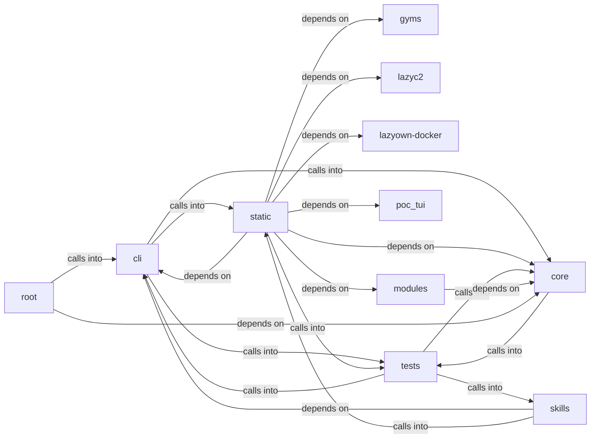

# cli

cli groups 129 files (c, js, php, py, sh) around _sanitize, colors_enabled, _paint, format_line, print_error. LazyOwn CLI infrastructure.

## cli (5.1)

cli groups 45 files (py) around Theme, get_theme, theme_from_payload, apply_assign, PendingCommandSet. LazyOwn CLI infrastructure.

## core (5.2)

core groups 8 files (py) around _sanitize, colors_enabled, _paint, format_line, print_error. ANSI color constants and console output helpers.

## gyms (5.3)

gyms groups 1 files (php).

## lazyc2 (5.4)

lazyc2 groups 1 files (py). Global C2 server state — namespace for shared mutable objects.

## lazyown-docker (5.5)

lazyown-docker groups 1 files (sh).

## modules (5.6)

modules groups 4 files (c, py) around PrivescVector, SystemProfile, _parse_kernel_version, _parse_version_from_range, parse_linpeas_output. gcc exp.c -o exp -l mnl -l nftnl -w

## poc_tui (5.7)

poc_tui groups 1 files (py) around main. Convenience launcher that symlinks LazyOwn dirs and starts the TUI.

## root (5.8)

root groups 2 files (py) around main, sanitize_content, RAGManager, __init__, initialize_cache_table. RAGManager: Manages RAG functionality with CAG caching for document processing and...

## skills (5.9)

skills groups 2 files (py) around OrchestratorConfig, from_payload, OrchestratorGoal, with_defaults, OrchestratorResult. MCP tool ``lazyown_palette`` (migrated from the call_tool dispatch chain).

## static (5.10)

static groups 16 files (js) around rand, clamp, Terminal, constructor, push. Version 1.73.4 3d-force-graph - https://github.com/vasturiano/3d-force-graph...

## tests (5.11)

tests groups 48 files (py) around crypto_module, tmp_sessions, TestAutoCryptoConfig, test_default_config, test_custom_config. Tests for cli.auto_crypto — automatic session data encryption.

**Files**:

- cli/__init__.py
- cli/assign.py
- cli/autosuggest.py
- cli/chain_mode.py
- cli/command_explorer.py
- cli/command_form.py
- cli/commands/__init__.py
- cli/commands/_dormancy.py
- cli/commands/help_ui.py
- cli/commands/misc_migrated.py
- cli/commands/orchestration.py
- cli/commands/recon.py
- cli/commands/session_ops.py
- cli/config_status.py
- cli/contextual_help.py
- cli/doctor.py
- cli/exploit_advisor.py
- cli/exploration_view.py
- cli/graph_overlay.py
- cli/marketplace_config.py
- cli/noise_verbs.py
- cli/palette.py
- cli/palette_command.py
- cli/palette_graph.py
- cli/palette_overlay.py
- cli/palette_telemetry.py
- cli/phase_labels.py
- cli/protips.py
- cli/reactive_hints.py
- cli/reasoning_stream.py
- cli/registry.py
- cli/session_resumer.py
- cli/sessions_browser.py
- cli/show.py
- cli/splash.py
- cli/status_bar.py
- cli/style.py
- cli/themes.py
- cli/timeline_browser.py
- cli/tips_engine.py
- cli/toast_bus.py
- cli/tui_theme.py
- cli/tutorial.py
- cli/wizard.py
- cli/wizard_scope.py
- core/console.py
- core/error_advice.py
- core/process.py
- core/profiles.py
- core/prompt.py
- core/safe_console.py
- core/safe_subprocess.py
- core/text_utils.py
- gyms/docker/php2shell/src/info.php
- key.py
- lazy_sentinel4.py
- lazyc2/state.py
- lazyown-docker/init.sh
- modules/exp.c
- modules/lazy_verify.py
- modules/privesc_predictor.py
- modules/search.py
- poc_tui/run.py
- skills/mcp_tools/palette.py
- skills/unified_orchestrator.py
- static/hexabot/hexabot-spinner.js
- static/js/3d-force-graph-1.73.4.min.js
- static/js/bootstrap-4.5.2.min.js
- static/js/bootstrap-5.3.0.bundle.min.js
- static/js/chart.min.js
- static/js/force-graph-1.43.5.min.js
- static/js/html2pdf.bundle.min.js
- static/js/jquery-3.5.1.slim.min.js
- static/js/particles.js
- static/js/popper-2.5.4.min.js
- static/js/quill-2.0.3.js
- static/js/showdown-2.1.0.min.js
- static/js/tippy-6.js
- static/js/vis-network-9.1.2.min.js
- static/js/vis-network.min.js
- static/js/xterm.js
- tests/test_auto_crypto.py
- tests/test_autosuggest.py
- tests/test_chain_mode.py
- tests/test_cli_assign.py
- tests/test_command_form.py
- tests/test_command_palette.py
- tests/test_command_set_migration.py
- tests/test_console_stdio.py
- tests/test_daemon_ctl_command_set.py
- tests/test_doctor.py
- tests/test_encoding_command_set.py
- tests/test_evidence_hints.py
- tests/test_exploration_and_addons.py
- tests/test_exposure_command_sets.py
- tests/test_graph_overlay.py
- tests/test_help_ui_command_set.py
- tests/test_improvements_spec.py
- tests/test_killchain_auto_refresh.py
- tests/test_marketplace_config.py
- tests/test_nethelpers_command_set.py
- tests/test_palette_overlay.py
- tests/test_phase_labels.py
- tests/test_profiles.py
- tests/test_reactive_hints.py
- tests/test_reactive_hints_expanded.py
- tests/test_reasoning_stream.py
- tests/test_safe_console.py
- tests/test_safe_subprocess.py
- tests/test_safe_subprocess_behavior.py
- tests/test_scope_deny_priority.py
- tests/test_scope_guard_integration.py
- tests/test_security_hardening.py
- tests/test_session_ops_command_set.py
- tests/test_sessions_browser.py
- tests/test_shell_semantics.py
- tests/test_shellsys_command_set.py
- tests/test_status_bar_operators.py
- tests/test_themes.py
- tests/test_timeline_browser.py
- tests/test_tips_engine.py
- tests/test_toast_bus.py
- tests/test_toastr_unify.py
- tests/test_tui_splash.py
- tests/test_tui_style.py
- tests/test_tui_theme_command.py
- tests/test_tui_themes.py
- tests/test_wizard_binary_check.py
- tests/test_wizard_llm.py
