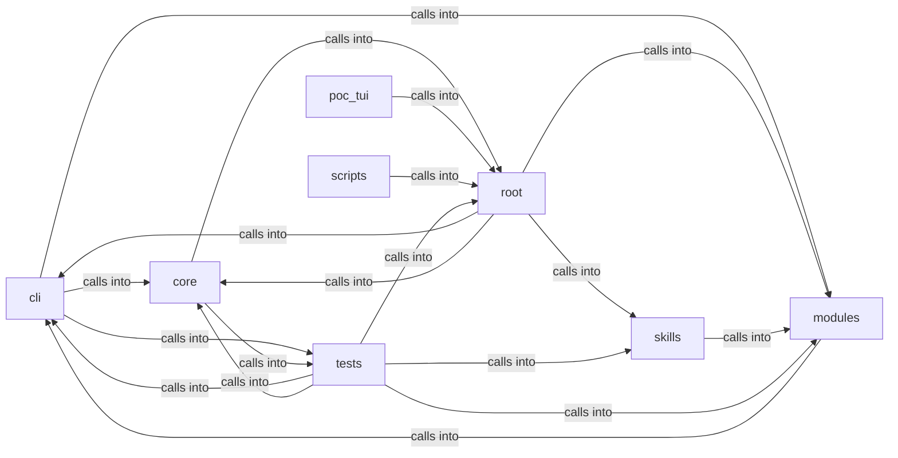

# cli

cli groups 126 files (py) around _sanitize, colors_enabled, _paint, format_line, print_error. LazyOwn CLI infrastructure.

## cli (3.1)

cli groups 50 files (py) around Theme, get_theme, theme_from_payload, EngagementState, _load_state. LazyOwn CLI infrastructure.

## core (3.2)

core groups 6 files (py) around _sanitize, colors_enabled, _paint, format_line, print_error. Lightweight command execution bridge between C2 bots and the LazyOwn CLI shell.

## modules (3.3)

modules groups 4 files (py) around KillChainConfig, world_model_path, phase_index, is_valid_phase, PhaseStatus. CLI authentication module — login against users.json with remember-me.

## poc_tui (3.4)

poc_tui groups 4 files (py) around ShellBackend, __init__, import_shell_class, start, run. Entry point: python3 -m poc_tui

## root (3.5)

root groups 2 files (py) around _ux_debug, _parse_bool_setting, _PayloadSettableProxy, __init__, __getattr__. RAGManager: Manages RAG functionality with CAG caching for document processing and...

## scripts (3.6)

scripts groups 1 files (py) around AuditConfig, argparser_commands, audit, main. Audit every registered shell command for dispatch and parser errors.

## skills (3.7)

skills groups 8 files (py) around ConfigKeys, EnvKeys, Defaults, PhaseNames, Paths. Dynamic Claude.md rule generator for the Hermes-LazyOwn integration.

## tests (3.8)

tests groups 51 files (py) around crypto_module, tmp_sessions, TestAutoCryptoConfig, test_default_config, test_custom_config. Tests for cli.auto_crypto — automatic session data encryption.

**Files**:

- cli/__init__.py
- cli/auto_crypto.py
- cli/autosuggest.py
- cli/chain_mode.py
- cli/command_chain.py
- cli/command_explorer.py
- cli/command_form.py
- cli/commands/__init__.py
- cli/commands/cli_auth.py
- cli/commands/help_ui.py
- cli/commands/orchestration.py
- cli/commands/recon.py
- cli/config_status.py
- cli/contextual_help.py
- cli/dashboard_layout.py
- cli/dashboard_tui.py
- cli/doctor.py
- cli/engagement_hooks.py
- cli/exploit_advisor.py
- cli/exploration.py
- cli/exploration_view.py
- cli/graph_advisor.py
- cli/graph_overlay.py
- cli/headless.py
- cli/killchain.py
- cli/lazynmap_post.py
- cli/noise_verbs.py
- cli/ops_commands.py
- cli/palette.py
- cli/palette_command.py
- cli/palette_graph.py
- cli/palette_overlay.py
- cli/palette_telemetry.py
- cli/phase_labels.py
- cli/protips.py
- cli/reactive_hints.py
- cli/reasoning_stream.py
- cli/recon_plan.py
- cli/scope_guard.py
- cli/sessions_browser.py
- cli/splash.py
- cli/status_bar.py
- cli/themes.py
- cli/timeline_browser.py
- cli/tips_engine.py
- cli/toast_bus.py
- cli/tui_theme.py
- cli/tutorial.py
- cli/wizard.py
- cli/wizard_scope.py
- core/command_bridge.py
- core/console.py
- core/error_advice.py
- core/profiles.py
- core/safe_console.py
- core/text_utils.py
- lazy_sentinel4.py
- lazyown.py
- modules/cli_auth.py
- modules/kill_chain_viz.py
- modules/killchain.py
- modules/session_cleanup.py
- poc_tui/__main__.py
- poc_tui/app.py
- poc_tui/run.py
- poc_tui/test_app.py
- scripts/devtools/command_audit.py
- skills/hermes-lazyown/claudemd_rules.py
- skills/hermes-lazyown/config_bridge.py
- skills/hermes-lazyown/constants.py
- skills/hermes-lazyown/executor.py
- skills/hermes-lazyown/hermes_sync.py
- skills/hermes-lazyown/mcp_server.py
- skills/hermes-lazyown/output_compactor.py
- skills/unified_orchestrator.py
- tests/test_auto_crypto.py
- tests/test_autosuggest.py
- tests/test_c2_agent.py
- tests/test_chain_mode.py
- tests/test_cli_auth_remember.py
- tests/test_command_chain.py
- tests/test_command_form.py
- tests/test_command_palette.py
- tests/test_console_stdio.py
- tests/test_core_command_bridge.py
- tests/test_dashboard_tui.py
- tests/test_doctor.py
- tests/test_engagement_and_ping.py
- tests/test_engagement_command_gate.py
- tests/test_engagement_elo_and_methodology.py
- tests/test_evidence_hints.py
- tests/test_exploration_and_addons.py
- tests/test_graph_advisor.py
- tests/test_graph_overlay.py
- tests/test_improvements_spec.py
- tests/test_killchain.py
- tests/test_killchain_auto_refresh.py
- tests/test_killchain_snapshot.py
- tests/test_killchain_unified.py
- tests/test_killchain_unified_v2.py
- tests/test_lazynmap_post.py
- tests/test_marketplace_config.py
- tests/test_ops_loot_phase.py
- tests/test_palette_overlay.py
- tests/test_phase_labels.py
- tests/test_profiles.py
- tests/test_reactive_hints.py
- tests/test_reactive_hints_expanded.py
- tests/test_reasoning_stream.py
- tests/test_recon_plan.py
- tests/test_safe_console.py
- tests/test_scope_guard.py
- tests/test_scope_guard_integration.py
- tests/test_sessions_browser.py
- tests/test_status_bar_operators.py
- tests/test_themes.py
- tests/test_timeline_browser.py
- tests/test_tips_engine.py
- tests/test_toast_bus.py
- tests/test_toastr_unify.py
- tests/test_tui_splash.py
- tests/test_tui_style.py
- tests/test_tui_theme_command.py
- tests/test_tui_themes.py
- tests/test_wizard_binary_check.py
- tests/test_wizard_llm.py
