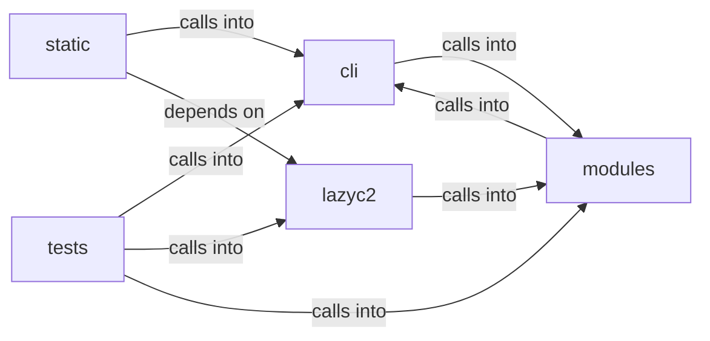

# cli: banner_config

cli: banner_config groups 40 files (js, py) around Role, valid_roles, Permission, _UsersFileUnreadable, RBACUser. Configurable Neon Box banner for the LazyOwn interactive shell.

## cli (7.1)

cli groups 10 files (py) around EngagementState, _load_state, _save_state, _load_index, _normalize_command. Configurable Neon Box banner for the LazyOwn interactive shell.

## lazyc2 (7.2)

lazyc2 groups 11 files (py) around require_role, _rbac_available, _get_rbac_store, _get_rbac_user_obj, _get_tenant_manager. LazyAddon creator contract for the LazyOwn C2 web interface.

## modules (7.3)

modules groups 4 files (py) around Role, valid_roles, Permission, _UsersFileUnreadable, RBACUser. CLI authentication module — login against users.json with remember-me.

## static (7.4)

static groups 2 files (js) around as, as, as, as, as. as: !

## tests (7.5)

tests groups 13 files (py) around _valid_draft, TestConfig, test_name_pattern_rejects_traversal, test_patterns_accept_canonical_values, test_os_options_cover_mitre_platforms. Tests for the LazyAddon creator contract and C2 blueprint.

**Files**:

- cli/banner_config.py
- cli/commands/cli_auth.py
- cli/commands/exploitgym.py
- cli/commands/redteam_gym.py
- cli/commands/ux.py
- cli/config_history.py
- cli/engagement_hooks.py
- cli/fuzzy_match.py
- cli/fuzzy_picker.py
- cli/session_hud.py
- lazyc2/__init__.py
- lazyc2/addon_creator.py
- lazyc2/blueprints/addons.py
- lazyc2/blueprints/auth.py
- lazyc2/blueprints/operations.py
- lazyc2/blueprints/session_auth.py
- lazyc2/extensions/decoy.py
- lazyc2/extensions/storage.py
- lazyc2/extensions/users.py
- lazyc2/models.py
- lazyc2/security/csrf.py
- modules/cli_auth.py
- modules/exploitgym_gym.py
- modules/lazy_rbac.py
- modules/redteam_gym.py
- static/js/socket.io-4.0.0.min.js
- static/js/socket.io-4.3.2.min.js
- tests/test_addon_creator.py
- tests/test_banner_config.py
- tests/test_cli_auth_remember.py
- tests/test_csrf_behavior.py
- tests/test_csrf_policy.py
- tests/test_engagement_and_ping.py
- tests/test_engagement_command_gate.py
- tests/test_engagement_elo_and_methodology.py
- tests/test_exploitgym_gym.py
- tests/test_fuzzy_picker.py
- tests/test_placeholder_coverage.py
- tests/test_prompt_readline_markers.py
- tests/test_prompt_refresh.py
