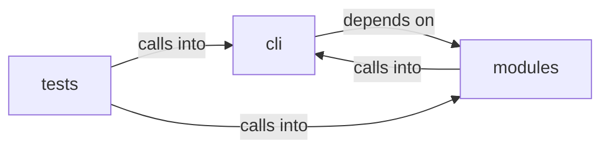

# cli: banner_config

cli: banner_config groups 19 files (py) around _load_users, _save_users, _load_payload, _save_payload, user_exists. Configurable Neon Box banner for the LazyOwn interactive shell.

## cli (11.1)

cli groups 9 files (py) around EngagementState, _load_state, _save_state, _load_index, _normalize_command. Configurable Neon Box banner for the LazyOwn interactive shell.

## modules (11.2)

modules groups 2 files (py) around _load_users, _save_users, _load_payload, _save_payload, user_exists. CLI authentication module — login against users.json with remember-me.

## tests (11.3)

tests groups 8 files (py) around registry, color_registry, glyph_registry, neutral_palette, test_registry_lists_every_canonical_segment. Tests for cli/banner_config.py — registry, settings, renderer, wizard.

**Files**:

- cli/banner_config.py
- cli/commands/cli_auth.py
- cli/commands/redteam_gym.py
- cli/commands/ux.py
- cli/config_history.py
- cli/engagement_hooks.py
- cli/fuzzy_match.py
- cli/fuzzy_picker.py
- cli/session_hud.py
- modules/cli_auth.py
- modules/redteam_gym.py
- tests/test_banner_config.py
- tests/test_cli_auth_remember.py
- tests/test_engagement_and_ping.py
- tests/test_engagement_command_gate.py
- tests/test_engagement_elo_and_methodology.py
- tests/test_fuzzy_picker.py
- tests/test_prompt_readline_markers.py
- tests/test_prompt_refresh.py
