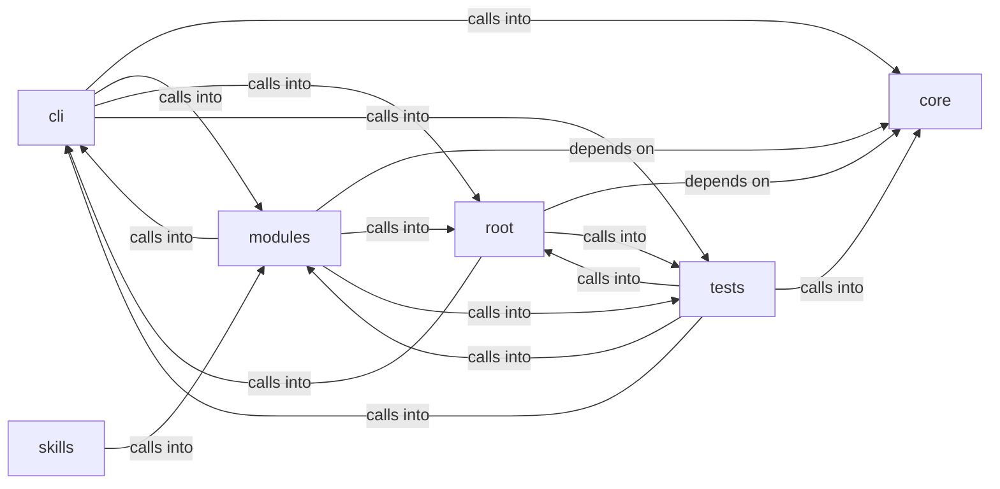

# cli/commands

cli/commands groups 166 files (py) around lazyown_set_config, needs_sudo, sudo_available, _retry_sudo_gate, redact_secrets. Autor: Gris Iscomeback Correo electrónico: grisiscomeback[at]gmail[dot]com Fecha de...

## cli (2.1)

cli groups 76 files (py) around extract_flag, LazyOwnCommandSet, _resolve_shell, params, payload. Configurable Neon Box banner for the LazyOwn interactive shell.

## core (2.2)

core groups 9 files (py) around check_rhost, check_lhost, check_lport, check_port, require_rhost. Symmetric primitives used by the framework.

## modules (2.3)

modules groups 27 files (py) around ContainerResource, ContainerFinding, DockerEnumerator, __init__, is_socket_accessible. Non-interactive, agent-safe implementation for atomic_tests / atomic_gen.

## root (2.4)

root groups 2 files (py) around lazyown_set_config, needs_sudo, sudo_available, _retry_sudo_gate, redact_secrets. Autor: Gris Iscomeback Correo electrónico: grisiscomeback[at]gmail[dot]com Fecha de...

## skills (2.5)

skills groups 1 files (py) around handle. MCP tool ``lazyown_list_modules``: list modules and scripts in modules/.

## tests (2.6)

tests groups 51 files (py) around AdLabCatalogueSpec, test_matrix_validates, test_summary_shape, test_all_vectors_resolve, test_get_unknown_is_none. Contract tests for the AD lab gym (Docker Samba DC) matrix and capture.

**Files**:

- banner.py
- cli/banner_config.py
- cli/commands/_base.py
- cli/commands/anti_forensics.py
- cli/commands/applocker_bypass.py
- cli/commands/bitm.py
- cli/commands/c2_profile.py
- cli/commands/c2_session.py
- cli/commands/campaign.py
- cli/commands/catalog.py
- cli/commands/cicd.py
- cli/commands/cli_auth.py
- cli/commands/cloud.py
- cli/commands/collaboration.py
- cli/commands/command_and_control.py
- cli/commands/containers.py
- cli/commands/cred.py
- cli/commands/cred_migrated.py
- cli/commands/crystal_ball.py
- cli/commands/database.py
- cli/commands/demo.py
- cli/commands/dns_exfil.py
- cli/commands/dpapi.py
- cli/commands/edr_detect.py
- cli/commands/encoding.py
- cli/commands/estorides.py
- cli/commands/evasive_payload.py
- cli/commands/exfiltration.py
- cli/commands/exploit.py
- cli/commands/exploitdb.py
- cli/commands/exposure_autofire.py
- cli/commands/exposure_intel.py
- cli/commands/exposure_inventory.py
- cli/commands/exposure_sentinel.py
- cli/commands/exposure_timeline.py
- cli/commands/golden_paths.py
- cli/commands/gym_matrix.py
- cli/commands/infra.py
- cli/commands/lab.py
- cli/commands/lateral.py
- cli/commands/lateral_migrated.py
- cli/commands/lazy_creds.py
- cli/commands/lazy_dorks.py
- cli/commands/lazy_oob.py
- cli/commands/lazy_passgen.py
- cli/commands/lazy_poc.py
- cli/commands/marketplace.py
- cli/commands/mobile_macos.py
- cli/commands/module_manager.py
- cli/commands/netattack.py
- cli/commands/nethelpers.py
- cli/commands/payload_generation.py
- cli/commands/persist.py
- cli/commands/persist_migrated.py
- cli/commands/phishing_wizard.py
- cli/commands/pivoting.py
- cli/commands/postexp.py
- cli/commands/postexp_migrated.py
- cli/commands/privilege_escalation.py
- cli/commands/resource_scripting.py
- cli/commands/retry_ops.py
- cli/commands/scan.py
- cli/commands/scan_migrated.py
- cli/commands/shellsys.py
- cli/commands/sleep_obfuscation.py
- cli/commands/socks_proxy.py
- cli/commands/supply_chain.py
- cli/commands/ux.py
- cli/commands/verb_admin.py
- cli/commands/winbox_gym.py
- cli/config_history.py
- cli/confirm.py
- cli/fuzzy_match.py
- cli/fuzzy_picker.py
- cli/output_mode.py
- cli/plugin_tiers.py
- cli/session_hud.py
- core/crypto.py
- core/hardening.py
- core/host_policy.py
- core/protocols.py
- core/reverse_shell_secret.py
- core/safe_exec.py
- core/safe_import.py
- core/safe_subprocess.py
- core/validators.py
- modules/__init__.py
- modules/atomic_cli.py
- modules/bitm_engine.py
- modules/categories.py
- modules/cicd_enumerator.py
- modules/cloud_enum.py
- modules/command_executor.py
- modules/dns_beacon.py
- modules/domain_dominance.py
- modules/dpapi_harvester.py
- modules/edr_detector.py
- modules/evasive_payloads.py
- modules/lazy_findings.py
- modules/lazycloud.py
- modules/lazyk8s.py
- modules/lazypassgen.py
- modules/lazypoophish.py
- modules/lazyshortener.py
- modules/loop/worker_gating.py
- modules/metasploitable_migrations.py
- modules/mfa_bypass.py
- modules/module_registry.py
- modules/phishing_orchestrator.py
- modules/resource_script.py
- modules/traffic_morpher.py
- modules/websocket_beacon.py
- modules/winbox_gym.py
- skills/mcp_tools/list_modules.py
- tests/test_ad_lab_gym.py
- tests/test_api_key_resolution.py
- tests/test_atomic_exploit_bridge.py
- tests/test_backdoor_random.py
- tests/test_banner_config.py
- tests/test_c2_agent_dual.py
- tests/test_campaign_import_safety.py
- tests/test_categories.py
- tests/test_core.py
- tests/test_credentials_rotation.py
- tests/test_executor_kernel.py
- tests/test_findings_gate.py
- tests/test_fuzzy_picker.py
- tests/test_group_kill.py
- tests/test_host_policy.py
- tests/test_input_fuzz.py
- tests/test_lab_target_visibility.py
- tests/test_lazy_autofire.py
- tests/test_lazy_creds.py
- tests/test_lazy_finalizer.py
- tests/test_lazy_findings.py
- tests/test_lazy_inventory.py
- tests/test_lazy_oob.py
- tests/test_lazy_runner_fallback.py
- tests/test_lazy_timeline.py
- tests/test_lazy_worker_safety.py
- tests/test_lazydorks.py
- tests/test_lazypassgen.py
- tests/test_lazypoophish.py
- tests/test_lazyshortener.py
- tests/test_loop_mentions.py
- tests/test_metasploitable_migrations.py
- tests/test_module_registry.py
- tests/test_module_registry_bridge.py
- tests/test_plugin_tiers.py
- tests/test_prompt_readline_markers.py
- tests/test_prompt_refresh.py
- tests/test_require_guards.py
- tests/test_resource_script.py
- tests/test_safe_subprocess.py
- tests/test_safe_subprocess_behavior.py
- tests/test_security_alerts_fix.py
- tests/test_security_hardening.py
- tests/test_security_hardening_v3.py
- tests/test_security_hardening_v4.py
- tests/test_security_hardening_v5.py
- tests/test_shell_semantics.py
- tests/test_ttpscope_bridge.py
- tests/test_unified_bridge_delegate.py
- tests/test_verb_catalog.py
- tests/test_winbox_gym.py
- utils.py
