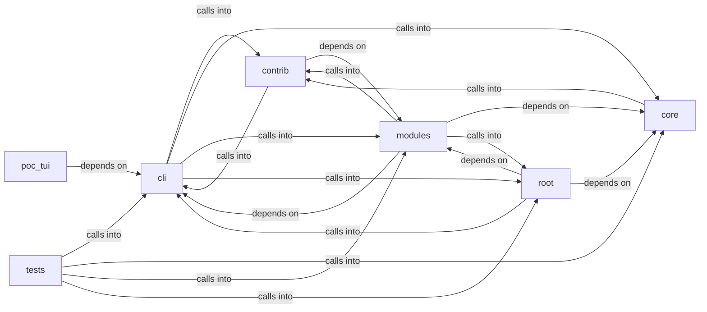

# cli/commands

cli/commands groups 158 files (c, py) around lazyown_set_config, needs_sudo, sudo_available, _retry_sudo_gate, redact_secrets. Autor: Gris Iscomeback Correo electrónico: grisiscomeback[at]gmail[dot]com Fecha de...

## cli (2.1)

cli groups 80 files (py) around EnumCommandSet, do_smbclient, do_smbclient_impacket, do_smbclient_py, do_smbmap. Configurable Neon Box banner for the LazyOwn interactive shell.

## contrib (2.2)

contrib groups 2 files (py) around SamsungKnoxExploitServer, do_GET, apk_bytes, launch_html, exploit_js.

## core (2.3)

core groups 9 files (py) around check_rhost, check_lhost, check_lport, check_port, require_rhost. Symmetric primitives used by the framework.

## modules (2.4)

modules groups 26 files (c, py) around main, ContainerResource, ContainerFinding, DockerEnumerator, __init__. Beacon configuration builder — wires profile engines into beacon compile-time config.

## poc_tui (2.5)

poc_tui groups 4 files (py) around ShellBackend, __init__, import_shell_class, start, run. Entry point: python3 -m poc_tui

## root (2.6)

root groups 2 files (py) around lazyown_set_config, needs_sudo, sudo_available, _retry_sudo_gate, redact_secrets. Autor: Gris Iscomeback Correo electrónico: grisiscomeback[at]gmail[dot]com Fecha de...

## tests (2.7)

tests groups 35 files (py) around TestApiKeyWiredIntoParams, test_params_api_key_is_not_hardcoded_none, test_params_api_key_binds_config_attr, test_class_attribute_api_key_reads_payload, TestReplaceCommandPlaceholders. API-key resolution contract tests.

**Files**:

- banner.py
- cli/banner_config.py
- cli/commands/_base.py
- cli/commands/anti_forensics.py
- cli/commands/applocker_bypass.py
- cli/commands/bitm.py
- cli/commands/bof_registry.py
- cli/commands/c2_profile.py
- cli/commands/c2_session.py
- cli/commands/campaign.py
- cli/commands/catalog.py
- cli/commands/cicd.py
- cli/commands/cli_auth.py
- cli/commands/cloud.py
- cli/commands/collaboration.py
- cli/commands/command_and_control.py
- cli/commands/containers.py
- cli/commands/cred.py
- cli/commands/cred_migrated.py
- cli/commands/crystal_ball.py
- cli/commands/daemon_ctl.py
- cli/commands/database.py
- cli/commands/defaults.py
- cli/commands/demo.py
- cli/commands/dns_exfil.py
- cli/commands/dpapi.py
- cli/commands/edr_detect.py
- cli/commands/encoding.py
- cli/commands/enum.py
- cli/commands/estorides.py
- cli/commands/evasive_payload.py
- cli/commands/exfiltration.py
- cli/commands/exploit.py
- cli/commands/exposure_autofire.py
- cli/commands/exposure_intel.py
- cli/commands/exposure_inventory.py
- cli/commands/exposure_sentinel.py
- cli/commands/exposure_timeline.py
- cli/commands/golden_paths.py
- cli/commands/gym_matrix.py
- cli/commands/infra.py
- cli/commands/lab.py
- cli/commands/lateral.py
- cli/commands/lateral_migrated.py
- cli/commands/lazy_creds.py
- cli/commands/lazy_dorks.py
- cli/commands/lazy_oob.py
- cli/commands/lazy_passgen.py
- cli/commands/marketplace.py
- cli/commands/mobile_macos.py
- cli/commands/module_manager.py
- cli/commands/nethelpers.py
- cli/commands/payload_generation.py
- cli/commands/persist.py
- cli/commands/phishing_wizard.py
- cli/commands/pivoting.py
- cli/commands/postexp.py
- cli/commands/postexp_migrated.py
- cli/commands/privilege_escalation.py
- cli/commands/recon_migrated.py
- cli/commands/resource_scripting.py
- cli/commands/retry_ops.py
- cli/commands/scan.py
- cli/commands/scan_migrated.py
- cli/commands/shellsys.py
- cli/commands/sleep_obfuscation.py
- cli/commands/socks_proxy.py
- cli/commands/supply_chain.py
- cli/commands/ux.py
- cli/commands/verb_admin.py
- cli/commands/winbox_gym.py
- cli/config_history.py
- cli/confirm.py
- cli/fuzzy_match.py
- cli/fuzzy_picker.py
- cli/graph_overlay.py
- cli/output_mode.py
- cli/plugin_tiers.py
- cli/scope_guard.py
- cli/session_hud.py
- cli/surface_tui.py
- contrib/legacy/lazygalazy.py
- contrib/legacy/lazyhttpreverseshell.py
- core/crypto.py
- core/defaults.py
- core/hardening.py
- core/host_policy.py
- core/protocols.py
- core/reverse_shell_secret.py
- core/safe_import.py
- core/safe_subprocess.py
- core/validators.py
- modules/backdoor/server.c
- modules/beacon_config_builder.py
- modules/bitm_engine.py
- modules/bof_registry.py
- modules/c2_builder.py
- modules/c2_profile_engine.py
- modules/categories.py
- modules/cicd_enumerator.py
- modules/cloud_enum.py
- modules/domain_dominance.py
- modules/dpapi_harvester.py
- modules/edr_detector.py
- modules/evasion_engine.py
- modules/evasive_payloads.py
- modules/lab_runtime.py
- modules/lazy_findings.py
- modules/lazy_oob.py
- modules/lazycloud.py
- modules/lazyk8s.py
- modules/mfa_bypass.py
- modules/phishing_orchestrator.py
- modules/professional_report.py
- modules/resource_script.py
- modules/sleep_obfuscation.py
- modules/socks_proxy.py
- modules/websocket_beacon.py
- poc_tui/__main__.py
- poc_tui/app.py
- poc_tui/run.py
- poc_tui/test_app.py
- tests/test_api_key_resolution.py
- tests/test_banner_config.py
- tests/test_bdd_infra_range_report.py
- tests/test_beacon_config_builder.py
- tests/test_bof_registry.py
- tests/test_c2_profile_engine.py
- tests/test_campaign_import_safety.py
- tests/test_categories.py
- tests/test_core.py
- tests/test_credentials_rotation.py
- tests/test_findings_gate.py
- tests/test_fuzzy_picker.py
- tests/test_graph_overlay.py
- tests/test_host_policy.py
- tests/test_implant_session_secrets.py
- tests/test_infra_disposable.py
- tests/test_input_fuzz.py
- tests/test_lab_target_visibility.py
- tests/test_lazy_findings.py
- tests/test_plugin_tiers.py
- tests/test_prompt_readline_markers.py
- tests/test_prompt_refresh.py
- tests/test_require_guards.py
- tests/test_resource_script.py
- tests/test_safe_subprocess.py
- tests/test_safe_subprocess_behavior.py
- tests/test_scope_guard.py
- tests/test_security_alerts_fix.py
- tests/test_security_hardening.py
- tests/test_security_hardening_v3.py
- tests/test_security_hardening_v5.py
- tests/test_shell_semantics.py
- tests/test_sleep_obfuscation.py
- tests/test_socks_proxy.py
- tests/test_winbox_gym.py
- utils.py
