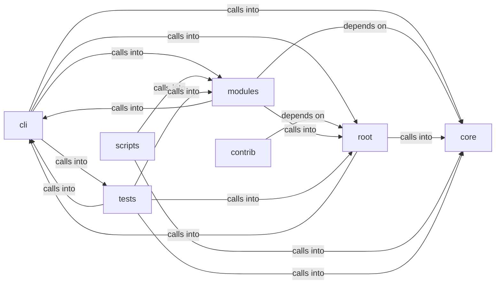

# cli/commands

cli/commands groups 157 files (py) around needs_sudo, sudo_available, redact_secrets, parse_ip_mac, create_arp_packet. Autor: Gris Iscomeback Correo electrónico: grisiscomeback[at]gmail[dot]com Fecha de...

## cli (1.1)

cli groups 70 files (py) around extract_flag, LazyOwnCommandSet, _resolve_shell, params, payload. Declarative cmd2 alias loader.

## contrib (1.2)

contrib groups 1 files (py) around check_sudo, start_smb_server, start_smb_relay, CustomSMBRelayServer, __init__.

## core (1.3)

core groups 8 files (py) around check_rhost, check_lhost, check_lport, check_port, require_rhost. Configuration loader and Config wrapper.

## modules (1.4)

modules groups 30 files (py) around _load_users, _save_users, _load_payload, _save_payload, user_exists. Purple Team Closed-Loop — honest measurement of offensive detection.

## root (1.5)

root groups 2 files (py) around needs_sudo, sudo_available, redact_secrets, parse_ip_mac, create_arp_packet. Autor: Gris Iscomeback Correo electrónico: grisiscomeback[at]gmail[dot]com Fecha de...

## scripts (1.6)

scripts groups 1 files (py) around SmokeConfig, check_surfaces, check_calls, main. Smoke check for the public surfaces documented in CORE.md.

## tests (1.7)

tests groups 45 files (py) around TestHexSource, test_valid_hex_decodes_to_32_bytes, test_wrong_length_raises, test_non_hex_raises, TestDiskSource. TDD tests for the AES key resolution contract.

**Files**:

- banner.py
- cli/aliases.py
- cli/banner_config.py
- cli/cli_enhancements.py
- cli/commands/__init__.py
- cli/commands/_base.py
- cli/commands/_dormancy.py
- cli/commands/anti_forensics.py
- cli/commands/applocker_bypass.py
- cli/commands/audit.py
- cli/commands/bitm.py
- cli/commands/bof_registry.py
- cli/commands/c2_profile.py
- cli/commands/campaign.py
- cli/commands/catalog.py
- cli/commands/cicd.py
- cli/commands/cli_auth.py
- cli/commands/cloud.py
- cli/commands/command_and_control.py
- cli/commands/cred.py
- cli/commands/cred_migrated.py
- cli/commands/crystal_ball.py
- cli/commands/defaults.py
- cli/commands/demo.py
- cli/commands/diagnostics.py
- cli/commands/dpapi.py
- cli/commands/edr_detect.py
- cli/commands/encoding.py
- cli/commands/evasive_payload.py
- cli/commands/exfiltration.py
- cli/commands/exploit.py
- cli/commands/exploitgym.py
- cli/commands/infra.py
- cli/commands/lab.py
- cli/commands/lateral.py
- cli/commands/lateral_migrated.py
- cli/commands/marketplace.py
- cli/commands/mcp_bridge.py
- cli/commands/misc_migrated.py
- cli/commands/mobile_macos.py
- cli/commands/module_manager.py
- cli/commands/nethelpers.py
- cli/commands/orchestration.py
- cli/commands/payload_generation.py
- cli/commands/persist.py
- cli/commands/persist_migrated.py
- cli/commands/pivoting.py
- cli/commands/postexp.py
- cli/commands/postexp_migrated.py
- cli/commands/privilege_escalation.py
- cli/commands/purple_team.py
- cli/commands/recon_migrated.py
- cli/commands/redteam_gym.py
- cli/commands/scan.py
- cli/commands/scan_migrated.py
- cli/commands/shellsys.py
- cli/commands/sleep_obfuscation.py
- cli/commands/socks_proxy.py
- cli/commands/supply_chain.py
- cli/commands/ux.py
- cli/config_history.py
- cli/confirm.py
- cli/engagement_hooks.py
- cli/fuzzy_match.py
- cli/fuzzy_picker.py
- cli/marketplace_config.py
- cli/output_mode.py
- cli/plugin_tiers.py
- cli/purple_tui.py
- cli/registry.py
- cli/session_hud.py
- contrib/legacy/lazysmbrelay.py
- core/config.py
- core/defaults.py
- core/hardening.py
- core/host_policy.py
- core/reverse_shell_secret.py
- core/safe_import.py
- core/safe_subprocess.py
- core/validators.py
- modules/auto_purple.py
- modules/beacon_config_builder.py
- modules/bitm_engine.py
- modules/bof_registry.py
- modules/c2_builder.py
- modules/c2_profile_engine.py
- modules/categories.py
- modules/cicd_enumerator.py
- modules/cli_auth.py
- modules/cloud_enum.py
- modules/domain_dominance.py
- modules/dpapi_harvester.py
- modules/edr_detector.py
- modules/evasion_engine.py
- modules/evasive_payloads.py
- modules/exploitgym_gym.py
- modules/lazycloud.py
- modules/metrics.py
- modules/mfa_bypass.py
- modules/module_registry.py
- modules/payload_factory.py
- modules/privesc_predictor.py
- modules/professional_report.py
- modules/redteam_gym.py
- modules/session_cleanup.py
- modules/sleep_obfuscation.py
- modules/socks_proxy.py
- modules/traffic_morpher.py
- modules/websocket_beacon.py
- modules/yara_scanner.py
- scripts/devtools/core_smoke.py
- tests/test_aes_key_propagation.py
- tests/test_api_key_resolution.py
- tests/test_backdoor_random.py
- tests/test_banner_config.py
- tests/test_bdd_infra_range_report.py
- tests/test_beacon_config_builder.py
- tests/test_bof_registry.py
- tests/test_c2_profile_engine.py
- tests/test_campaign_import_safety.py
- tests/test_categories.py
- tests/test_cli_assign.py
- tests/test_cli_auth_remember.py
- tests/test_cli_command_sets.py
- tests/test_cli_enhancements.py
- tests/test_command_set_migration.py
- tests/test_credentials_rotation.py
- tests/test_daemon_ctl_command_set.py
- tests/test_encoding_command_set.py
- tests/test_engagement_and_ping.py
- tests/test_engagement_command_gate.py
- tests/test_engagement_elo_and_methodology.py
- tests/test_exploitgym_gym.py
- tests/test_fuzzy_picker.py
- tests/test_help_ui_command_set.py
- tests/test_host_policy.py
- tests/test_improvements_spec.py
- tests/test_infra_disposable.py
- tests/test_input_fuzz.py
- tests/test_metrics.py
- tests/test_module_registry.py
- tests/test_nethelpers_command_set.py
- tests/test_payload_factory.py
- tests/test_plugin_tiers.py
- tests/test_prompt_readline_markers.py
- tests/test_prompt_refresh.py
- tests/test_require_guards.py
- tests/test_safe_subprocess.py
- tests/test_safe_subprocess_behavior.py
- tests/test_security_alerts_fix.py
- tests/test_security_hardening.py
- tests/test_session_ops_command_set.py
- tests/test_shell_semantics.py
- tests/test_shellsys_command_set.py
- tests/test_sleep_obfuscation.py
- tests/test_socks_proxy.py
- utils.py
