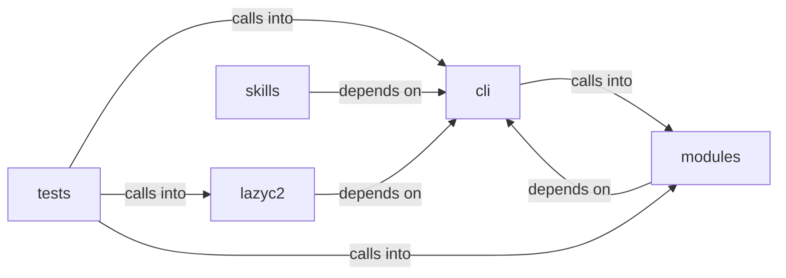

# cli/commands: c2_profile_engine

cli/commands: c2_profile_engine groups 26 files (py) around EnumCommandSet, do_smbclient, do_smbclient_impacket, do_smbclient_py, do_smbmap. BOF marketplace CommandSet — Beacon Object File discovery, install, and execution.

## cli (9.1)

cli groups 6 files (py) around EnumCommandSet, do_smbclient, do_smbclient_impacket, do_smbclient_py, do_smbmap. BOF marketplace CommandSet — Beacon Object File discovery, install, and execution.

## lazyc2 (9.2)

lazyc2 groups 1 files (py) around CommandRejectionReason, CommandDecision, to_dict, CommandAllowlist, __init__. Command allowlist policy for the LazyOwn C2 ``/api/run`` endpoint.

## modules (9.3)

modules groups 5 files (py) around TlsProfile, get_cipher_suites, get_ja3_hash, from_dict, to_dict. Beacon configuration builder — wires profile engines into beacon compile-time config.

## skills (9.4)

skills groups 6 files (py) around CompactionResult, summary, ContextCompactor, __init__, apply_budget. LazyOwn CLAUDE.md Hierarchical Loader (Claude Code style)  4-level hierarchy (highest...

## tests (9.5)

tests groups 8 files (py) around TestBeaconConfig, test_default_construction, test_to_gen_beacon_args, test_to_go_implant_vars, test_to_config_json. Tests for modules/beacon_config_builder.py — BeaconConfig, BeaconConfigBuilder, and...

**Files**:

- cli/commands/bof_registry.py
- cli/commands/c2_profile.py
- cli/commands/enum.py
- cli/commands/sleep_obfuscation.py
- cli/commands/socks_proxy.py
- cli/scope_guard.py
- lazyc2/security/command_allowlist.py
- modules/beacon_config_builder.py
- modules/bof_registry.py
- modules/c2_profile_engine.py
- modules/sleep_obfuscation.py
- modules/socks_proxy.py
- skills/lazyown_claudemd.py
- skills/lazyown_context.py
- skills/lazyown_hooks.py
- skills/lazyown_permissions.py
- skills/lazyown_session.py
- skills/tests/test_harness_e2e.py
- tests/test_beacon_config_builder.py
- tests/test_bof_registry.py
- tests/test_c2_profile_engine.py
- tests/test_command_allowlist.py
- tests/test_command_allowlist_behavior.py
- tests/test_scope_guard.py
- tests/test_sleep_obfuscation.py
- tests/test_socks_proxy.py
