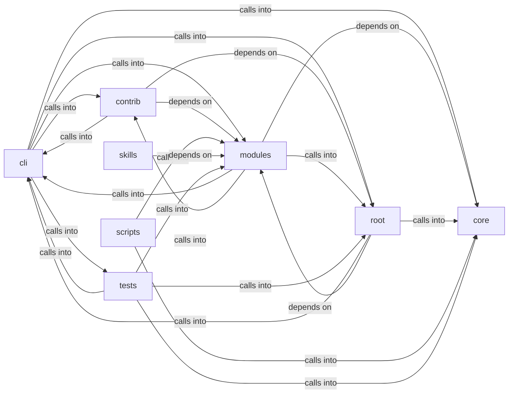

# cli/commands: utils

cli/commands: utils groups 146 files (c, py) around needs_sudo, sudo_available, _retry_sudo_gate, redact_secrets, parse_ip_mac. Autor: Gris Iscomeback Correo electrónico: grisiscomeback[at]gmail[dot]com Fecha de...

## cli (2.1)

cli groups 63 files (py) around extract_flag, LazyOwnCommandSet, _resolve_shell, params, payload. Declarative cmd2 alias loader.

## contrib (2.2)

contrib groups 3 files (py) around SamsungKnoxExploitServer, do_GET, apk_bytes, launch_html, exploit_js.

## core (2.3)

core groups 7 files (py) around check_rhost, check_lhost, check_lport, check_port, require_rhost. Centralized security hardening utilities for the LazyOwn framework.

## modules (2.4)

modules groups 28 files (c, py) around main, Migration, _docker_exec, _core_services_apply, build_migrations. Git update contract for lazyaddons.

## root (2.5)

root groups 2 files (py) around needs_sudo, sudo_available, _retry_sudo_gate, redact_secrets, parse_ip_mac. Autor: Gris Iscomeback Correo electrónico: grisiscomeback[at]gmail[dot]com Fecha de...

## scripts (2.6)

scripts groups 1 files (py) around SmokeConfig, check_surfaces, check_calls, main. Smoke check for the public surfaces documented in CORE.md.

## skills (2.7)

skills groups 1 files (py) around list_tools, call_tool, main. LazyOwn MCP OpenCode bridge.

## tests (2.8)

tests groups 41 files (py) around _git, _repo_with_remote, _addon, test_every_shipped_addon_opts_in, test_update_disabled_is_skipped. Lazyaddon update BDD contract: opt-in, path-safe, dirty-tree aware.

**Files**:

- banner.py
- cli/aliases.py
- cli/banner_config.py
- cli/cli_enhancements.py
- cli/commands/__init__.py
- cli/commands/_base.py
- cli/commands/_dormancy.py
- cli/commands/anti_forensics.py
- cli/commands/applocker_bypass.py
- cli/commands/audit.py
- cli/commands/bitm.py
- cli/commands/campaign.py
- cli/commands/catalog.py
- cli/commands/cicd.py
- cli/commands/cloud.py
- cli/commands/command_and_control.py
- cli/commands/cred.py
- cli/commands/cred_migrated.py
- cli/commands/crystal_ball.py
- cli/commands/demo.py
- cli/commands/diagnostics.py
- cli/commands/dns_exfil.py
- cli/commands/dpapi.py
- cli/commands/edr_detect.py
- cli/commands/encoding.py
- cli/commands/evasive_payload.py
- cli/commands/exfiltration.py
- cli/commands/exploit.py
- cli/commands/infra.py
- cli/commands/lab.py
- cli/commands/lateral.py
- cli/commands/lateral_migrated.py
- cli/commands/marketplace.py
- cli/commands/mcp_bridge.py
- cli/commands/misc_migrated.py
- cli/commands/mobile_macos.py
- cli/commands/module_manager.py
- cli/commands/nethelpers.py
- cli/commands/orchestration.py
- cli/commands/payload_generation.py
- cli/commands/persist.py
- cli/commands/persist_migrated.py
- cli/commands/phishing_wizard.py
- cli/commands/pivoting.py
- cli/commands/postexp.py
- cli/commands/postexp_migrated.py
- cli/commands/privilege_escalation.py
- cli/commands/recon_migrated.py
- cli/commands/resource_scripting.py
- cli/commands/scan.py
- cli/commands/scan_migrated.py
- cli/commands/shellsys.py
- cli/commands/supply_chain.py
- cli/commands/ux.py
- cli/commands/verb_admin.py
- cli/config_history.py
- cli/confirm.py
- cli/fuzzy_match.py
- cli/fuzzy_picker.py
- cli/marketplace_config.py
- cli/output_mode.py
- cli/plugin_tiers.py
- cli/registry.py
- cli/session_hud.py
- contrib/legacy/lazygalazy.py
- contrib/legacy/lazyhttpreverseshell.py
- contrib/legacy/lazysmbrelay.py
- core/hardening.py
- core/host_policy.py
- core/reverse_shell_secret.py
- core/safe_exec.py
- core/safe_import.py
- core/safe_subprocess.py
- core/validators.py
- modules/addon_updater.py
- modules/backdoor/server.c
- modules/bitm_engine.py
- modules/c2_builder.py
- modules/categories.py
- modules/cicd_enumerator.py
- modules/cloud_enum.py
- modules/command_executor.py
- modules/dns_beacon.py
- modules/domain_dominance.py
- modules/dpapi_harvester.py
- modules/edr_detector.py
- modules/evasion_engine.py
- modules/evasive_payloads.py
- modules/icmp_server.py
- modules/lazycloud.py
- modules/metasploitable_migrations.py
- modules/mfa_bypass.py
- modules/module_registry.py
- modules/payload_factory.py
- modules/phishing_orchestrator.py
- modules/privesc_predictor.py
- modules/professional_report.py
- modules/resource_script.py
- modules/session_cleanup.py
- modules/traffic_morpher.py
- modules/websocket_beacon.py
- modules/yara_scanner.py
- scripts/devtools/core_smoke.py
- skills/lazyown_mcp_opencode.py
- tests/test_addon_updater.py
- tests/test_api_key_resolution.py
- tests/test_atomic_exploit_bridge.py
- tests/test_backdoor_random.py
- tests/test_banner_config.py
- tests/test_bdd_infra_range_report.py
- tests/test_campaign_import_safety.py
- tests/test_categories.py
- tests/test_cli_command_sets.py
- tests/test_cli_enhancements.py
- tests/test_command_set_migration.py
- tests/test_credentials_rotation.py
- tests/test_daemon_ctl_command_set.py
- tests/test_encoding_command_set.py
- tests/test_executor_kernel.py
- tests/test_fuzzy_picker.py
- tests/test_help_ui_command_set.py
- tests/test_host_policy.py
- tests/test_improvements_spec.py
- tests/test_infra_disposable.py
- tests/test_input_fuzz.py
- tests/test_lab_target_visibility.py
- tests/test_metasploitable_migrations.py
- tests/test_module_registry.py
- tests/test_nethelpers_command_set.py
- tests/test_payload_factory.py
- tests/test_plugin_tiers.py
- tests/test_prompt_readline_markers.py
- tests/test_prompt_refresh.py
- tests/test_require_guards.py
- tests/test_resource_script.py
- tests/test_safe_subprocess.py
- tests/test_safe_subprocess_behavior.py
- tests/test_security_alerts_fix.py
- tests/test_security_hardening.py
- tests/test_security_hardening_v3.py
- tests/test_security_hardening_v4.py
- tests/test_security_hardening_v5.py
- tests/test_session_ops_command_set.py
- tests/test_shell_semantics.py
- tests/test_shellsys_command_set.py
- utils.py
