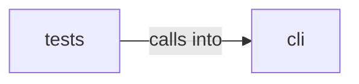

# cli: exploration

cli: exploration groups 9 files (py) around ExplorationConfig, DiscoveredService, label, AddonEntry, ToolEntry. Command chain registry: explicit prerequisites and dynamic next steps.

## cli (13.1)

cli groups 5 files (py) around ExplorationConfig, DiscoveredService, label, AddonEntry, ToolEntry. Command chain registry: explicit prerequisites and dynamic next steps.

## tests (13.2)

tests groups 4 files (py) around _svc, _FakeEngine, __init__, services, unexplored_addons. Tests for cli/command_chain.py.

**Files**:

- cli/command_chain.py
- cli/exploration.py
- cli/exploration_view.py
- cli/lazynmap_post.py
- cli/recon_plan.py
- tests/test_command_chain.py
- tests/test_exploration_and_addons.py
- tests/test_lazynmap_post.py
- tests/test_recon_plan.py
