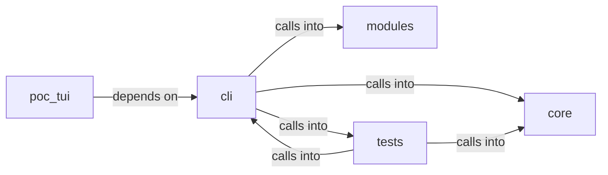

# cli: status_bar

cli: status_bar groups 61 files (py) around Theme, get_theme, theme_from_payload, truncate_text, ContainerCommandSet. LazyOwn CLI infrastructure.

## cli (5.1)

cli groups 27 files (py) around Theme, get_theme, theme_from_payload, ContainerCommandSet, do_docker_enum. LazyOwn CLI infrastructure.

## core (5.2)

core groups 2 files (py) around truncate_text, supports_unicode, get_console, panel_box, milestone_glyph. Terminal-safe Rich console factory.

## modules (5.3)

modules groups 2 files (py) around ContainerResource, ContainerFinding, DockerEnumerator, __init__, is_socket_accessible. APT Playbook Engine — map public APT reports to executable Atomic Red Team chains.

## poc_tui (5.4)

poc_tui groups 4 files (py) around ShellBackend, __init__, import_shell_class, start, run. Entry point: python3 -m poc_tui

## tests (5.5)

tests groups 26 files (py) around _StaticProvider, __init__, suggest, _RaisingProvider, suggest. Unit tests for cli.autosuggest.

**Files**:

- cli/__init__.py
- cli/autosuggest.py
- cli/chain_mode.py
- cli/command_form.py
- cli/commands/containers.py
- cli/contextual_help.py
- cli/graph_advisor.py
- cli/graph_overlay.py
- cli/noise_verbs.py
- cli/palette.py
- cli/palette_command.py
- cli/palette_graph.py
- cli/palette_overlay.py
- cli/palette_telemetry.py
- cli/phase_labels.py
- cli/protips.py
- cli/purple_tui.py
- cli/reactive_hints.py
- cli/recommendation.py
- cli/recommendation_signals.py
- cli/sessions_browser.py
- cli/status_bar.py
- cli/themes.py
- cli/timeline_browser.py
- cli/tips_engine.py
- cli/toast_bus.py
- cli/tui_theme.py
- core/safe_console.py
- core/text_utils.py
- modules/apt_playbooks.py
- modules/lazyk8s.py
- poc_tui/__main__.py
- poc_tui/app.py
- poc_tui/run.py
- poc_tui/test_app.py
- tests/test_autosuggest.py
- tests/test_chain_mode.py
- tests/test_command_form.py
- tests/test_command_palette.py
- tests/test_evidence_hints.py
- tests/test_graph_advisor.py
- tests/test_graph_overlay.py
- tests/test_killchain_auto_refresh.py
- tests/test_killchain_gap_signal.py
- tests/test_palette_overlay.py
- tests/test_phase1_data_gaps.py
- tests/test_phase_labels.py
- tests/test_reactive_hints.py
- tests/test_reactive_hints_expanded.py
- tests/test_recommendation.py
- tests/test_safe_console.py
- tests/test_sessions_browser.py
- tests/test_status_bar_operators.py
- tests/test_themes.py
- tests/test_timeline_browser.py
- tests/test_tips_engine.py
- tests/test_toast_bus.py
- tests/test_tui_style.py
- tests/test_tui_theme_command.py
- tests/test_tui_themes.py
- tests/test_wizard_binary_check.py
