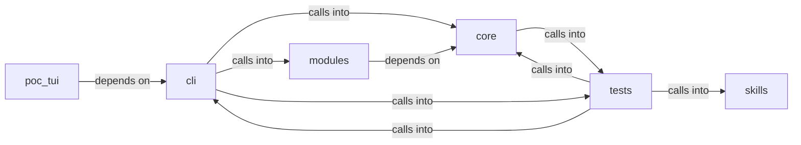

# cli: status_bar

cli: status_bar groups 101 files (c, py) around _sanitize, colors_enabled, _paint, format_line, print_error. LazyOwn CLI infrastructure.

## cli (4.1)

cli groups 44 files (py) around Theme, get_theme, theme_from_payload, ContainerCommandSet, do_docker_enum. LazyOwn CLI infrastructure.

## core (4.2)

core groups 12 files (py) around _sanitize, colors_enabled, _paint, format_line, print_error. Core primitives for the LazyOwn framework.

## modules (4.3)

modules groups 3 files (c, py) around ContainerResource, ContainerFinding, DockerEnumerator, __init__, is_socket_accessible. Purple Team Closed-Loop — honest measurement of offensive detection.

## poc_tui (4.4)

poc_tui groups 4 files (py) around ShellBackend, __init__, import_shell_class, start, run. Entry point: python3 -m poc_tui

## skills (4.5)

skills groups 1 files (py) around OrchestratorConfig, from_payload, OrchestratorGoal, with_defaults, OrchestratorResult. Unified orchestrator facade collapsing daemon, hive and SWAN into one surface.

## tests (4.6)

tests groups 37 files (py) around _StaticProvider, __init__, suggest, _RaisingProvider, suggest. Unit tests for cli.autosuggest.

**Files**:

- cli/__init__.py
- cli/autosuggest.py
- cli/chain_mode.py
- cli/command_chain.py
- cli/command_explorer.py
- cli/command_form.py
- cli/commands/__init__.py
- cli/commands/containers.py
- cli/commands/help_ui.py
- cli/commands/orchestration.py
- cli/commands/purple_team.py
- cli/commands/recon.py
- cli/config_status.py
- cli/contextual_help.py
- cli/doctor.py
- cli/exploit_advisor.py
- cli/exploration.py
- cli/exploration_view.py
- cli/graph_overlay.py
- cli/lazynmap_post.py
- cli/noise_verbs.py
- cli/palette.py
- cli/palette_command.py
- cli/palette_graph.py
- cli/palette_overlay.py
- cli/palette_telemetry.py
- cli/phase_labels.py
- cli/protips.py
- cli/purple_tui.py
- cli/reactive_hints.py
- cli/reasoning_stream.py
- cli/recon_plan.py
- cli/session_resumer.py
- cli/sessions_browser.py
- cli/splash.py
- cli/status_bar.py
- cli/themes.py
- cli/timeline_browser.py
- cli/tips_engine.py
- cli/toast_bus.py
- cli/tui_theme.py
- cli/tutorial.py
- cli/wizard.py
- cli/wizard_scope.py
- core/__init__.py
- core/console.py
- core/crypto.py
- core/dependencies.py
- core/error_advice.py
- core/errors.py
- core/http.py
- core/network.py
- core/profiles.py
- core/protocols.py
- core/safe_console.py
- core/text_utils.py
- modules/auto_purple.py
- modules/lazyk8s.py
- modules/rootkit/rootkit.c
- poc_tui/__main__.py
- poc_tui/app.py
- poc_tui/run.py
- poc_tui/test_app.py
- skills/unified_orchestrator.py
- tests/test_autosuggest.py
- tests/test_chain_mode.py
- tests/test_command_chain.py
- tests/test_command_form.py
- tests/test_command_palette.py
- tests/test_console_stdio.py
- tests/test_core.py
- tests/test_dependencies.py
- tests/test_doctor.py
- tests/test_evidence_hints.py
- tests/test_exploration_and_addons.py
- tests/test_graph_overlay.py
- tests/test_improvements_spec.py
- tests/test_killchain_auto_refresh.py
- tests/test_lazynmap_post.py
- tests/test_loop_progress.py
- tests/test_palette_overlay.py
- tests/test_phase_labels.py
- tests/test_profiles.py
- tests/test_reactive_hints.py
- tests/test_reactive_hints_expanded.py
- tests/test_reasoning_stream.py
- tests/test_recon_plan.py
- tests/test_safe_console.py
- tests/test_scope_guard_integration.py
- tests/test_sessions_browser.py
- tests/test_status_bar_operators.py
- tests/test_themes.py
- tests/test_timeline_browser.py
- tests/test_tips_engine.py
- tests/test_toast_bus.py
- tests/test_tui_splash.py
- tests/test_tui_style.py
- tests/test_tui_theme_command.py
- tests/test_tui_themes.py
- tests/test_wizard_binary_check.py
- tests/test_wizard_llm.py
