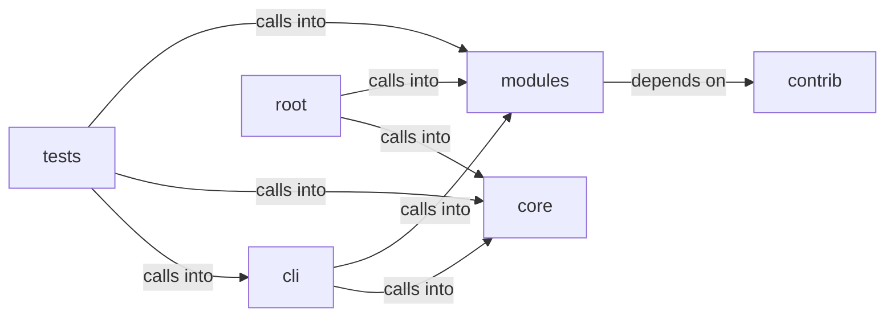

# core

core groups 22 files (py) around strip_ansi, BudgetExceeded, LLMBackendLike, generate, stream_generate. Artificial Intelligence command set.

## cli (12.1)

cli groups 1 files (py) around AiCommandSet, do_ask, do_groq, do_poolcheck, _serve. Artificial Intelligence command set.

## contrib (12.2)

contrib groups 1 files (py) around clean_think, clean_yaml, truncate_message, configure_logging, create_complex_prompt. Author: Gris Iscomeback Email: grisiscomeback[at]gmail[dot]com Creation Date...

## core (12.3)

core groups 7 files (py) around strip_ansi, BudgetExceeded, LLMBackendLike, generate, stream_generate. Core primitives for the LazyOwn framework.

## modules (12.4)

modules groups 3 files (py) around default_project_root, resolve_model, truncate_message, LlmPromptConfig, from_defaults. LLM adapter facade — single import point for all LLM backends used by lazyc2.

## root (12.5)

root groups 4 files (py) around SecureSessionManager, __init__, register_failed_attempt, check_lockout, check_rate_limit. download_c2: Handle the /download_c2 command to download a file from the C2.

## tests (12.6)

tests groups 6 files (py) around _command_set, TestDoAsk, test_empty_question_prints_usage, test_question_forwarded_with_session_context, test_backend_error_surfaces_as_message. Behavioural tests for the resurrected ``ask``/``groq`` commands.

**Files**:

- cli/commands/ai.py
- contrib/legacy/lazyphishingai.py
- core/__init__.py
- core/dependencies.py
- core/errors.py
- core/http.py
- core/llm_budget.py
- core/network.py
- core/parsers.py
- discord_c2.py
- modules/llm_adapter.py
- modules/llm_prompts.py
- modules/sidequestion.py
- slack_c2_bot.py
- telegram_c2.py
- telegram_hermes.py
- tests/test_ai_commands_llm.py
- tests/test_dependencies.py
- tests/test_llm_adapter_parity.py
- tests/test_llm_budget.py
- tests/test_llm_prompts.py
- tests/test_single_implementation.py
