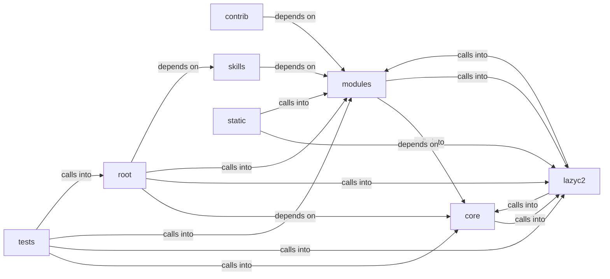

# lazyc2/security

lazyc2/security groups 72 files (c, js, py) around Role, valid_roles, Permission, _UsersFileUnreadable, RBACUser. Tenant-bound API authorization for the LazyOwn C2 dashboard.

## contrib (8.1)

contrib groups 2 files (py) around SamsungKnoxExploitServer, do_GET, apk_bytes, launch_html, exploit_js.

## core (8.2)

core groups 2 files (py) around ApiAuthzConfig, ApiKey, to_dict, from_dict, is_expired. Tenant-bound API authorization for the LazyOwn C2 dashboard.

## lazyc2 (8.3)

lazyc2 groups 25 files (py) around CorsConfigError, CorsPolicy, __init__, env, resolve_origins. Flask application factory for the LazyOwn C2 server.

## modules (8.4)

modules groups 11 files (c, py) around Role, valid_roles, Permission, _UsersFileUnreadable, RBACUser. Malleable C2 client lifecycle for lab targets.

## root (8.5)

root groups 2 files (py) around _env_tag, is_insecure_credential, _listen_address, _is_unspecified_bind_literal, _select_specific_bind_address. is_insecure_credential: Check for weak or default credentials

## skills (8.6)

skills groups 8 files (py) around ConfigKeys, EnvKeys, Defaults, PhaseNames, Paths. Daemon health monitor — watchdog for the autonomous daemon and C2 listeners.

## static (8.7)

static groups 2 files (js) around as, as, as, as, as. as: !

## tests (8.8)

tests groups 20 files (py) around _valid_draft, TestConfig, test_name_pattern_rejects_traversal, test_patterns_accept_canonical_values, test_os_options_cover_mitre_platforms. Tests for the LazyAddon creator contract and C2 blueprint.

**Files**:

- contrib/legacy/lazygalazy.py
- contrib/legacy/lazyhttpreverseshell.py
- core/api_authz.py
- core/session_secrets.py
- lazyc2.py
- lazyc2/__init__.py
- lazyc2/app_factory.py
- lazyc2/blueprints/__init__.py
- lazyc2/blueprints/addons.py
- lazyc2/blueprints/auth.py
- lazyc2/blueprints/operations.py
- lazyc2/blueprints/phishing.py
- lazyc2/blueprints/session_auth.py
- lazyc2/extensions/__init__.py
- lazyc2/extensions/decoy.py
- lazyc2/extensions/short_urls.py
- lazyc2/extensions/storage.py
- lazyc2/extensions/users.py
- lazyc2/models.py
- lazyc2/security/__init__.py
- lazyc2/security/cli_credentials.py
- lazyc2/security/command_allowlist.py
- lazyc2/security/constants.py
- lazyc2/security/cors.py
- lazyc2/security/csrf.py
- lazyc2/security/html_sanitizer.py
- lazyc2/security/https_redirect.py
- lazyc2/security/services.py
- lazyc2/security/trusted_proxy.py
- lazyc2/security/validators.py
- modules/backdoor/server.c
- modules/c2_agent.py
- modules/dashboard_bp.py
- modules/kill_chain_viz.py
- modules/lazy_oob.py
- modules/lazy_rbac.py
- modules/lazyown_bprfuzzer.py
- modules/listener_manager.py
- modules/live_surface.py
- modules/loop_manager.py
- modules/security_sanitizers.py
- pwntomate.py
- skills/daemon_health.py
- skills/hermes-lazyown/claudemd_rules.py
- skills/hermes-lazyown/config_bridge.py
- skills/hermes-lazyown/constants.py
- skills/hermes-lazyown/executor.py
- skills/hermes-lazyown/hermes_sync.py
- skills/hermes-lazyown/mcp_server.py
- skills/hermes-lazyown/output_compactor.py
- static/js/socket.io-4.0.0.min.js
- static/js/socket.io-4.3.2.min.js
- tests/test_addon_creator.py
- tests/test_api_authz.py
- tests/test_c2_credential_bootstrap.py
- tests/test_command_allowlist.py
- tests/test_command_allowlist_behavior.py
- tests/test_cors_behavior.py
- tests/test_cors_policy.py
- tests/test_cors_socketio_regression.py
- tests/test_csrf_behavior.py
- tests/test_csrf_policy.py
- tests/test_dashboard_routes.py
- tests/test_html_sanitizer.py
- tests/test_https_redirect.py
- tests/test_live_surface.py
- tests/test_loop_manager.py
- tests/test_security_lazyc2.py
- tests/test_security_sanitizers.py
- tests/test_session_secrets.py
- tests/test_short_url_file_containment.py
- tests/test_trusted_proxy.py
