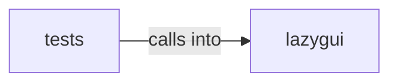

# lazygui/panels

lazygui/panels groups 54 files (py) around WindowConstants, TimingConstants, NetworkConstants, PtyConstants, FontConstants. Entry point for ``python -m lazygui``.

## lazygui (8.1)

lazygui groups 51 files (py) around WindowConstants, TimingConstants, NetworkConstants, PtyConstants, FontConstants. Entry point for ``python -m lazygui``.

## tests (8.2)

tests groups 3 files (py) around TestBackendDescriptor, test_construction, test_immutable, TestBackendStatus, test_values. Tests for lazygui backend services.

**Files**:

- lazygui/__main__.py
- lazygui/app.py
- lazygui/config/__init__.py
- lazygui/config/c2_credentials.py
- lazygui/config/constants.py
- lazygui/config/paths.py
- lazygui/config/settings.py
- lazygui/panels/__init__.py
- lazygui/panels/base.py
- lazygui/panels/campaign_panel.py
- lazygui/panels/credentials_panel.py
- lazygui/panels/cve_panel.py
- lazygui/panels/event_log_panel.py
- lazygui/panels/graph_panel.py
- lazygui/panels/history_panel.py
- lazygui/panels/killchain_panel.py
- lazygui/panels/listeners_panel.py
- lazygui/panels/marketplace_panel.py
- lazygui/panels/registry.py
- lazygui/panels/sessions_panel.py
- lazygui/panels/terminal_panel.py
- lazygui/services/__init__.py
- lazygui/services/backend.py
- lazygui/services/event_log.py
- lazygui/services/factory.py
- lazygui/services/local_backend.py
- lazygui/services/models.py
- lazygui/services/teamserver_backend.py
- lazygui/theme/__init__.py
- lazygui/theme/manager.py
- lazygui/theme/palettes/__init__.py
- lazygui/theme/palettes/catppuccin_mocha.py
- lazygui/theme/palettes/cobalt_clone.py
- lazygui/theme/palettes/gruvbox_dark.py
- lazygui/theme/palettes/solarized_light.py
- lazygui/theme/palettes/tactical_green.py
- lazygui/theme/palettes/tokyo_night.py
- lazygui/theme/qss_builder.py
- lazygui/theme/tokens.py
- lazygui/widgets/__init__.py
- lazygui/widgets/beacon_command_modal.py
- lazygui/widgets/command_palette_list.py
- lazygui/widgets/event_log_view.py
- lazygui/widgets/filter_bar.py
- lazygui/widgets/graph_view.py
- lazygui/widgets/status_badge.py
- lazygui/widgets/terminal_view.py
- lazygui/windows/__init__.py
- lazygui/windows/command_palette_window.py
- lazygui/windows/connect_dialog.py
- lazygui/windows/main_window.py
- tests/test_lazygui_backend.py
- tests/test_lazygui_graph_widget.py
- tests/test_lazygui_models.py
