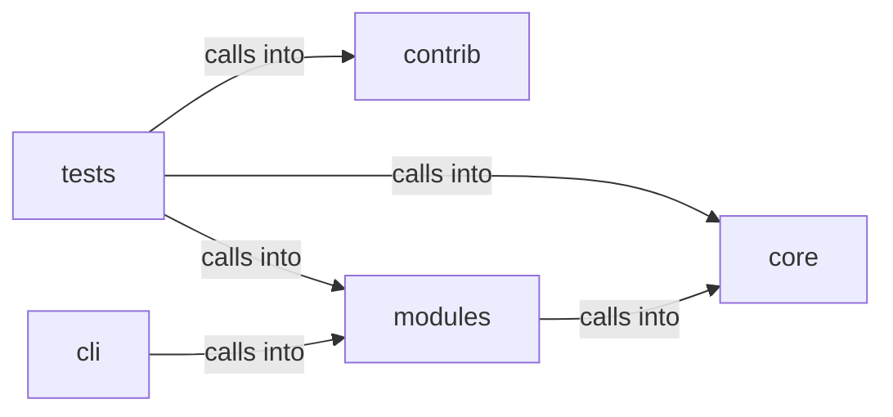

# modules: atomic_exploit_bridge

modules: atomic_exploit_bridge groups 23 files (py) around CommandInjectionError, UrlValidationError, needs_shell, safe_system, safe_run_argv. C2 session CommandSet — headless server, agent deploy, exec, loot.

## cli (10.1)

cli groups 3 files (py) around _lab_auth, _fresh_lab_creds, _server, _issue, C2SessionCommandSet. C2 session CommandSet — headless server, agent deploy, exec, loot.

## contrib (10.2)

contrib groups 1 files (py) around truncate_message, configure_logging, _load_payload_kv, _load_report_context, _prompt_redteam. Unified Ollama/DeepSeek client for LazyOwn — merges lazydeepseekcli_local +...

## core (10.3)

core groups 1 files (py) around CommandInjectionError, UrlValidationError, needs_shell, safe_system, safe_run_argv. Centralized safe command execution for the LazyOwn framework.

## modules (10.4)

modules groups 10 files (py) around normalize_mitre_id, is_mitre_id, normalize_guid, is_guid, normalize_platform. APT Playbook Engine — map public APT reports to executable Atomic Red Team chains.

## tests (10.5)

tests groups 8 files (py) around _write, _valid_doc, test_validate_accepts_good_document, test_validate_rejects_bad_documents, test_load_all_skips_invalid_and_disabled. Atomic exploit catalogue: one YAML per exploit, engine administered by files.

**Files**:

- cli/commands/c2_session.py
- cli/commands/command_and_control_migrated.py
- cli/commands/resource_scripting.py
- contrib/legacy/lazydeepseekcli.py
- core/safe_exec.py
- modules/apt_playbooks.py
- modules/atomic_cli.py
- modules/atomic_exploit_bridge.py
- modules/atomic_resolver.py
- modules/c2_agent.py
- modules/c2_surfaces.py
- modules/chain_registry.py
- modules/command_executor.py
- modules/listener_manager.py
- modules/resource_script.py
- tests/test_atomic_exploit_bridge.py
- tests/test_atomic_loop.py
- tests/test_atomic_resolver.py
- tests/test_c2_surfaces.py
- tests/test_chain_registry.py
- tests/test_executor_kernel.py
- tests/test_resource_script.py
- tests/test_security_hardening_v4.py
