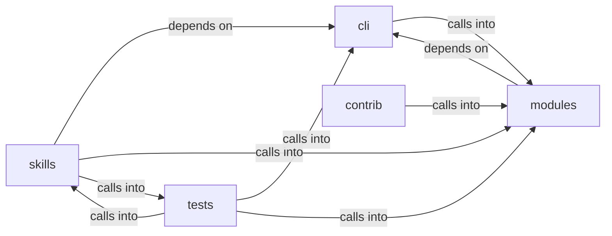

# modules: autonomous_daemon

modules: autonomous_daemon groups 115 files (py) around EnumCommandSet, do_smbclient, do_smbclient_impacket, do_smbclient_py, do_smbmap. Phase-scoped CommandSet modules.

## cli (2.1)

cli groups 7 files (py) around EnumCommandSet, do_smbclient, do_smbclient_impacket, do_smbclient_py, do_smbmap. Phase-scoped CommandSet modules.

## contrib (2.2)

contrib groups 1 files (py) around parse_github_url, github_api_get, fetch_repo_metadata, fetch_readme, fetch_root_files. parse_github_url: Extrae (owner, repo) de una URL de GitHub.

## modules (2.3)

modules groups 45 files (py) around LLMClient, __init__, ask, classify, summarize. AI-Driven Exploit Chaining Engine.

## skills (2.4)

skills groups 33 files (py) around _try_import, _update_task_status, _inject_to_tasks_json, _emit, _record_intent. skills/autonomous_daemon.py — LazyOwn Autonomous Execution Daemon

## tests (2.5)

tests groups 29 files (py) around test_autonomous_flow_integration, test_c04_dedup_anchor_coverage, test_c04_mirror_to_campaign_db, test_c05_frontier_emits_once_then_empty, test_c05_todo_blocks_lateral_until_creds. test_autonomous_flow_integration: Simulates a simplified autonomous flow to verify...

**Files**:

- cli/commands/__init__.py
- cli/commands/caldera.py
- cli/commands/enum.py
- cli/commands/exploitgym.py
- cli/commands/orchestration.py
- cli/reasoning_stream.py
- cli/scope_guard.py
- contrib/legacy/lazyaddon_creator.py
- modules/__init__.py
- modules/ai_exploit_chain.py
- modules/ai_fallback.py
- modules/asset_graph.py
- modules/atomic_enricher.py
- modules/auto_pivot.py
- modules/autonomous_exploit_engine.py
- modules/config_store.py
- modules/cve_matcher.py
- modules/detection_feed.py
- modules/detection_oracle.py
- modules/engage_summary.py
- modules/enrich.py
- modules/event_engine.py
- modules/evidence.py
- modules/exploitgym_gym.py
- modules/goals.py
- modules/integrations/__init__.py
- modules/integrations/misp_export.py
- modules/integrations/searchsploit.py
- modules/intercept.py
- modules/lazyown_bridge.py
- modules/lesson_ingestor.py
- modules/llm_client.py
- modules/llm_evaluator.py
- modules/llm_pool.py
- modules/memory_store.py
- modules/moe_router.py
- modules/notify.py
- modules/obs_parser.py
- modules/operation.py
- modules/planner.py
- modules/playbook_engine.py
- modules/reactive_engine.py
- modules/recommender.py
- modules/rl_trainer.py
- modules/selfupdate.py
- modules/session_rag.py
- modules/session_reader.py
- modules/session_state.py
- modules/threat_model.py
- modules/timeline_narrator.py
- modules/toolset.py
- modules/traffic_recorder.py
- modules/ttp_coverage.py
- skills/autonomous_daemon.py
- skills/autonomous_replay.py
- skills/daemon_control.py
- skills/heartbeat.py
- skills/hive_mind.py
- skills/lazyown_automapper.py
- skills/lazyown_campaign.py
- skills/lazyown_claudemd.py
- skills/lazyown_context.py
- skills/lazyown_daemon.py
- skills/lazyown_facts.py
- skills/lazyown_groq_agents.py
- skills/lazyown_hooks.py
- skills/lazyown_llm.py
- skills/lazyown_mcp.py
- skills/lazyown_mcp_helpers.py
- skills/lazyown_objective.py
- skills/lazyown_parquet_db.py
- skills/lazyown_permissions.py
- skills/lazyown_policy.py
- skills/lazyown_session.py
- skills/mcp_lazy.py
- skills/sessions_watcher.py
- skills/swan_agent.py
- skills/tests/test_autonomous_daemon.py
- skills/tests/test_facts.py
- skills/tests/test_harness_e2e.py
- skills/tests/test_hive_mind.py
- skills/tests/test_mcp_smoke.py
- skills/tests/test_objectives.py
- skills/tests/test_parquet_db.py
- skills/unified_orchestrator.py
- skills/update_knowledge.py
- tests/integration_autonomous_flow.py
- tests/test_autonomous_ops.py
- tests/test_autonomous_replay.py
- tests/test_boyscout_contracts.py
- tests/test_bridge_catalog_filtered.py
- tests/test_core_modules.py
- tests/test_daemon_control.py
- tests/test_daemon_loop.py
- tests/test_detection_feed.py
- tests/test_engage_gates.py
- tests/test_engage_orchestrator.py
- tests/test_engage_summary.py
- tests/test_exploitgym_gym.py
- tests/test_improvements_spec.py
- tests/test_lazy_parity.py
- tests/test_lesson_ingestor.py
- tests/test_mcp_improvements.py
- tests/test_mcp_lazy.py
- tests/test_metrics_aware_selector.py
- tests/test_moe_rl_swan.py
- tests/test_moe_router_check_regression.py
- tests/test_rea_mcp.py
- tests/test_reactive_engine_semantic.py
- tests/test_reactive_lateral_data.py
- tests/test_reasoning_stream.py
- tests/test_safety_gates.py
- tests/test_scope_bound_auto_gate.py
- tests/test_scope_guard.py
- tests/test_security_sanitizers.py
