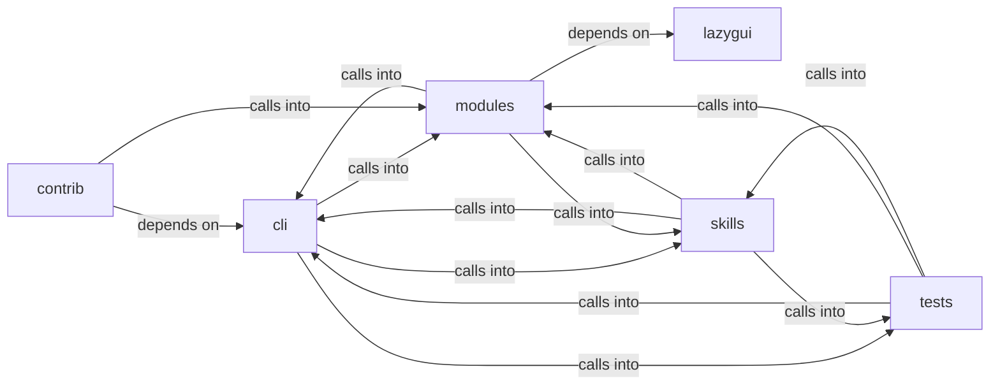

# modules: autonomous_daemon

modules: autonomous_daemon groups 116 files (py) around EnumCommandSet, do_smbclient, do_smbclient_impacket, do_smbclient_py, do_smbmap. Caldera-style command set — operation lifecycle, TTP coverage, and planner.

## cli (3.1)

cli groups 12 files (py) around EnumCommandSet, do_smbclient, do_smbclient_impacket, do_smbclient_py, do_smbmap. Caldera-style command set — operation lifecycle, TTP coverage, and planner.

## contrib (3.2)

contrib groups 4 files (py) around parse_github_url, github_api_get, fetch_repo_metadata, fetch_readme, fetch_root_files. parse_github_url: Extrae (owner, repo) de una URL de GitHub.

## lazygui (3.3)

lazygui groups 2 files (py). LazyOwn Operator Console.

## modules (3.4)

modules groups 38 files (py) around _derive_crypto_key, _master_password, read_state_dict, write_state_dict, HostState. AI-Driven Exploit Chaining Engine.

## skills (3.5)

skills groups 26 files (py) around _try_import, _update_task_status, _inject_to_tasks_json, _emit, _record_intent. skills/autonomous_daemon.py — LazyOwn Autonomous Execution Daemon

## tests (3.6)

tests groups 34 files (py) around test_autonomous_flow_integration, _event, _write_jsonl, test_event_log_reader_returns_empty_when_missing, test_event_log_reader_skips_malformed_lines. test_autonomous_flow_integration: Simulates a simplified autonomous flow to verify...

**Files**:

- cli/commands/caldera.py
- cli/commands/daemon_ctl.py
- cli/commands/enum.py
- cli/commands/pwn.py
- cli/commands/session_ops.py
- cli/dashboard_layout.py
- cli/dashboard_tui.py
- cli/graph_advisor.py
- cli/killchain.py
- cli/ops_commands.py
- cli/recommendation.py
- cli/recommendation_signals.py
- contrib/legacy/lazyaddon_creator.py
- contrib/legacy/lazypwn.py
- contrib/legacy/lazyvsftp.py
- contrib/legacy/sql.py
- lazygui/__init__.py
- lazygui/version.py
- modules/ai_exploit_chain.py
- modules/apt_playbooks.py
- modules/asset_graph.py
- modules/atomic_enricher.py
- modules/auto_pivot.py
- modules/autonomous_exploit_engine.py
- modules/config_store.py
- modules/cve_matcher.py
- modules/dashboard_engine.py
- modules/detection_feed.py
- modules/detection_oracle.py
- modules/engage_summary.py
- modules/enrich.py
- modules/evidence.py
- modules/exploit_recommender.py
- modules/goals.py
- modules/intercept.py
- modules/kill_chain_viz.py
- modules/killchain.py
- modules/lazyown_bridge.py
- modules/live_surface.py
- modules/llm_client.py
- modules/llm_evaluator.py
- modules/memory_store.py
- modules/moe_router.py
- modules/obs_parser.py
- modules/operation.py
- modules/planner.py
- modules/playbook_engine.py
- modules/reactive_engine.py
- modules/rich_tui.py
- modules/rl_trainer.py
- modules/session_rag.py
- modules/session_reader.py
- modules/threat_model.py
- modules/toolset.py
- modules/unified_dashboard.py
- modules/world_model.py
- skills/autonomous_daemon.py
- skills/autonomous_replay.py
- skills/daemon_control.py
- skills/hive_mind.py
- skills/lazyown_automapper.py
- skills/lazyown_claudemd.py
- skills/lazyown_context.py
- skills/lazyown_groq_agents.py
- skills/lazyown_hooks.py
- skills/lazyown_llm.py
- skills/lazyown_mcp.py
- skills/lazyown_mcp_helpers.py
- skills/lazyown_objective.py
- skills/lazyown_parquet_db.py
- skills/lazyown_permissions.py
- skills/lazyown_policy.py
- skills/lazyown_session.py
- skills/mcp_lazy.py
- skills/swan_agent.py
- skills/tests/test_autonomous_daemon.py
- skills/tests/test_harness_e2e.py
- skills/tests/test_hive_mind.py
- skills/tests/test_mcp_smoke.py
- skills/tests/test_objectives.py
- skills/tests/test_parquet_db.py
- skills/update_knowledge.py
- tests/integration_autonomous_flow.py
- tests/test_autonomous_replay.py
- tests/test_boyscout_contracts.py
- tests/test_bridge_catalog_filtered.py
- tests/test_core_modules.py
- tests/test_daemon_control.py
- tests/test_daemon_loop.py
- tests/test_dashboard_tui.py
- tests/test_detection_feed.py
- tests/test_engage_gates.py
- tests/test_engage_orchestrator.py
- tests/test_engage_summary.py
- tests/test_graph_advisor.py
- tests/test_killchain.py
- tests/test_killchain_gap_signal.py
- tests/test_killchain_snapshot.py
- tests/test_killchain_unified.py
- tests/test_killchain_unified_v2.py
- tests/test_lazy_parity.py
- tests/test_live_surface.py
- tests/test_mcp_improvements.py
- tests/test_mcp_lazy.py
- tests/test_metrics_aware_selector.py
- tests/test_moe_rl_swan.py
- tests/test_moe_router_check_regression.py
- tests/test_ops_loot_phase.py
- tests/test_phase1_data_gaps.py
- tests/test_rea_mcp.py
- tests/test_reactive_engine_semantic.py
- tests/test_reactive_lateral_data.py
- tests/test_recommendation.py
- tests/test_scope_bound_auto_gate.py
- tests/test_unified_dashboard.py
- tests/test_world_model_extended.py
