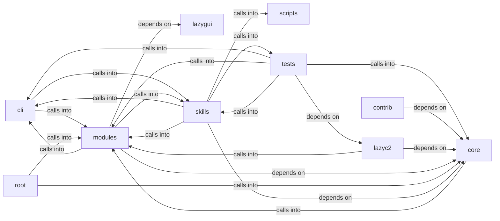

# modules: autonomous_daemon

modules: autonomous_daemon groups 172 files (py) around StructuredLogConfig, _JsonLineFormatter, __init__, format, _ConsoleFormatter. Automation command set — credential reuse, conditional hooks, operator profiles.

## cli (1.1)

cli groups 4 files (py) around GraphAdvisorConfig, GraphNode, to_summary, GraphEdge, to_summary. Automation command set — credential reuse, conditional hooks, operator profiles.

## contrib (1.2)

contrib groups 4 files (py) around parse_args, setup_logging, generate_rsa_key, Server, __init__. Autor: Gris Iscomeback Correo electrónico: grisiscomeback[at]gmail[dot]com Fecha de...

## core (1.3)

core groups 4 files (py) around StructuredLogConfig, _JsonLineFormatter, __init__, format, _ConsoleFormatter. Centralised subprocess wrapper for the LazyOwn framework.

## lazyc2 (1.4)

lazyc2 groups 2 files (py) around _sessions_dir, _db, _error, health, targets. Versioned REST API (``/api/v1``) for the LazyOwn C2 server.

## lazygui (1.5)

lazygui groups 2 files (py). LazyOwn Operator Console.

## modules (1.6)

modules groups 73 files (py) around ColoredFormatter, format, JsonFormatter, format, CorrelationFilter. LazyOwn AI Fallback Chain

## root (1.7)

root groups 1 files (py) around sanitize_content, RAGManager, __init__, initialize_cache_table, get_cache_key. RAGManager: Manages RAG functionality with CAG caching for document processing and...

## scripts (1.8)

scripts groups 1 files (py) around _backup, _opencode_path, _hermes_path, patch_opencode, patch_hermes. Patch operator agent configs to use the Lazy llama.cpp server.

## skills (1.9)

skills groups 35 files (py) around _try_import, _update_task_status, _credential_worth_task, _task_title_open, _inject_to_tasks_json. Autonomous Campaign Intelligence (ACI) Planner

## tests (1.10)

tests groups 46 files (py) around test_autonomous_flow_integration, _make_goal, _patched_paths, _start_patches, _stop_patches. test_autonomous_flow_integration: Simulates a simplified autonomous flow to verify...

**Files**:

- cli/commands/automation.py
- cli/commands/daemon_ctl.py
- cli/commands/mcp_bridge.py
- cli/graph_advisor.py
- contrib/legacy/lazyhoneypot.py
- contrib/legacy/lazyopenssh77enum2.py
- contrib/legacy/lazysearch_bot.py
- contrib/legacy/lazyssh.py
- core/executor.py
- core/logging.py
- core/scheduler.py
- core/security.py
- lazy_sentinel4.py
- lazyc2/blueprints/api_v1.py
- lazyc2/blueprints/beacon.py
- lazygui/__init__.py
- lazygui/version.py
- modules/ai_fallback.py
- modules/asset_graph.py
- modules/atomic_enricher.py
- modules/auto_purple.py
- modules/beacon_history.py
- modules/c2_profile.py
- modules/collab_bp.py
- modules/conditional_hooks.py
- modules/credential_reuse.py
- modules/cve_matcher.py
- modules/db.py
- modules/detection_feed.py
- modules/detection_oracle.py
- modules/engage_summary.py
- modules/engagement_hooks.py
- modules/enrich.py
- modules/estorides_importer.py
- modules/event_bus.py
- modules/event_consumers.py
- modules/event_engine.py
- modules/evidence.py
- modules/exploit_recommender.py
- modules/goals.py
- modules/golden_path.py
- modules/hash_cracker.py
- modules/hive_invoke.py
- modules/ia_code_analysis.py
- modules/ia_logs_analysis.py
- modules/ia_network_analysis.py
- modules/integrations/__init__.py
- modules/integrations/misp_export.py
- modules/integrations/nuclei_bridge.py
- modules/integrations/nuclei_parser.py
- modules/integrations/searchsploit.py
- modules/intelligence_engine.py
- modules/intercept.py
- modules/lazy_search.py
- modules/lazyown_bridge.py
- modules/lazyownerweb.py
- modules/lesson_ingestor.py
- modules/lilsplunky.py
- modules/llm_evaluator.py
- modules/logging_config.py
- modules/loop_ai_bridge.py
- modules/mcp_agent_bridge.py
- modules/memory_embeddings.py
- modules/memory_store.py
- modules/metrics.py
- modules/moe_router.py
- modules/obs_parser.py
- modules/operation.py
- modules/operator_profiles.py
- modules/pipeline_engine.py
- modules/planner.py
- modules/playbook_engine.py
- modules/playbook_executor.py
- modules/reactive_engine.py
- modules/recommender.py
- modules/rl_trainer.py
- modules/session_rag.py
- modules/session_reader.py
- modules/session_state.py
- modules/sidequestion.py
- modules/sinks/campaign_db.py
- modules/state_manager.py
- modules/sudo_tiocsti.py
- modules/threat_model.py
- modules/timeline_narrator.py
- modules/toolset.py
- modules/toposwarm_bridge.py
- modules/ttpscope_bridge.py
- modules/unified_bridge.py
- modules/unified_dashboard.py
- scripts/lazy_opencode_config.py
- skills/aci_planner.py
- skills/autonomous_daemon.py
- skills/autonomous_replay.py
- skills/daemon_control.py
- skills/heartbeat.py
- skills/hive_mind.py
- skills/lazyown_automapper.py
- skills/lazyown_campaign.py
- skills/lazyown_claudemd.py
- skills/lazyown_context.py
- skills/lazyown_daemon.py
- skills/lazyown_facts.py
- skills/lazyown_groq_agents.py
- skills/lazyown_hooks.py
- skills/lazyown_llm.py
- skills/lazyown_mcp.py
- skills/lazyown_mcp_helpers.py
- skills/lazyown_objective.py
- skills/lazyown_parquet_db.py
- skills/lazyown_permissions.py
- skills/lazyown_policy.py
- skills/lazyown_session.py
- skills/mcp_lazy.py
- skills/sessions_watcher.py
- skills/swan_agent.py
- skills/tests/test_autonomous_daemon.py
- skills/tests/test_facts.py
- skills/tests/test_harness_e2e.py
- skills/tests/test_hive_mind.py
- skills/tests/test_mcp_smoke.py
- skills/tests/test_objectives.py
- skills/tests/test_parquet_db.py
- skills/toposwarm_autonomous.py
- skills/unified_orchestrator.py
- skills/update_knowledge.py
- tests/integration_autonomous_flow.py
- tests/test_aci_planner.py
- tests/test_api_v1.py
- tests/test_autonomous_ops.py
- tests/test_autonomous_replay.py
- tests/test_beacon_history.py
- tests/test_bridge_catalog_filtered.py
- tests/test_chain_selector.py
- tests/test_collab_and_onboarding.py
- tests/test_conditional_hooks_extended.py
- tests/test_core_executor.py
- tests/test_core_modules.py
- tests/test_daemon_control.py
- tests/test_daemon_loop.py
- tests/test_db.py
- tests/test_detection_dampening.py
- tests/test_detection_feed.py
- tests/test_engage_gates.py
- tests/test_engage_orchestrator.py
- tests/test_engage_summary.py
- tests/test_golden_path.py
- tests/test_graph_advisor.py
- tests/test_hash_cracker.py
- tests/test_intelligence_engine.py
- tests/test_lazy_parity.py
- tests/test_lazy_search.py
- tests/test_lesson_ingestor.py
- tests/test_logging_config.py
- tests/test_loop_ai_bridge.py
- tests/test_mcp_improvements.py
- tests/test_mcp_lazy.py
- tests/test_memory_semantics.py
- tests/test_metrics.py
- tests/test_metrics_aware_selector.py
- tests/test_moe_rl_swan.py
- tests/test_moe_router_check_regression.py
- tests/test_mutation_verification.py
- tests/test_nuclei_parser.py
- tests/test_pipeline_engine.py
- tests/test_rea_mcp.py
- tests/test_reactive_engine_semantic.py
- tests/test_reactive_lateral_data.py
- tests/test_safety_gates.py
- tests/test_scope_bound_auto_gate.py
- tests/test_structured_logging.py
- tests/test_unified_dashboard.py
