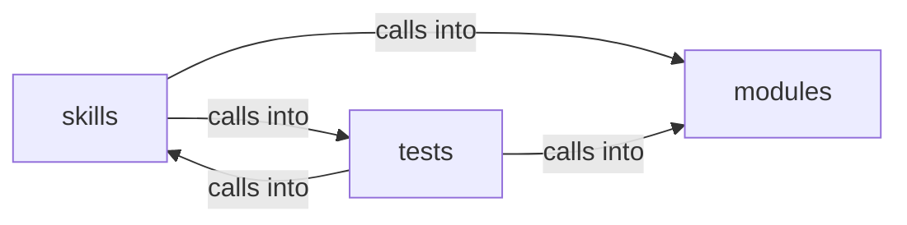

# modules: autonomous_daemon

modules: autonomous_daemon groups 42 files (py) around SelectionContext, ActionDecision, Selector, propose, _try_import. Global asset truth store joined to per-task exploration chains.

## modules (9.1)

modules groups 20 files (py) around SelectionContext, ActionDecision, Selector, propose, SigmaRule. Global asset truth store joined to per-task exploration chains.

## skills (9.2)

skills groups 6 files (py) around _try_import, _update_task_status, _credential_worth_task, _task_title_open, _inject_to_tasks_json. skills/autonomous_daemon.py — LazyOwn Autonomous Execution Daemon

## tests (9.3)

tests groups 16 files (py) around _event, _write_jsonl, test_event_log_reader_returns_empty_when_missing, test_event_log_reader_skips_malformed_lines, test_slice_is_inclusive_on_both_bounds. Tests for ``skills/autonomous_replay.py``.

**Files**:

- modules/asset_graph.py
- modules/chain_match.py
- modules/detection_feed.py
- modules/detection_oracle.py
- modules/engage_summary.py
- modules/enrich.py
- modules/evidence.py
- modules/goals.py
- modules/moe_router.py
- modules/rl_trainer.py
- modules/selection/__init__.py
- modules/selection/adversary.py
- modules/selection/atomic.py
- modules/selection/base.py
- modules/selection/chain.py
- modules/selection/cred_spray.py
- modules/selection/intel.py
- modules/selection/playbook.py
- modules/selection/registry.py
- modules/toolset.py
- skills/autonomous_daemon.py
- skills/autonomous_replay.py
- skills/daemon_control.py
- skills/lazyown_policy.py
- skills/swan_agent.py
- skills/tests/test_autonomous_daemon.py
- tests/test_autonomous_replay.py
- tests/test_chain_selector.py
- tests/test_daemon_control.py
- tests/test_detection_dampening.py
- tests/test_detection_feed.py
- tests/test_engage_orchestrator.py
- tests/test_engage_summary.py
- tests/test_intel_selector.py
- tests/test_loop_fire_pending.py
- tests/test_metrics_aware_selector.py
- tests/test_moe_rl_swan.py
- tests/test_moe_router_check_regression.py
- tests/test_scope_bound_auto_gate.py
- tests/test_selection_wiring.py
- tests/test_selectors_base.py
- tests/test_selectors_capabilities.py
