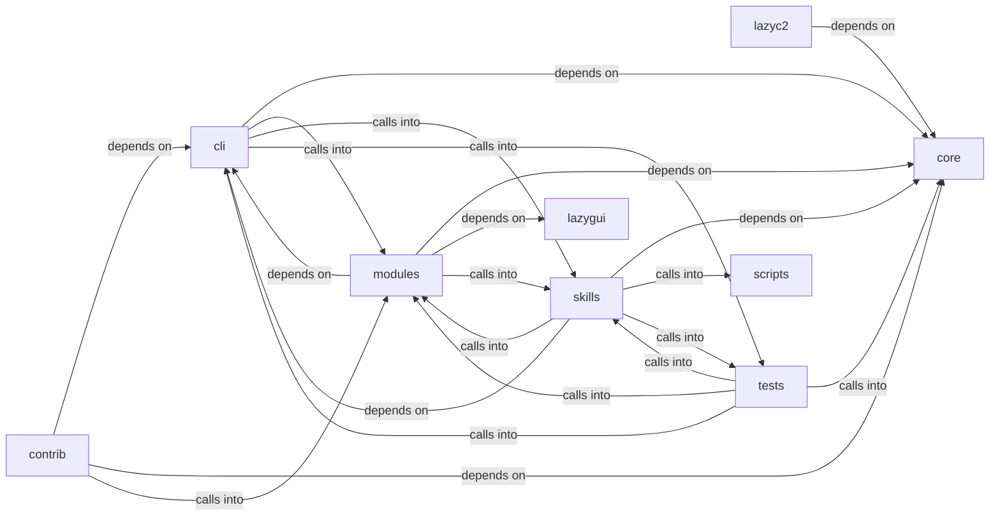

# modules: autonomous_daemon

modules: autonomous_daemon groups 186 files (py) around StructuredLogConfig, _JsonLineFormatter, __init__, format, _ConsoleFormatter. Caldera-style command set — operation lifecycle, TTP coverage, and planner.

## cli (1.1)

cli groups 7 files (py) around EnumCommandSet, do_smbclient, do_smbclient_impacket, do_smbclient_py, do_smbmap. Caldera-style command set — operation lifecycle, TTP coverage, and planner.

## contrib (1.2)

contrib groups 9 files (py) around parse_github_url, github_api_get, fetch_repo_metadata, fetch_readme, fetch_root_files. parse_github_url: Extrae (owner, repo) de una URL de GitHub.

## core (1.3)

core groups 4 files (py) around StructuredLogConfig, _JsonLineFormatter, __init__, format, _ConsoleFormatter. Centralised subprocess wrapper for the LazyOwn framework.

## lazyc2 (1.4)

lazyc2 groups 2 files (py) around configure, load_short_urls, save_short_urls, _get_safe_file_path, is_valid_url. Phishing blueprint for the LazyOwn C2 server.

## lazygui (1.5)

lazygui groups 2 files (py). LazyOwn Operator Console.

## modules (1.6)

modules groups 83 files (py) around is_model_missing_error, groq_model_chain, LLMBackendUnavailableError, LLMBackendNotSupportedError, default_model_for. LazyOwn AI Agent - Ultimate Edition Improvements: anti-hang timeout, memory...

## scripts (1.7)

scripts groups 1 files (py) around _backup, _opencode_path, _hermes_path, patch_opencode, patch_hermes. Patch operator agent configs to use the Lazy llama.cpp server.

## skills (1.8)

skills groups 32 files (py) around _try_import, _update_task_status, _credential_worth_task, _task_title_open, _inject_to_tasks_json. Autonomous Campaign Intelligence (ACI) Planner

## tests (1.9)

tests groups 46 files (py) around _isolated_llm_health, _isolated_path, _fast_llm_connect_backoff, _reset_world_model_singleton, _offline_llm_for_loop_tests. Global pytest isolation hooks.

**Files**:

- cli/commands/caldera.py
- cli/commands/daemon_ctl.py
- cli/commands/enum.py
- cli/commands/estorides.py
- cli/commands/pwn.py
- cli/recommendation.py
- cli/recommendation_signals.py
- contrib/legacy/lazyaddon_creator.py
- contrib/legacy/lazyhoneypot.py
- contrib/legacy/lazyllmchat.py
- contrib/legacy/lazyopenssh77enum2.py
- contrib/legacy/lazypwn.py
- contrib/legacy/lazysearch_bot.py
- contrib/legacy/lazyssh.py
- contrib/legacy/lazyvsftp.py
- contrib/legacy/sql.py
- core/executor.py
- core/logging.py
- core/scheduler.py
- core/security.py
- lazyc2/blueprints/phishing.py
- lazyc2/extensions/short_urls.py
- lazygui/__init__.py
- lazygui/version.py
- modules/agent_runner.py
- modules/ai_exploit_chain.py
- modules/ai_fallback.py
- modules/ai_model.py
- modules/apt_playbooks.py
- modules/asset_graph.py
- modules/atomic_enricher.py
- modules/atomic_resolver.py
- modules/auto_loop_memory.py
- modules/auto_pivot.py
- modules/autonomous_exploit_engine.py
- modules/c2_profile.py
- modules/compliance.py
- modules/config_store.py
- modules/cve_matcher.py
- modules/dashboard_engine.py
- modules/detection_feed.py
- modules/detection_oracle.py
- modules/digest.py
- modules/emulation_runner.py
- modules/engage_summary.py
- modules/engagement_hooks.py
- modules/enrich.py
- modules/estorides_importer.py
- modules/event_engine.py
- modules/evidence.py
- modules/exploit_recommender.py
- modules/factsio.py
- modules/goals.py
- modules/golden_path.py
- modules/hive_invoke.py
- modules/ia_code_analysis.py
- modules/ia_logs_analysis.py
- modules/ia_network_analysis.py
- modules/integrations/__init__.py
- modules/integrations/misp_export.py
- modules/integrations/nuclei_bridge.py
- modules/integrations/nuclei_parser.py
- modules/integrations/searchsploit.py
- modules/intelligence_engine.py
- modules/intercept.py
- modules/lazy_agent.py
- modules/lazyown_bridge.py
- modules/lazyownerweb.py
- modules/lesson_ingestor.py
- modules/lilsplunky.py
- modules/llm_client.py
- modules/llm_evaluator.py
- modules/llm_factory.py
- modules/llm_pool.py
- modules/logging_config.py
- modules/loop_ai_bridge.py
- modules/mcp_agent_bridge.py
- modules/memory_embeddings.py
- modules/memory_store.py
- modules/metrics.py
- modules/moe_router.py
- modules/obs_parser.py
- modules/operation.py
- modules/pipeline_engine.py
- modules/planner.py
- modules/playbook_engine.py
- modules/playbook_executor.py
- modules/reactive_engine.py
- modules/recommender.py
- modules/rich_tui.py
- modules/rl_trainer.py
- modules/selector_manager.py
- modules/session_rag.py
- modules/session_reader.py
- modules/session_state.py
- modules/sudo_tiocsti.py
- modules/threat_model.py
- modules/timeline_narrator.py
- modules/toolset.py
- modules/toposwarm_bridge.py
- modules/ttp_coverage.py
- modules/ttpscope_bridge.py
- modules/unified_bridge.py
- modules/unified_dashboard.py
- modules/vuln_bot_cli.py
- modules/vulnbot.py
- modules/yaml_generator.py
- scripts/lazy_opencode_config.py
- skills/aci_planner.py
- skills/autonomous_daemon.py
- skills/autonomous_replay.py
- skills/daemon_control.py
- skills/heartbeat.py
- skills/hive_mind.py
- skills/lazyown_automapper.py
- skills/lazyown_campaign.py
- skills/lazyown_claudemd.py
- skills/lazyown_context.py
- skills/lazyown_daemon.py
- skills/lazyown_groq_agents.py
- skills/lazyown_hooks.py
- skills/lazyown_llm.py
- skills/lazyown_mcp.py
- skills/lazyown_mcp_helpers.py
- skills/lazyown_objective.py
- skills/lazyown_parquet_db.py
- skills/lazyown_permissions.py
- skills/lazyown_policy.py
- skills/lazyown_session.py
- skills/mcp_lazy.py
- skills/sessions_watcher.py
- skills/swan_agent.py
- skills/tests/test_autonomous_daemon.py
- skills/tests/test_harness_e2e.py
- skills/tests/test_hive_mind.py
- skills/tests/test_mcp_smoke.py
- skills/tests/test_objectives.py
- skills/tests/test_parquet_db.py
- skills/toposwarm_autonomous.py
- skills/update_knowledge.py
- tests/conftest.py
- tests/integration_autonomous_flow.py
- tests/test_aci_planner.py
- tests/test_atomic_loop.py
- tests/test_atomic_resolver.py
- tests/test_auto_loop_memory.py
- tests/test_autonomous_ops.py
- tests/test_autonomous_replay.py
- tests/test_boyscout_contracts.py
- tests/test_bridge_catalog_filtered.py
- tests/test_core_executor.py
- tests/test_core_modules.py
- tests/test_daemon_control.py
- tests/test_daemon_loop.py
- tests/test_detection_feed.py
- tests/test_emulation_runner.py
- tests/test_engage_gates.py
- tests/test_engage_orchestrator.py
- tests/test_engage_summary.py
- tests/test_golden_path.py
- tests/test_intelligence_engine.py
- tests/test_killchain_gap_signal.py
- tests/test_lazy_parity.py
- tests/test_lazy_streaming.py
- tests/test_lesson_ingestor.py
- tests/test_logging_config.py
- tests/test_loop_ai_bridge.py
- tests/test_mcp_improvements.py
- tests/test_mcp_lazy.py
- tests/test_memory_semantics.py
- tests/test_metrics.py
- tests/test_metrics_aware_selector.py
- tests/test_moe_rl_swan.py
- tests/test_moe_router_check_regression.py
- tests/test_nuclei_parser.py
- tests/test_phase1_data_gaps.py
- tests/test_pipeline_engine.py
- tests/test_rea_mcp.py
- tests/test_reactive_engine_semantic.py
- tests/test_reactive_lateral_data.py
- tests/test_recommendation.py
- tests/test_safety_gates.py
- tests/test_scope_bound_auto_gate.py
- tests/test_single_source_of_truth.py
- tests/test_structured_logging.py
- tests/test_unified_dashboard.py
