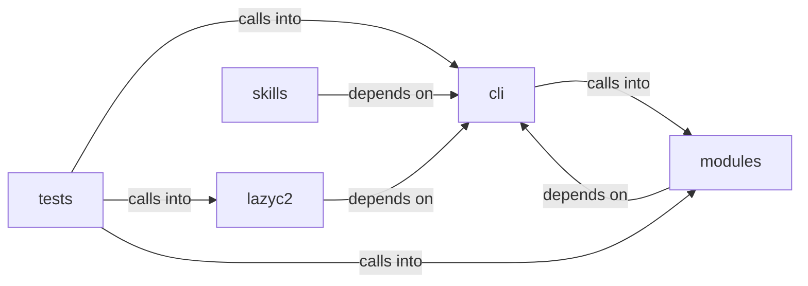

# modules: bof_registry

modules: bof_registry groups 43 files (py) around EnumCommandSet, do_smbclient, do_smbclient_impacket, do_smbclient_py, do_smbmap. BOF marketplace CommandSet — Beacon Object File discovery, staging and delivery.

## cli (12.1)

cli groups 4 files (py) around EnumCommandSet, do_smbclient, do_smbclient_impacket, do_smbclient_py, do_smbmap. BOF marketplace CommandSet — Beacon Object File discovery, staging and delivery.

## lazyc2 (12.2)

lazyc2 groups 1 files (py) around CommandRejectionReason, CommandDecision, to_dict, CommandAllowlist, __init__. Command allowlist policy for the LazyOwn C2 ``/api/run`` endpoint.

## modules (12.3)

modules groups 20 files (py) around RiskLevel, GateAction, _risk_bucket, _risk_label, _risk_level. Beacon configuration builder — wires profile engines into beacon compile-time config.

## skills (12.4)

skills groups 4 files (py) around HookEvent, HookRegistry, __init__, register, run. LazyOwn CLAUDE.md Hierarchical Loader (Claude Code style)  4-level hierarchy (highest...

## tests (12.5)

tests groups 14 files (py) around TestBeaconConfig, test_default_construction, test_to_gen_beacon_args, test_to_go_implant_vars, test_to_config_json. Tests for modules/beacon_config_builder.py — BeaconConfig, BeaconConfigBuilder, and...

**Files**:

- cli/commands/bof_registry.py
- cli/commands/enum.py
- cli/commands/opsec_cleanup.py
- cli/scope_guard.py
- lazyc2/security/command_allowlist.py
- modules/beacon_config_builder.py
- modules/bof_admin.py
- modules/bof_delivery.py
- modules/bof_registry.py
- modules/bsb_compat.py
- modules/c2_profile_engine.py
- modules/forensic_cleaner.py
- modules/guardrails/__init__.py
- modules/guardrails/advisories.py
- modules/guardrails/budget.py
- modules/guardrails/checkpoints.py
- modules/guardrails/contracts.py
- modules/guardrails/harness.py
- modules/log_tamper.py
- modules/memory_cleaner.py
- modules/network_opsec.py
- modules/opsec_scorer.py
- modules/sleep_obfuscation.py
- modules/socks_proxy.py
- modules/timestomper.py
- skills/lazyown_claudemd.py
- skills/lazyown_hooks.py
- skills/lazyown_permissions.py
- skills/tests/test_harness_e2e.py
- tests/test_beacon_config_builder.py
- tests/test_bof_admin.py
- tests/test_bof_delivery.py
- tests/test_bof_registry.py
- tests/test_bof_repo_contract.py
- tests/test_bsb_fileless_compat.py
- tests/test_c2_profile_engine.py
- tests/test_command_allowlist.py
- tests/test_command_allowlist_behavior.py
- tests/test_opsec_scorer.py
- tests/test_opsec_scorer_consolidated.py
- tests/test_scope_guard.py
- tests/test_sleep_obfuscation.py
- tests/test_socks_proxy.py
