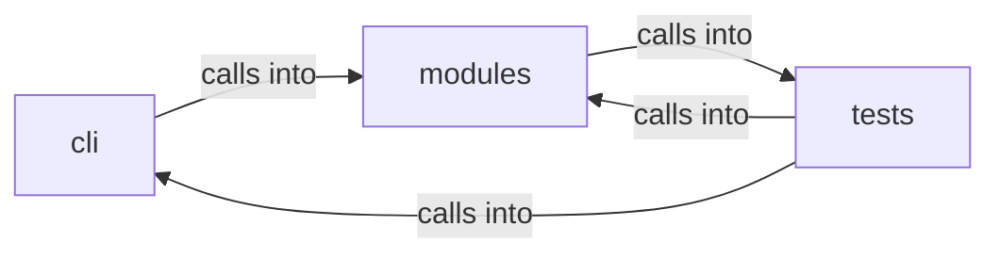

# modules: chain_runner

modules: chain_runner groups 38 files (py) around ChainStep, identifier, Chain, resolve, _render. Parsing, printing and replanning support for the ``apt_chain`` CLI.

## cli (10.1)

cli groups 4 files (py) around select_agent_flavour, CommandAndControlMigratedCommandSet, do_msf, do_c2, do_listener. Parsing, printing and replanning support for the ``apt_chain`` CLI.

## modules (10.2)

modules groups 16 files (py) around ChainStep, identifier, Chain, resolve, _render. Non-interactive, agent-safe implementation for atomic_tests / atomic_gen.

## tests (10.3)

tests groups 18 files (py) around _make_shell, _Set, _Shell, __init__, _write_chain. apt_chain admin & run options BDD contract.

**Files**:

- cli/apt_chain_support.py
- cli/commands/command_and_control_migrated.py
- cli/commands/retry_ops.py
- cli/retry_support.py
- modules/atomic_cli.py
- modules/chain_distill.py
- modules/chain_facts.py
- modules/chain_registry.py
- modules/chain_runner.py
- modules/chain_state.py
- modules/chain_synth.py
- modules/closedloop.py
- modules/defense_eval.py
- modules/defense_stages.py
- modules/gym_matrix_runner.py
- modules/gym_winbox_runner.py
- modules/hunt_verify.py
- modules/listener_manager.py
- modules/retry_session.py
- modules/verb_manifest.py
- tests/test_apt_chain_admin.py
- tests/test_apt_chain_integration.py
- tests/test_chain_distill.py
- tests/test_chain_evidence.py
- tests/test_chain_parallel_fallback.py
- tests/test_chain_registry.py
- tests/test_chain_runner.py
- tests/test_chain_synth.py
- tests/test_chain_v24_core.py
- tests/test_closedloop.py
- tests/test_codeql_alert_fixes.py
- tests/test_command_control_agent.py
- tests/test_defense_eval.py
- tests/test_defense_stages.py
- tests/test_f4_hardening.py
- tests/test_hunt_verify.py
- tests/test_retry_session.py
- tests/test_verb_manifest.py
